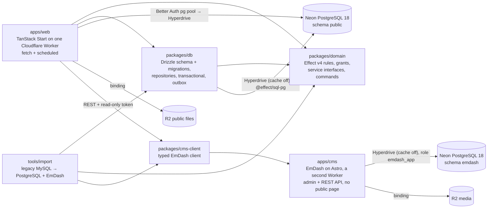

# vektorprogrammet (reimagined)

A rebuild of the legacy Symfony 3.4 site for Vektorprogrammet, a volunteer organisation that places student assistants in schools. Phase 1 covers the public site and organisation core. Spec 0006 starts Phase 2 with people, teams and a declaration kernel.

## Where the truth lives

| Fact | Source |
| --- | --- |
| What to build, phase gates, operator decisions | `../../analysis/vektorprogrammet/MODERNIZATION_BRIEF.md` (binding; changes go on `Proposed revision:` lines) |
| Capabilities, domain model, interface contracts, Behavior Contract | `../../analysis/vektorprogrammet/AI_NATIVE_SPEC.md` |
| Architecture, decisions and their sources | `../../analysis/vektorprogrammet/REIMAGINED_ARCHITECTURE.md` |
| Business rules (RULE-nnn) with legacy citations | `../../analysis/vektorprogrammet/BUSINESS_RULES.md` |
| Slice specs | `docs/specs/`, including `0006-people-and-teams.md` |
| Accepted information-system design | `docs/system/` (read `README.md` first); analysis in `../../analysis/vektorprogrammet/INFORMATION_MODEL.md` |
| Names of domain concepts, with Norwegian terms | `GLOSSARY.md` |
| Hard-to-reverse decisions | `docs/decisions/` |
| Mission state | `STATE.md` |
| Package details | each package's `README.md` |

Paths starting with `../../` are relative to this repository inside the modernization workspace (`/srv/share/projects/vektorprogrammet/vektorprogrammet`). The legacy code is a read-only worktree at `../../legacy/vektorprogrammet`.

## Architecture in one picture



- **One Worker.** Domain commands write domain, audit and outbox rows in one transaction. Better Auth owns its four tables and writes outside domain command transactions. Delivery runs after commit. Code delivery mints, sends and acknowledges in a separate transaction (spec 0007 R1).
- **`domain` is pure Effect** and imports nothing from `db` or `web`. Every port method that writes with others, or takes a lock token, requires `InTransaction` (`Outbox.enqueue`, `AuditLog.record`, the claims, every `Locked` method: spec 0018), which `db`'s `transactional` provides, so a program that calls one outside `Transactor.run` doesn't type-check. `shared/transactionModes.ts` declares the mode of every port method, and a type test checks it against the method's type. The proof is the live transaction's own (spec 0019, TX5): `transactional` makes a fresh proof for each level it opens, and every adapter method that the declaration marks `Requires` checks at run time, before its first statement, that the proof the program holds is the one of the level the fiber is in, and dies as `TransactionNotLive` otherwise (`packages/db/src/live.ts`, shown by `liveProof.postgres.test.ts`). Effect keys a service by a string, so a program can still make a value of `InTransaction` without naming it (`Context.makeUnsafe`, `Context.addUnsafe`, a cast `{ key }`); the adapter refuses that value, and so refuses a proof that was used after its transaction, in another one or in a nested level. `tools/quality/test/inTransactionProviders.test.ts` is a lint against accidental provision, not the proof: it fails at review time when another file holds `InTransaction` as a value or writes its key as a string, where the adapter would refuse only at first use.
- **Modules sit in layers (ADR 0015).** libraries < services < platform ≈ integrations; the domain's catalogs and assembly are the top of the service category. A check that enforces the declared module graph is stage 1 of the ADR's plan and is not built yet.
- **The store ports are the domain's** (spec 0017, ADR 0014 stage 1): `Transactor`, `OutboxDelivery`, `SessionDirectory`, `CapturedMessageStore`, `SignInDirectory` and `ImportTarget` are declared in `packages/domain` and implemented in `packages/db`. Nothing imports `@vektorprogrammet/db`, `drizzle-orm`, `@effect/sql-pg` or `pg` except `packages/db`, the two composition roots (`apps/web/src/server/runtime.ts` builds `DatabaseLive`; `tools/import/src/pipeline.ts` builds `ImportDatabaseLive`), Better Auth's own `pg` pool (`apps/web/src/server/auth.ts`) and the adapter tests that `tools/quality/storeBoundary.ts` lists, each with its reason; `bun run check:store-boundary` and the lint fail otherwise (a sibling package's `../../db/…` too: the check resolves relative paths). Better Auth's pool reads and writes its four `auth_*` tables only: what the library needs of a person it asks `AccountRepository` and `SignInDirectory` (its two Promise callbacks through `RunDomain`, EX-0017; a failing read rejects the callback, and `auth.postgres.test.ts` shows both hooks refuse and write no session), and `auth.postgres.test.ts` signs people in through a role that holds privileges on those four tables and no other. That restriction is enforced by the code, the lint and the tests' role; in production the pool connects with the application's own Hyperdrive credentials, so no database role enforces it there (a separate Neon role and Hyperdrive binding for Better Auth is the infrastructure follow-up).
- **Only production can send real mail or Slack.** Local and preview deployments get a capture sink (structural, tested).
- **Codes and sessions.** A code principal is request-scoped and narrowed to one command and person. The outbox carries no plaintext code. Every login session requires an Active account. The non-production mailbox is the only stored copy of the delivered link.
- **Person aggregate writes (spec 0006b).** Every write to a table that the Person root owns (`membership`, `admin_grant`, `account`, `code`) takes a `Locked<"Person">`: the token that `AggregateLocks.lock` (declared in the domain, implemented in `packages/db`) returns after `SELECT … FOR NO KEY UPDATE` on the person's row. A command locks first, reads the facts it decides on through the token (`findLocked`, `listLocked`), and writes through it, so a write without the lock does not type-check and a token that the running transaction does not hold dies as a defect. Several people lock in one `lockAll` in ascending id order, and a lock out of order is a defect. Whether an Active administrator is left spans every administrator, so the admin list is a root of its own (`lockAdminList`, before every person): `deactivateAccount`, `reactivateAccount`, `createAdminGrant` and `deleteAdminGrant` lock it first, the two decisions read through its token, and a place counts only while an Active account holds it (R2). A stored machine's state (the account's) is changed only by `Aggregates.apply`. Reset first identifies a candidate, then rechecks its address and state under the lock. `packages/db/src/aggregate/ownership.ts` declares what each root owns; a test fails when a table with a foreign key to `person` is not declared, and the lint rule `vektor-anti-slop/no-owned-table-write` rejects a Drizzle write of an owned table anywhere but `Aggregates` (`packages/db/README.md` § Aggregate locks and writes).
- **Welcome ledger (spec 0008).** `welcome_ledger` is Person-owned too. `createMembership` takes the person's token before reading their membership history, then commits the first-membership claim and both outbox messages with the membership. The real-provider delivery remains at least once.
- **Workspace addresses (spec 0008).** Person company addresses and Team group addresses share `company_address`; every writer claims the new address before changing its owner row and releases the old claim in the same transaction. Person claims use `Aggregates` with the Person token. A generated assignment commits with its outbox intent; dry-runs do not assign. Multi-person projection locks people by id and claims addresses in address order.
- **Scheduled jobs (spec 0008).** A job is one declaration in `packages/domain/src/jobs/registry.ts` (its name is its `System` principal; when it is due; its cron; `approved` or `proposed`; limits), a runner in `apps/web/src/server/jobRunners.ts` and a command whose `info` names it (`job:`). The semester job, the ending-soon digest, the alumni consent mail, the Workspace sync, the outbox sweep and the nightly retention run are all registry jobs, and `scheduled` is one call, `runTick`: every job of the cron that fired that is due runs as its own principal, and `job_run` claims each period once and keeps a cursor, so a killed run resumes at its last committed chunk. A local trigger without a cron (`/cdn-cgi/handler/scheduled`) runs the ten-minute tick; the retention cron string runs the retention run. The Worker's cron triggers (`alchemy.run.ts`, `vite.config.ts`: `CRON_TRIGGERS`) and the jobs table of `docs/system/administration.md` are generated from the registry. A `proposed` cadence installs no trigger and runs only explicit requests; approving it is one word in the declaration. `jobProblems` (`test/jobs/registry.test.ts`) and `bun run check:docs` fail on a job without a declaration, a command or a row in the document, and `Periods.jobRuns` keeps a claim longer than the longest period.
- **Outbox delivery on Cloudflare Queues (spec 0008b).** The PostgreSQL outbox rows stay the only record of what must be sent; a queue message is a row's id and nothing else (`OutboxSweep.QueueBody`). After a commit (a request's `waitUntil`, a job's chunk) `OutboxPublisher` (`apps/web/src/server/outboxPublisher.ts`) puts the ids on `OUTBOX_QUEUE` and records the queue's receipt (`outbox.queued_at`, which is not "delivered"). The Worker's `queue` handler (`outboxQueue.ts`) claims each row by id with one conditional `UPDATE` (`OutboxDelivery.claim`: `Claimed`, `Held` or `Settled`), delivers it and acknowledges the message, or answers `retry` with `DeliveryPolicy`'s backoff; after the declared attempts the queue moves the message to its dead-letter queue, whose consumer marks the row `dead` only when a failure class was recorded (a provider's refusal, `delivery defect` after a successful claim, `undecodable payload`, or `delivery stack unavailable` when the stack cannot be built: shown as failed on the Integrations page); a pure outage (the claim itself dies) records nothing, retries with the policy's backoff for the message's own attempt count and leaves the row pending for the sweep. The `outboxSweep` job only finds pending rows that no receipt covers (older than `requeueAfter`) and the publisher puts them back; it delivers nothing. A Worker Preview cannot own a queue consumer, so `alchemy.run.ts` binds the queue and its consumers on `main` and `production` only, and a Worker without `OUTBOX_QUEUE` delivers in `waitUntil`. `DeliveryPolicy` (`packages/domain/src/outbox/declaration.ts`) holds the attempts (8, so `max_retries` is 7), the sweep's threshold (10 minutes) and the retry delays. A queue message that carries more than an id is the bug that `outboxQueue.postgres.test.ts` scans for.
- **Personal data (spec 0007b).** Every stored table has a declaration in `packages/domain` (`personalData/catalog.ts` gathers one `personalData.ts` of each domain): for each column, what it holds about a person (purpose, legal basis, retention with its trigger and period, what happens at the end) or why it holds nothing. A table that rows can be about a person for also says how they are found, exported, erased and merged. The nightly retention job (`System("retention")`, on its own cron `RETENTION_CRON` in `apps/web/worker.config.ts`), the export, the erasure, the merge, the privacy notice of a form and the record of processing are all read from the declarations, and `packages/db/test/personalDataClosure.postgres.test.ts` fails when a column of the migrated schema has no declaration or a foreign key to `person` has no merge rule. A new table or column is declared in its domain's `personalData.ts` in the same change; a new foreign key to `person` also gets a merge rule, joins `packages/db/src/aggregate/ownership.ts` when the Person root owns it, and is named in the truncate list of `packages/db/src/repositories/legacyImport.ts` (the importer's adapter truncates without `CASCADE`). A retention period is one value in `personalData/periods.ts` with an `approval`; the generated documents and the notice on the contact form say "proposed, awaiting operator approval" next to a proposed one, and approving is a one-line change. That holds because a reason, a purpose or a command text that states a period builds the phrase with `durationWords` (or `lifetimeWords` for a code's lifetime, from `codePolicy`) and never writes the number: `personalData/periodsInText.test.ts` moves every period and fails on a phrase that did not move. A consent text is the exception, since it is what a person agreed to (a record names its version), so it is written out and the same test checks the periods it states. A consent record names the version of its text (`texts.ts`); the `alumniConsent` code is the one reusable code (no account needed), and `codePolicy` is where a purpose says so. Only the person answers a consent question for themself or downloads their own file: the kernel's `Admin` row would admit an administrator for every command, so `setAlumniConsent` and `exportMyData` refuse any other principal in the handler (`onlyThePerson`). `bun run docs` regenerates `docs/system/administration.md`.
- **Approvals in the record of processing (spec 0007b R3 item 32, R4).** A period and a legal basis are decided separately. A period carries its own `approval` in `periods.ts`; the legal bases have one declaration, `basesApproval` in `personalData/texts.ts`. Each row of the record in `docs/system/administration.md` says which of the two is still a proposal, and the privacy notice of a form is a draft while the bases, its text or any period it states is: the notice carries the decisions that are open (`open`, from `openDecisions`), and `draftNote` writes the one sentence that names them and no other, for the page and for the generated document, and no sentence when nothing is open. Two guard tests re-evaluate the domain with those declarations replaced (`periodsInText.test.ts`, `basesApproval.test.ts`); they mock modules on purpose, which `anti-slop/no-module-mocking` cannot see here (it recognises `vitest` and this repository imports `vite-plus/test`), and EX-0027 registers it.
- **The retention run only counts in production until the periods are approved (spec 0007b R4).** `RetentionRun` (`packages/domain/src/personalData/services.ts`) is the nightly run as a service whose mode, `Apply` or `ReportOnly`, is fixed by the layer that provides it, so no program chooses it. `DatabaseLive` and every other ordinary layer provide a run that only counts: it takes the database and nothing else (no lock, no writer) and is audited as `retention.reported`. `JobDatabaseLive({ …, retention })` is the one constructor that can provide a run that changes rows (`retention.ran`), and `apps/web/src/server/runtime.ts` builds it for the cron with `retentionModeFor(deployment)` (`server/retentionMode.ts`): production applies only when no period that a run applies is `proposed`, and local and preview, which hold fake data, always apply. So approving the periods is still one line, and it is also what lets production delete. A test that builds a second database layer inside a test layer builds it with `Layer.fresh`, or the layers that the two share (`Drizzle`) are the first one's, and a run as another role is the first role's (`retentionGate.postgres.test.ts`).
- **Database rules for every phase:** no advisory locks, LISTEN/NOTIFY or session `SET` (Hyperdrive). A store guarantee is a property that the domain declares (`packages/domain/src/shared/guarantees.ts`, rendered in `docs/system/store-guarantees.md`; ADR 0014, spec 0018), with a strength: `store-enforced` (it holds against every writer, the importer and migrations included) or `port-enforced` (only against writers that use the port); other prose cites a guarantee by its id. An invariant is store-enforced, with one named exception: the last administrator (LK7), whose validity depends on time (recovery: the `Emergency` principal of ADR 0011). `InTransaction` promises the isolation floor TX3 (ReadCommittedWithLocks: a read after a lock sees the record as of the lock or later). The PostgreSQL adapter begins each `transactional` (so every `Transactor.run`) transaction, and the importer's one, at READ COMMITTED in its own `BEGIN`. A statement that runs outside a transaction (a `Standalone` or `Joins` method used alone) runs at the role's default, which must be READ COMMITTED (spec 0018 R9). That default is asserted for the test server and for every pull request's Worker Preview, not for production: `GET /api/isolation` reports three levels through Hyperdrive (a `Transactor.run` transaction, a probe begun at SERIALIZABLE, the role's default), the pull request's deploy job fails unless they are `read committed`, `serializable` and `read committed` (R10), and production answers an empty 404 there, so nothing asserts production's role default until it is deployed (the follow-up is in `STATE.md`; spec 0018 R18). The adapter implements the guarantees with constraints, `INSERT … ON CONFLICT … RETURNING` and row locks that `AggregateLocks` takes inside a transaction. Engine features stay inside the adapter; ADR 0014's staged plan moves the existing leaks.
- **A cancelled request interrupts its domain program** (and rolls back an open domain transaction) only because `apps/web/worker.config.ts` sets `enable_request_signal`, which has no default compatibility date. Slice 0000 check 3b measured both sides: without the flag the transaction committed after the client had gone. Better Auth's pg/Kysely adapter cannot receive an `AbortSignal`: its calls complete in an uninterruptible boundary before interruption is reported (spec 0007 R4, EX-0017). An aborted sign-in can leave one unseen session, visible on Min side until it expires.
- **Reads never write** (specs 0003 and 0006). Commands and the scheduled jobs are the write paths. Register each new `runQuery` path and principal read in `apps/web/test/readsNeverWrite.postgres.test.ts`.

## Units

| Unit | Responsibility | Tests |
| --- | --- | --- |
| `packages/domain` | rules, branded types, grant declarations, subject sets, schema guards, service interfaces and RPC commands | rule-named acceptance tests |
| `packages/db` | Drizzle schema (single source) → `drizzle/` migrations, `DatabaseLive`, `ImportDatabaseLive`, `transactional`, the aggregate lock construct (`AggregateLocks`, `Aggregates`, the ownership declaration), the adapters of the domain's store ports (`Transactor`, `OutboxDelivery` with the claim by id, the queue's receipt and the dead-letter ending, `SessionDirectory`, `CapturedMessageStore`, `SignInDirectory`, `ImportTarget`), `classifySqlFailure`. The package root exports no port and no schema | PGlite + real PostgreSQL (concurrency, transactions, negative controls) |
| `apps/web` | the public site (routes ported from mono-web), the control panel, server functions, per-request Effect runtime, error table, `/filer` header policy, redirects, `alchemy.run.ts` | Node tests + `vp build`; Playwright browser tests (`apps/web/e2e`) against `vp dev`, the CMS and a disposable database |
| `apps/cms` | the editors' CMS: EmDash 1.3.0 headless on Astro (admin, REST API, no public page), its collections (`seed/seed.json`), its role and schema script, and the Alchemy build it ships with | `bun run check:cms` builds it as Alchemy does and runs that bundle in workerd on a disposable PostgreSQL; the browser tests run it for real, unbundled (`astro dev`) |
| `packages/cms-client` | the typed client of EmDash's content API, generated from its OpenAPI document, and the collection schemas and Portable Text that `apps/web` and the importer share | Node tests (decoding, published-only reads, the generator's subset) |
| `tools/import` | deterministic, rerunnable legacy import, in two programs: MySQL → PostgreSQL (organisation data, department logos) and MySQL → EmDash (articles, texts, sponsors), each with a reconciliation report holding no personal data | real MySQL → PostgreSQL round trip; a fake EmDash for the CMS program, and the real one in the browser tests |
| `tools/docgen` | generates the marked system documentation from domain declarations | drift and mutation tests, `bun run check:docs` |
| `tools/effx-conformance` | the kernel's declarations exported to effx (`Effx.describe`, spec 0007d), effx's conformance vectors committed with their provenance in `packages/domain/conformance`, and the tests that ask the kernel's `authorize` and machine tables every row of them | `vp run -r test` reads files (no JVM, Nix or network); `bun run description:regenerate` makes the vectors with effx and Nix, and `bun run description:drift` checks that another effx commit makes the same ones |
| `tools/db-path-spike` | slice 0000: a throwaway Worker and a smoke command that check Worker → Hyperdrive → Neon → `@effect/sql-pg` → Drizzle on the real platform (torn down 2026-10-16; redeployable) | local PostgreSQL rehearsal with negative controls; the deployed run in `docs/specs/0000-results.md` |

## Run it

Everything runs inside devenv: it pins Bun 1.4.2 and Node 24 and runs PostgreSQL 18 and MySQL 8.4. The system Bun (1.3.x) hangs on `bun install`.

```sh
devenv up -d                                   # PostgreSQL + MySQL; stop with: devenv down
devenv shell -- bun install
devenv shell -- bash -c 'cd packages/db && bun run db:migrate'   # local schema
devenv shell -- bash -c 'cd packages/db && bun run db:seed:local' # seeded local people
devenv shell -- bun run test:all               # every unit's tests, with the live service environment
devenv shell -- bun run e2e                    # browser tests: Playwright + devenv's Chromium, the CMS and the web app; check CPU and memory first
devenv shell -- bunx vp check                  # format, lint, type check
devenv shell -- bash -c 'cd apps/web && bunx vp dev --port 3000'  # http://localhost:3000
```

- Environment variables (`DATABASE_URL`, `TEST_DATABASE_ADMIN_URL`, `LEGACY_MYSQL_URL`) come from `devenv.nix`, derived from the ports devenv allocates. Deployed environments get the database through the Hyperdrive binding declared in `apps/web/alchemy.run.ts`.
- Turnstile, Slack and CMS secrets are Worker secrets set with `cf`, never files. Alchemy generates the Better Auth signing secret once per stage and stores it in stage state. Only local development uses a fake key.
- Alchemy binds each Preview's `SITE_URL` with `Cloudflare.Worker.URL`. Production uses its explicitly configured origin.
- Neon secrets are declared in `secretspec.toml` and read only through `secretspec run -- <command>` with a `SECRETSPEC_REASON`, so a value never enters devenv evaluation, the Nix store or a shell. `packages/db/README.md` (Neon) has the branch, role and connection details.
- Real-PostgreSQL tests create and drop their own `vp_db_test_*` databases, through one helper (`@vektorprogrammet/db/testing`; `@vektorprogrammet/db/testing/read-only-role` adds a SELECT-only role on top, and `@vektorprogrammet/db/testing/auth-tables-role` a role that holds privileges on Better Auth's four tables only). The importer's MySQL fixture databases are `import_test_*`.
- The CMS has its own run steps (`apps/cms/README.md` § Run it locally) and so does the importer's pair of programs (`tools/import/README.md`); the browser tests start the CMS themselves, put the importer's fixture in it twice, and need outbound network for Turnstile's always-pass test keys.
- The local test actor exists only when `DEPLOYMENT=local`. The cookie selects a seeded person when no Better Auth cookie exists. Preview and production use real sessions and never accept the test-actor cookie.
- **Worktree PostgreSQL troubleshooting:** If PostgreSQL tests fail with "PgConnection: Failed to connect" in a worktree, run `devenv processes list`. If postgres is `gave_up`, read `devenv processes logs postgres`: (a) "Address already in use" means another worktree's services hold the port. Run `devenv down` here and start again, or stop the other worktree's services. (b) "lock file postmaster.pid already exists" naming another worktree's server indicates a foreign state copy (observed; cause unknown). Run `devenv down; rm -rf .devenv/state/postgres .devenv/state/mysql; devenv up -d`. Never touch another worktree's state.
- To verify a change by hand, or to review a pull request, use the skill `.agents/skills/verify-vektorprogrammet`: it launches the browser-test stack and keeps it alive (`bun run e2e:serve` in `apps/web`, `e2e/serve.ts` over the same `e2e/support/stack.ts` that `bun run e2e` uses), checks it, drives features from its map, keeps evidence outside the worktree and cleans up. It needs both devenv services (`devenv up -d`: the importer loads its fake fixture through MySQL).

## Quality gates

One source: the root `vite.config.ts` (`lint`, `fmt`, `staged`). Nested lint configs are ignored by Vite+.

| Gate | What enforces it | Run it |
| --- | --- | --- |
| Format, lint, type check | Oxfmt; Oxlint with Ultracite (`core`, `anti-slop`, `shadcn`), `@effect/tsgo` (`strict`, `effectNative`), the Effect plugin (all rules), mono-web's anti-slop plugins (`tools/oxlint/anti-slop/`) and our own `no-owned-table-write` (spec 0006b), cognitive complexity ≤ 15, import boundaries; type-aware via tsgolint. The `RuleTester` tests of the rules that have them (`node --test`, because Bun lacks raw transfer) are the `test` script of `tools/oxlint`, so `bun run test:all` runs them, in the pre-push hook and in CI | `devenv shell -- bunx vp check` |
| Everything at once | check, generated docs, tests, web build, knip, jscpd, gitleaks, exception registry (browser tests are separate) | `devenv shell -- bun run ready` |
| Pre-commit | `vp staged` (`vp check --fix` on staged files) + gitleaks on staged changes (secrets, Norwegian national ids, SQL user dumps) | automatic (`.vite-hooks/pre-commit`) |
| Commit message | commitlint, Conventional Commits | automatic (`.vite-hooks/commit-msg`) |
| Pre-push | `bun run test:all` | automatic (`.vite-hooks/pre-push`) |
| Suppressions | every `oxlint-disable` / `@ts-expect-error` needs an entry in `tools/quality/effect-exceptions.json` | `devenv shell -- bun run check:exceptions` |
| Store boundary | no import of `@vektorprogrammet/db`, `drizzle-orm`, `@effect/sql-pg` or `pg` outside `packages/db`, a composition root or an adapter test: Oxlint's `no-restricted-imports`, generated from `tools/quality/storeBoundary.ts` (the one list of allowances, each with its reason), plus a check that fails on an allowance that no file needs (spec 0017, ADR 0014 stage 1) | `devenv shell -- bun run check:store-boundary` (the lint itself is part of `vp check`) |
| Effect family | every `@effect/*` package in `bun.lock` except `@effect/tsgo` is the version of `effect` | `devenv shell -- bunx vp -C tools/quality test test/effectFamily.test.ts` |
| Browser tests | Playwright 1.63.0 (pinned to nixpkgs' `playwright-driver`) on devenv's Chromium, against `vp dev`, the real CMS (`astro dev` on the database's `emdash` schema, its seed copy and the importer's fixture, imported twice) and a disposable migrated database that the real importer fills from its fake fixture; one Effect program owns the lifecycle (`apps/web/e2e/run.ts`) | `devenv shell -- bun run e2e` |
| CI | the same gates, including the browser tests (that step is limited to 15 minutes; a run takes a few minutes) and the CMS bundle check, on every pull request | `.github/workflows/checks.yml` |

- PostgreSQL test files share one local server. The db suite runs one file at a time and the web suite at most two, and never more than Vitest's own default (one fewer than the CPUs: CI's two-CPU runner runs one); the concurrent callers within each race are unchanged. This keeps their pools below PostgreSQL's connection limit. Both suites allow 60 seconds per test and per hook, because a shared two-CPU runner migrates a database and hashes with bcrypt at cost 12 slower than Vitest's 10 s and 5 s defaults (the first CI run of spec 0008 timed out a sign-in test with two files at once).
- Enter devenv once for the workspace test graph. `bun run test:all` passes `--no-cache`: uncached Vite+ scripts retain the live service environment. Package test scripts use that shell; concurrent nested `devenv shell` calls race on `.devenv/load-exports`.
- Hooks are installed by `vp config` (the `prepare` script, which also runs `effect-tsgo patch`). Never use `--no-verify`.
- Fix the code, not the rule. A rule that is wrong for a file class gets a narrow `overrides` entry with a one-line reason. Two presets that contradict each other get one global switch with a comment naming both rules.
- Editor diagnostics use the TypeScript 7 native language server patched by `effect-tsgo patch`; it reads the `@effect/language-service` tsconfig options. Run `devenv shell -- bunx effect-tsgo diagnostics --project <absolute-tsconfig> --format text` to check the project config. After editing unstable API exceptions, run `devenv shell -- bun run sync:effect-policy`.

## Conventions

- Native Effect v4: read `<package>/node_modules/effect/AGENTS.md` before writing Effect code. Total calculations stay plain functions.
- Tests are named by rule id (`RULE-022: …`). An unimplemented rule is `it.fails` with its id, never skipped.
- Exact dependency pins live in the root `package.json` `catalog`. `effect` and every `@effect/*` package (except `@effect/tsgo`, its own release line) are one version, 4.0.6, and `tools/quality/test/effectFamily.test.ts` fails when `bun.lock` holds a different one. `@effect/sql-d1` and `@effect/sql-sqlite-do` come in through Alchemy, so the root `overrides` pin them to the same version (bump them with the catalog; the family test catches a miss). Drizzle is the final `1.0.0-rc.5` (npm tag `rc`), unpatched; `packages/db/README.md` § Drizzle has what changed in rc.5.
- UI is shadcn/ui on Base UI (`base-nova`). Add components with `shadcn add`, then `bun add` any dependency it names (its npm install fails silently under the Bun `devEngines` rule). A component that imports `cn` from `"cn"` gets `@/lib/utils` instead (and no `cn` dependency), and a generated file is fixed until it passes lint; a component the shell does not use is not kept. Answer `n` to its prompt to overwrite `button.tsx` and `input.tsx`, which are the lint-fixed versions of the same registry files.
- The control panel derives its sidebar and controls from the domain's grant table. Handlers use `Domain.handle`, which asks the same table. `apps/web/test/shell.test.ts` and `teamsPanel.test.ts` compare controls with commands. Do not add a second role list in web code.
- Every command declares its **resource and method** (ADR 0010, spec 0007c): `info({ summary, resource: "Membership", method: ":extend" })` in `packages/domain/src/kernel/commands.ts`. Both fields are required; `resource` is a closed set (`EntityName` plus `NonEntityResources`), and `method` is `get`, `list`, `create`, `update`, `delete` or a colon verb. A command's name follows its method (`createTeam`, `updatePerson`, `deleteAdminGrant`; a list or custom method starts with its verb: `listAuditEntries`, `extendMembership`), and `Domain.problems` fails on a name, a query or a transition that contradicts the pair, and `Domain.allProblems` on a tag or a pair that two commands share. A command that refuses on its own, for a rule that no grant row states (never for oneself), builds the refusal with its domain's `forbidden` (`TeamsDomain.forbidden("createAdminGrant")`), whose parameter is that domain's own names; a hand-written `new Forbidden({ command: "…" })` is how a renamed command stayed behind as a string (spec 0007c R2). No `update` promises a `412`: add the row version first. `docs/system/commands.md` is generated from the declarations (`bun run docs`, checked by `bun run check:docs`).
- **The kernel is exported to effx** (ADR 0009, spec 0007d). A change to a grant row, a subject set, a machine or a membership binding changes `packages/domain/conformance/*`: run `devenv shell -- bun run description` (the descriptions and the register of gaps), then `EFFX_DIR=… devenv shell -- bun run description:regenerate` (effx's vectors at the pinned commit, on Nix: 2 to 2.5 minutes and 10 to 24 CPU-minutes on 32 threads, so read the machine's headroom first), and commit the regenerated files with the declaration. `vp run -r test` fails on a description that is not the export of the declarations, and on a row where `authorize` or a machine table disagrees with the vectors. A construct that effx cannot state is a typed `Effx.Gap` in `conformance/gaps.json`, never a silent drop, and `Effx.closures` says what closes it. A machine declares its `terminal` states (`Machine.make` does not compile without them), the semester `fields` its guards read, and a `guard` on each calculated transition (a change that time makes; `term.test.ts` shows that they lead where `membershipState` goes, and the diagram's label for the change is generated from the guard, so there is no label to write beside it). `bun run description:drift` and a weekly job (`.github/workflows/effx-drift.yml`) check that effx's `main` still makes the committed vectors. `tools/effx-conformance/README.md` has the steps and what the vectors do not cover.
- A principal without a page's read gets no 2xx for the page or its data (issue 15, spec 0006 R7). `apps/web/src/server/panelAccess.ts` is the one declaration of what each control-panel section and read server function needs; the sidebar (`shell.ts`) and the guard of every GET server function (`panelReads.ts`) both read it, and a refusal is `Forbidden` (403) before any row is read. A new control-panel page or read gets its entry there and runs as `panelReads.<name>`; `apps/web/test/panelReads.test.ts` (with a negative control per read) and `e2e/shell.spec.ts` fail otherwise. Filtering rows with `authorize` stays underneath.
- A release (a finalizer, `Effect.acquireRelease`'s second argument) never waits on a pooled client built earlier in its own scope. The pool retires an idle connection after 60 to 120 seconds, and a scope that is closing cannot grow it again (Effect 4.0.5 and 4.0.6, whose `Pool.ts` is identical), so the release never returns: the first CI browser-test run longer than two minutes hung for that reason. Run admin and cleanup statements through `withClient` (`@vektorprogrammet/db/testing`), a client with one connection that lives for the statement. `packages/db/test/disposableDatabase.postgres.test.ts` guards it.
- A race test runs many rounds, not one. A single concurrent attempt passed 320 times in a row while two overlapping membership writes deadlocked (SQLSTATE 40P01) in about 0.6% of contended rounds; only a 300-round loop found it (spec 0006 R6). A concurrency falsifier repeats the race in fresh state, prints each loser's full Cause on failure, and names its round count. A falsifier of a lock has a negative control that fails every time: the same race without the lock, or with the lock written by hand, when it deadlocks or loses in each run (`packages/db/test/aggregates.postgres.test.ts`, `adminList.postgres.test.ts`). A race that fails without the lock only now and then (the overlap races, about 6 rounds in 1,000) is a guard and not a control; its control is a test that fails whenever the lock is taken away, one that holds the row lock and shows the write waiting, or one whose outcome only the lock keeps legal (`packages/db/test/teams.postgres.test.ts`, spec 0006b R3). Prove a control by removing the lock and running it five times. A test that says a command waited before it wrote reads the waiting backend itself (`meetsHeldLock` returns `wrote`, the tables it holds a write lock on, and `hasTransactionId`): under READ COMMITTED another session cannot read an uncommitted row, so a read of the table cannot fail, and the same mutation (a write placed before the lock) must fail the test (spec 0006b R4). A test that shares one database with others starts from clean state for any fact that spans every row (`noAdmins`): the last-administrator rule reads them all.
- The concurrency of membership writes is model-checked as well as raced. `.agents/skills/verify-membership-writes` holds a TLA+ model of the aggregate locks (the person's and the admin list's row locks, taken first and in one global order), of the sequence of each membership command (find, lock, read, write through the token), of `membership_no_overlap` and of the conditional updates (every interleaving of three commands, TLC 1.7.4 from the `formal` devenv profile); its `--code` run executes the tests that pin the PostgreSQL facts it takes from the code. Run `devenv shell --profile formal -- .agents/skills/verify-membership-writes/run.sh` after a change to `packages/db/src/aggregate`, `MembershipRepository`, a Teams or Account handler that locks, or a `membership` migration, and before a new command takes a lock or writes a table that a person owns. CI runs the model on PRs touching covered files and fails on drift.
- Lint, format and staged-file checks are configured once, in the root `vite.config.ts`.
- The public pages are mono-web's design, so their page theme (`.public-site` in `apps/web/src/styles.css`) sets the page colours and default border once, and no unlayered rule may set an element's colour: Tailwind's utilities live in a cascade layer and lose to it (the starter template's global `a` colour turned every ported link and button teal for a while). A text an editor owns is a CMS `texts` entry named in `src/lib/textSlots.ts`; a page shows layout, headings and pictures itself and everything else from the slot.
- The CMS is read over its REST API with a published-only client (`packages/cms-client`): a token that can read drafts never makes a draft public.
- A third-party widget that scans the page once (Turnstile's implicit rendering) breaks when React replaces its container: the contact page's department tabs are client-side navigation, and the new form had no widget, so the post was refused. The widget is `@marsidev/react-turnstile`'s, rendered explicitly when the form mounts. Under `vp dev`, workerd verifies TLS with `SSL_CERT_FILE`, which Nix leaves out of an exported environment and NixOS has no default for; `devenv.nix` exports it in `enterShell`, or the Turnstile verification (a fetch to Cloudflare) fails with "unable to get local issuer certificate".
- Run what is deployed, not a stand-in. The CMS Worker answered 500 to every request on its first deploy while `astro dev`, the browser tests and a build that passed no Worker settings were all green. EmDash's Hyperdrive adapter inlines `pg` (CommonJS), and rolldown keeps a throwing `__require` for its `require("events")` unless the `builtin:esm-external-require` plugin that Alchemy adds for `nodejs_compat` takes effect. It did not: Bun installs `vite-plus-core` twice (`astro` and Alchemy get different `esbuild` peers), and rolldown ignores a builtin plugin built by the other copy. `apps/cms/build/ownExternalRequire.ts` rebuilds the plugin with the copy that builds, as Alchemy's own Worker bundler does, and `bun run check:cms` is the guard: it builds with `buildInChild` and the Worker's real compatibility settings, rejects a surviving `__require` of a Node built-in, and runs the bundle in workerd (Miniflare) until `GET /_emdash/api/setup/status` answers 200. Run it after a change that moves `vite`, `astro` or Alchemy. `apps/cms/README.md` § The Worker bundle has the evidence.

## Legacy → modern traceability (Phase 1)

| Legacy (`src/AppBundle/…`) | Rules | New home |
| --- | --- | --- |
| `Entity/Semester.php`, `Utils/SemesterUtil.php`, `Entity/Repository/SemesterRepository.php` | 022, 033, 050, 051, 084, 237 | `domain/src/organisation/semester.ts`; `db` `SemesterRepository.ensure` (only the scheduled job calls it) |
| `Controller/SemesterController.php`, `Form/Type/CreateSemesterType.php` | 144 and 190 retired (spec 0003) | `domain` `semesterJob`; `currentSemester`/`findCurrentSemester` are reads; `web` `/kontrollpanel/semestre` is a list only |
| `Entity/Department.php` (admission helpers) | 015ʳ, 119ʳ | `domain/src/organisation/admission.ts` |
| `Controller/FieldOfStudyController.php` | 139 | `domain/src/organisation/fieldOfStudy.ts` and the grant table; `web` `/kontrollpanel/linjer` |
| `Entity/Team.php`, `Entity/TeamMembership.php`, `Entity/User.php` | 016, 023, 031, 048, 124, 157, 164, 206, 234, 251, 252, 284, 298 | `domain/src/teams`; `db` people and membership repositories; `web` Team and People pages |
| Legacy user credentials and sessions | 024, 104, 112, 125, 126, 131, 132, 166, 201, 202, 220, 281 | `domain/src/accounts`, Better Auth in `web/src/server/auth.ts`, Min side and code pages |
| `app/Resources/views/adminBase.html.twig`, `base/admin/main_navigation.html.twig`, `base/admin/mobile_navigation.html.twig` (menu entries hidden by `is_granted_team_leader()` and `is_granted_admin()`, a role list beside the security rules) | — (brief §7, spec 0004) | `web` shell: `server/shell.ts` derives the sidebar from `authorize`; `components/panel/` |
| `Controller/StaticContentController.php`, `Twig/Extension/SafeHtmlExtension.php` | 296 retired (EmDash's role model), 133ʳ | the CMS's `texts` collection, keyed by the legacy `html_id` (`apps/cms/seed/seed.json`, `apps/web/src/lib/textSlots.ts`); `domain/src/content/sanitizer.ts` runs in the CMS importer; `web` `components/site/portableTextView.tsx` renders Portable Text without raw HTML |
| `Controller/ArticleController.php`, `ArticleAdminController.php`, `Service/SlugMaker.php`, `Repository/ArticleRepository.php` | 096, 182, 266 (bug fixed), 267 → CMS drafts, 326, 331 | the CMS's `news` collection; `domain/src/content/{article,slug}.ts` keeps the pure rules (page size, front-page order, slugs); `web` `/nyheter`, `/nyhet/$slug` |
| `Controller/HomeController.php`, `home/index.html.twig` | 070 retired with the countdown; 075 dropped | `web` `/` (mono-web's home page: the CMS's `home-tagline` text, the admission state, the news teaser) |
| `Entity/Sponsor.php` | 189 → the CMS client's URL check | the CMS's `sponsors` collection; `domain/src/content/sponsor.ts` keeps the footer order; `web` footer |
| mono-web `apps/homepage` pages (spec 0005) | — | `web` `/om-oss`, `/assistenter`, `/team`, `/foreldre`, `/skoler`, `/nyheter`, `/kontakt`; the FAQ is the CMS's `faq` collection; the picture and styling are mono-web's at commit `2aa6ce97` |
| `Entity/SocialEvent.php` | 085, 188 (end after start added) | `domain/src/content/socialEvent.ts`; `web` `/kontrollpanel/arrangementer` |
| `Entity/SupportTicket.php`, `Controller/ContactController.php`, `EventSubscriber/SupportTicketSubscriber.php`, `Form/Type/SupportTicketType.php` | 156, 167 (Turnstile), 249, 327ʳ | `domain/src/contact/*`; `web` `/kontakt`, `/kontakt/avdeling/$id`; outbox |
| `Service/FileUploader.php`, `Controller/FileBrowserController.php` | 130, 290ʳ | `domain/src/files/*`; `web` `/filer/$key` |
| Slack as the audit log | C12 | `audit_log` table, written in each staff write's transaction |
| Legacy URLs `/om`, `/bedrifter`, `/faq`, `/artikkel/{slug}`, file paths | — | 301 redirects in `apps/web/src/server/redirects.ts` + `public_file.legacy_path` |

ʳ = replaced by an operator decision (brief §7). Dropped at Checkpoint 1: the changelog (C7), feedback (C9), RULE-075 count inflation, ipinfo geolocation.

## Not done yet (Phase 1 gates)

- **File migration:** copying the production upload directories is not authorised yet, so the importer reports every file as missing.
- Phase 1 exit criterion in the brief §3: the page-by-page diff against legacy.
- **Deployments:** the base stage `main` and per-PR Worker Previews run on fake data (spec 0002, `apps/web/README.md` § Stages and previews), now for two Workers, `apps/web` and `apps/cms`. Production is not deployed. The CMS needs the Neon role `emdash_app` and three secrets before its first deploy (`apps/cms/README.md`, `apps/web/README.md`), and the Alchemy plan has not been run against Cloudflare.
- **The CMS's pictures:** article images and sponsor logos are missing until the file copy is authorised (D5); the CMS importer keeps the legacy path, so an article shows without its picture.
- **Editors' sign-in:** EmDash's own passkeys, bound to a hostname: a Preview has no editor access (D6). Phase 2 decides whether Better Auth becomes its login provider.
