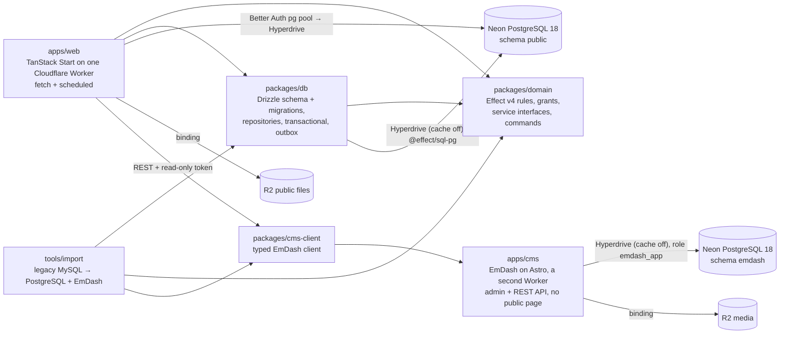

# vektorprogrammet (reimagined)

A rebuild of the legacy Symfony 3.4 site for Vektorprogrammet, a volunteer organisation that places student assistants in schools. Phase 1 covers the public site and organisation core. Spec 0006 starts Phase 2 with people, teams and a declaration kernel.

## Where the truth lives

| Fact | Source |
| --- | --- |
| What to build, phase gates, operator decisions | `../../analysis/vektorprogrammet/MODERNIZATION_BRIEF.md` (binding; changes go on `Proposed revision:` lines) |
| Capabilities, domain model, interface contracts, Behavior Contract | `../../analysis/vektorprogrammet/AI_NATIVE_SPEC.md` |
| Architecture, decisions and their sources | `../../analysis/vektorprogrammet/REIMAGINED_ARCHITECTURE.md` |
| Business rules (RULE-nnn) with legacy citations | `../../analysis/vektorprogrammet/BUSINESS_RULES.md` |
| Slice specs | `docs/specs/`, including `0006-people-and-teams.md` |
| Accepted information-system design | `docs/system/` (read `README.md` first); analysis in `../../analysis/vektorprogrammet/INFORMATION_MODEL.md` |
| Names of domain concepts, with Norwegian terms | `GLOSSARY.md` |
| Hard-to-reverse decisions | `docs/decisions/` |
| Mission state | `STATE.md` |
| Package details | each package's `README.md` |

Paths starting with `../../` are relative to this repository inside the modernization workspace (`/srv/share/projects/vektorprogrammet/vektorprogrammet`). The legacy code is a read-only worktree at `../../legacy/vektorprogrammet`.

## Architecture in one picture



- **One Worker.** Domain commands write domain, audit and outbox rows in one transaction. Better Auth owns its four tables and writes outside domain command transactions. Delivery runs after commit. Code delivery mints, sends and acknowledges in a separate transaction (spec 0007 R1).
- **`domain` is pure Effect** and imports nothing from `db` or `web`. Atomic commands require `InTransaction`, which only `db`'s `transactional` provides, so an unwrapped command doesn't type-check.
- **Only production can send real mail or Slack.** Local and preview deployments get a capture sink (structural, tested).
- **Codes and sessions.** A code principal is request-scoped and narrowed to one command and person. The outbox carries no plaintext code. Every login session requires an Active account. The non-production mailbox is the only stored copy of the delivered link.
- **Person aggregate writes.** Account commands concerning an identified person and code delivery lock the Person row with `FOR NO KEY UPDATE` in their transaction before final state decisions and guarded writes. Reset first identifies a candidate, then rechecks its address and state under the lock. Account and Code persistence live in separate repository modules; state updates remain conditional. This prepares the cutover to spec 0006b's `Locked<Person>` token.
- **Database rules for every phase:** no advisory locks, LISTEN/NOTIFY or session `SET` (Hyperdrive). Invariants live in constraints and `INSERT … ON CONFLICT … RETURNING`.
- **A cancelled request interrupts its domain program** (and rolls back an open domain transaction) only because `apps/web/worker.config.ts` sets `enable_request_signal`, which has no default compatibility date. Slice 0000 check 3b measured both sides: without the flag the transaction committed after the client had gone. Better Auth's pg/Kysely adapter cannot receive an `AbortSignal`: its calls complete in an uninterruptible boundary before interruption is reported (spec 0007 R4, EX-0017). An aborted sign-in can leave one unseen session, visible on Min side until it expires.
- **Reads never write** (specs 0003 and 0006). Commands and the scheduled jobs are the write paths. Register each new `runQuery` path and principal read in `apps/web/test/readsNeverWrite.postgres.test.ts`.

## Units

| Unit | Responsibility | Tests |
| --- | --- | --- |
| `packages/domain` | rules, branded types, grant declarations, subject sets, schema guards, service interfaces and RPC commands | rule-named acceptance tests |
| `packages/db` | Drizzle schema (single source) → `drizzle/` migrations, `DatabaseLive`, `transactional`, `OutboxDelivery`, `classifySqlFailure` | PGlite + real PostgreSQL (concurrency, transactions, negative controls) |
| `apps/web` | the public site (routes ported from mono-web), the control panel, server functions, per-request Effect runtime, error table, `/filer` header policy, redirects, `alchemy.run.ts` | Node tests + `vp build`; Playwright browser tests (`apps/web/e2e`) against `vp dev`, the CMS and a disposable database |
| `apps/cms` | the editors' CMS: EmDash 1.3.0 headless on Astro (admin, REST API, no public page), its collections (`seed/seed.json`), its role and schema script, and the Alchemy build it ships with | `bun run check:cms` builds it as Alchemy does and runs that bundle in workerd on a disposable PostgreSQL; the browser tests run it for real, unbundled (`astro dev`) |
| `packages/cms-client` | the typed client of EmDash's content API, generated from its OpenAPI document, and the collection schemas and Portable Text that `apps/web` and the importer share | Node tests (decoding, published-only reads, the generator's subset) |
| `tools/import` | deterministic, rerunnable legacy import, in two programs: MySQL → PostgreSQL (organisation data, department logos) and MySQL → EmDash (articles, texts, sponsors), each with a reconciliation report holding no personal data | real MySQL → PostgreSQL round trip; a fake EmDash for the CMS program, and the real one in the browser tests |
| `tools/docgen` | generates the marked system documentation from domain declarations | drift and mutation tests, `bun run check:docs` |
| `tools/db-path-spike` | slice 0000: a throwaway Worker and a smoke command that check Worker → Hyperdrive → Neon → `@effect/sql-pg` → Drizzle on the real platform (torn down 2026-10-16; redeployable) | local PostgreSQL rehearsal with negative controls; the deployed run in `docs/specs/0000-results.md` |

## Run it

Everything runs inside devenv: it pins Bun 1.4.2 and Node 24 and runs PostgreSQL 18 and MySQL 8.4. The system Bun (1.3.x) hangs on `bun install`.

```sh
devenv up -d                                   # PostgreSQL + MySQL; stop with: devenv down
devenv shell -- bun install
devenv shell -- bash -c 'cd packages/db && bun run db:migrate'   # local schema
devenv shell -- bash -c 'cd packages/db && bun run db:seed:local' # seeded local people
devenv shell -- bunx vp run -r test            # every unit's tests
devenv shell -- bun run e2e                    # browser tests: Playwright + devenv's Chromium, the CMS and the web app; check CPU and memory first
devenv shell -- bunx vp check                  # format, lint, type check
devenv shell -- bash -c 'cd apps/web && bunx vp dev --port 3000'  # http://localhost:3000
```

- Environment variables (`DATABASE_URL`, `TEST_DATABASE_ADMIN_URL`, `LEGACY_MYSQL_URL`) come from `devenv.nix`, derived from the ports devenv allocates. Deployed environments get the database through the Hyperdrive binding declared in `apps/web/alchemy.run.ts`.
- Turnstile, Slack and CMS secrets are Worker secrets set with `cf`, never files. Alchemy generates the Better Auth signing secret once per stage and stores it in stage state. Only local development uses a fake key.
- Alchemy binds each Preview's `SITE_URL` with `Cloudflare.Worker.URL`. Production uses its explicitly configured origin.
- Neon secrets are declared in `secretspec.toml` and read only through `secretspec run -- <command>` with a `SECRETSPEC_REASON`, so a value never enters devenv evaluation, the Nix store or a shell. `packages/db/README.md` (Neon) has the branch, role and connection details.
- Real-PostgreSQL tests create and drop their own `vp_db_test_*` databases, through one helper (`@vektorprogrammet/db/testing`; `@vektorprogrammet/db/testing/read-only-role` adds a SELECT-only role on top). The importer's MySQL fixture databases are `import_test_*`.
- The CMS has its own run steps (`apps/cms/README.md` § Run it locally) and so does the importer's pair of programs (`tools/import/README.md`); the browser tests start the CMS themselves, put the importer's fixture in it twice, and need outbound network for Turnstile's always-pass test keys.
- The local test actor exists only when `DEPLOYMENT=local`. The cookie selects a seeded person when no Better Auth cookie exists. Preview and production use real sessions and never accept the test-actor cookie.
- **A new git worktree starts with a copy of the main worktree's database state** (devenv 2.4.0 seeds `.devenv/state`), including a `postmaster.pid` that names the main worktree's running PostgreSQL. The worktree's PostgreSQL then refuses to start ("lock file postmaster.pid already exists"), and tests fail with "PgConnection: Failed to connect". It is also a copy of a running data directory, so not a consistent one. In a new worktree, before the first `devenv up -d`: `rm -rf .devenv/state/postgres .devenv/state/mysql`, then `devenv up -d && devenv processes wait`.

## Quality gates

One source: the root `vite.config.ts` (`lint`, `fmt`, `staged`). Nested lint configs are ignored by Vite+.

| Gate | What enforces it | Run it |
| --- | --- | --- |
| Format, lint, type check | Oxfmt; Oxlint with Ultracite (`core`, `anti-slop`, `shadcn`), `@effect/tsgo` (`strict`, `effectNative`), the Effect plugin (all rules), mono-web's anti-slop plugins (`tools/oxlint/anti-slop/`), cognitive complexity ≤ 15, import boundaries; type-aware via tsgolint | `devenv shell -- bunx vp check` |
| Everything at once | check, generated docs, tests, web build, knip, jscpd, gitleaks, exception registry (browser tests are separate) | `devenv shell -- bun run ready` |
| Pre-commit | `vp staged` (`vp check --fix` on staged files) + gitleaks on staged changes (secrets, Norwegian national ids, SQL user dumps) | automatic (`.vite-hooks/pre-commit`) |
| Commit message | commitlint, Conventional Commits | automatic (`.vite-hooks/commit-msg`) |
| Pre-push | `vp run -r test` | automatic (`.vite-hooks/pre-push`) |
| Suppressions | every `oxlint-disable` / `@ts-expect-error` needs an entry in `tools/quality/effect-exceptions.json` | `devenv shell -- bun run check:exceptions` |
| Effect family | every `@effect/*` package in `bun.lock` except `@effect/tsgo` is the version of `effect` | `devenv shell -- bunx vp -C tools/quality test test/effectFamily.test.ts` |
| Browser tests | Playwright 1.63.0 (pinned to nixpkgs' `playwright-driver`) on devenv's Chromium, against `vp dev`, the real CMS (`astro dev` on the database's `emdash` schema, its seed copy and the importer's fixture, imported twice) and a disposable migrated database that the real importer fills from its fake fixture; one Effect program owns the lifecycle (`apps/web/e2e/run.ts`) | `devenv shell -- bun run e2e` |
| CI | the same gates, including the browser tests (that step is limited to 15 minutes; a run takes a few minutes) and the CMS bundle check, on every pull request | `.github/workflows/checks.yml` |

- Hooks are installed by `vp config` (the `prepare` script, which also runs `effect-tsgo patch`). Never use `--no-verify`.
- Fix the code, not the rule. A rule that is wrong for a file class gets a narrow `overrides` entry with a one-line reason. Two presets that contradict each other get one global switch with a comment naming both rules.
- Editor diagnostics use the TypeScript 7 native language server patched by `effect-tsgo patch`; it reads the `@effect/language-service` tsconfig options. Run `devenv shell -- bunx effect-tsgo diagnostics --project <absolute-tsconfig> --format text` to check the project config. After editing unstable API exceptions, run `devenv shell -- bun run sync:effect-policy`.

## Conventions

- Native Effect v4: read `<package>/node_modules/effect/AGENTS.md` before writing Effect code. Total calculations stay plain functions.
- Tests are named by rule id (`RULE-022: …`). An unimplemented rule is `it.fails` with its id, never skipped.
- Exact dependency pins live in the root `package.json` `catalog`. `effect` and every `@effect/*` package (except `@effect/tsgo`, its own release line) are one version, 4.0.6, and `tools/quality/test/effectFamily.test.ts` fails when `bun.lock` holds a different one. `@effect/sql-d1` and `@effect/sql-sqlite-do` come in through Alchemy, so the root `overrides` pin them to the same version (bump them with the catalog; the family test catches a miss). Drizzle is the final `1.0.0-rc.5` (npm tag `rc`), unpatched; `packages/db/README.md` § Drizzle has what changed in rc.5.
- UI is shadcn/ui on Base UI (`base-nova`). Add components with `shadcn add`, then `bun add` any dependency it names (its npm install fails silently under the Bun `devEngines` rule). A component that imports `cn` from `"cn"` gets `@/lib/utils` instead (and no `cn` dependency), and a generated file is fixed until it passes lint; a component the shell does not use is not kept. Answer `n` to its prompt to overwrite `button.tsx` and `input.tsx`, which are the lint-fixed versions of the same registry files.
- The control panel derives its sidebar and controls from the domain's grant table. Handlers use `Domain.handle`, which asks the same table. `apps/web/test/shell.test.ts` and `teamsPanel.test.ts` compare controls with commands. Do not add a second role list in web code.
- A release (a finalizer, `Effect.acquireRelease`'s second argument) never waits on a pooled client built earlier in its own scope. The pool retires an idle connection after 60 to 120 seconds, and a scope that is closing cannot grow it again (Effect 4.0.5 and 4.0.6, whose `Pool.ts` is identical), so the release never returns: the first CI browser-test run longer than two minutes hung for that reason. Run admin and cleanup statements through `withClient` (`@vektorprogrammet/db/testing`), a client with one connection that lives for the statement. `packages/db/test/disposableDatabase.postgres.test.ts` guards it.
- A race test runs many rounds, not one. A single concurrent attempt passed 320 times in a row while two overlapping membership writes deadlocked (SQLSTATE 40P01) in about 0.6% of contended rounds; only a 300-round loop found it (spec 0006 R6). A concurrency falsifier repeats the race in fresh state, prints each loser's full Cause on failure, and names its round count.
- Lint, format and staged-file checks are configured once, in the root `vite.config.ts`.
- The public pages are mono-web's design, so their page theme (`.public-site` in `apps/web/src/styles.css`) sets the page colours and default border once, and no unlayered rule may set an element's colour: Tailwind's utilities live in a cascade layer and lose to it (the starter template's global `a` colour turned every ported link and button teal for a while). A text an editor owns is a CMS `texts` entry named in `src/lib/textSlots.ts`; a page shows layout, headings and pictures itself and everything else from the slot.
- The CMS is read over its REST API with a published-only client (`packages/cms-client`): a token that can read drafts never makes a draft public.
- A third-party widget that scans the page once (Turnstile's implicit rendering) breaks when React replaces its container: the contact page's department tabs are client-side navigation, and the new form had no widget, so the post was refused. The widget is `@marsidev/react-turnstile`'s, rendered explicitly when the form mounts. Under `vp dev`, workerd verifies TLS with `SSL_CERT_FILE`, which Nix leaves out of an exported environment and NixOS has no default for; `devenv.nix` exports it in `enterShell`, or the Turnstile verification (a fetch to Cloudflare) fails with "unable to get local issuer certificate".
- Run what is deployed, not a stand-in. The CMS Worker answered 500 to every request on its first deploy while `astro dev`, the browser tests and a build that passed no Worker settings were all green. EmDash's Hyperdrive adapter inlines `pg` (CommonJS), and rolldown keeps a throwing `__require` for its `require("events")` unless the `builtin:esm-external-require` plugin that Alchemy adds for `nodejs_compat` takes effect. It did not: Bun installs `vite-plus-core` twice (`astro` and Alchemy get different `esbuild` peers), and rolldown ignores a builtin plugin built by the other copy. `apps/cms/build/ownExternalRequire.ts` rebuilds the plugin with the copy that builds, as Alchemy's own Worker bundler does, and `bun run check:cms` is the guard: it builds with `buildInChild` and the Worker's real compatibility settings, rejects a surviving `__require` of a Node built-in, and runs the bundle in workerd (Miniflare) until `GET /_emdash/api/setup/status` answers 200. Run it after a change that moves `vite`, `astro` or Alchemy. `apps/cms/README.md` § The Worker bundle has the evidence.

## Legacy → modern traceability (Phase 1)

| Legacy (`src/AppBundle/…`) | Rules | New home |
| --- | --- | --- |
| `Entity/Semester.php`, `Utils/SemesterUtil.php`, `Entity/Repository/SemesterRepository.php` | 022, 033, 050, 051, 084, 237 | `domain/src/organisation/semester.ts`; `db` `SemesterRepository.ensure` (only the scheduled job calls it) |
| `Controller/SemesterController.php`, `Form/Type/CreateSemesterType.php` | 144 and 190 retired (spec 0003) | `domain` `semesterJob`; `currentSemester`/`findCurrentSemester` are reads; `web` `/kontrollpanel/semestre` is a list only |
| `Entity/Department.php` (admission helpers) | 015ʳ, 119ʳ | `domain/src/organisation/admission.ts` |
| `Controller/FieldOfStudyController.php` | 139 | `domain/src/organisation/fieldOfStudy.ts` and the grant table; `web` `/kontrollpanel/linjer` |
| `Entity/Team.php`, `Entity/TeamMembership.php`, `Entity/User.php` | 016, 023, 031, 048, 124, 157, 164, 206, 234, 251, 252, 284, 298 | `domain/src/teams`; `db` people and membership repositories; `web` Team and People pages |
| Legacy user credentials and sessions | 024, 104, 112, 125, 126, 131, 132, 166, 201, 202, 220, 281 | `domain/src/accounts`, Better Auth in `web/src/server/auth.ts`, Min side and code pages |
| `app/Resources/views/adminBase.html.twig`, `base/admin/main_navigation.html.twig`, `base/admin/mobile_navigation.html.twig` (menu entries hidden by `is_granted_team_leader()` and `is_granted_admin()`, a role list beside the security rules) | — (brief §7, spec 0004) | `web` shell: `server/shell.ts` derives the sidebar from `authorize`; `components/panel/` |
| `Controller/StaticContentController.php`, `Twig/Extension/SafeHtmlExtension.php` | 296 retired (EmDash's role model), 133ʳ | the CMS's `texts` collection, keyed by the legacy `html_id` (`apps/cms/seed/seed.json`, `apps/web/src/lib/textSlots.ts`); `domain/src/content/sanitizer.ts` runs in the CMS importer; `web` `components/site/portableTextView.tsx` renders Portable Text without raw HTML |
| `Controller/ArticleController.php`, `ArticleAdminController.php`, `Service/SlugMaker.php`, `Repository/ArticleRepository.php` | 096, 182, 266 (bug fixed), 267 → CMS drafts, 326, 331 | the CMS's `news` collection; `domain/src/content/{article,slug}.ts` keeps the pure rules (page size, front-page order, slugs); `web` `/nyheter`, `/nyhet/$slug` |
| `Controller/HomeController.php`, `home/index.html.twig` | 070 retired with the countdown; 075 dropped | `web` `/` (mono-web's home page: the CMS's `home-tagline` text, the admission state, the news teaser) |
| `Entity/Sponsor.php` | 189 → the CMS client's URL check | the CMS's `sponsors` collection; `domain/src/content/sponsor.ts` keeps the footer order; `web` footer |
| mono-web `apps/homepage` pages (spec 0005) | — | `web` `/om-oss`, `/assistenter`, `/team`, `/foreldre`, `/skoler`, `/nyheter`, `/kontakt`; the FAQ is the CMS's `faq` collection; the picture and styling are mono-web's at commit `2aa6ce97` |
| `Entity/SocialEvent.php` | 085, 188 (end after start added) | `domain/src/content/socialEvent.ts`; `web` `/kontrollpanel/arrangementer` |
| `Entity/SupportTicket.php`, `Controller/ContactController.php`, `EventSubscriber/SupportTicketSubscriber.php`, `Form/Type/SupportTicketType.php` | 156, 167 (Turnstile), 249, 327ʳ | `domain/src/contact/*`; `web` `/kontakt`, `/kontakt/avdeling/$id`; outbox |
| `Service/FileUploader.php`, `Controller/FileBrowserController.php` | 130, 290ʳ | `domain/src/files/*`; `web` `/filer/$key` |
| Slack as the audit log | C12 | `audit_log` table, written in each staff write's transaction |
| Legacy URLs `/om`, `/bedrifter`, `/faq`, `/artikkel/{slug}`, file paths | — | 301 redirects in `apps/web/src/server/redirects.ts` + `public_file.legacy_path` |

ʳ = replaced by an operator decision (brief §7). Dropped at Checkpoint 1: the changelog (C7), feedback (C9), RULE-075 count inflation, ipinfo geolocation.

## Not done yet (Phase 1 gates)

- **File migration:** copying the production upload directories is not authorised yet, so the importer reports every file as missing.
- Phase 1 exit criterion in the brief §3: the page-by-page diff against legacy.
- **Deployments:** the base stage `main` and per-PR Worker Previews run on fake data (spec 0002, `apps/web/README.md` § Stages and previews), now for two Workers, `apps/web` and `apps/cms`. Production is not deployed. The CMS needs the Neon role `emdash_app` and three secrets before its first deploy (`apps/cms/README.md`, `apps/web/README.md`), and the Alchemy plan has not been run against Cloudflare.
- **The CMS's pictures:** article images and sponsor logos are missing until the file copy is authorised (D5); the CMS importer keeps the legacy path, so an article shows without its picture.
- **Editors' sign-in:** EmDash's own passkeys, bound to a hostname: a Preview has no editor access (D6). Phase 2 decides whether Better Auth becomes its login provider.
