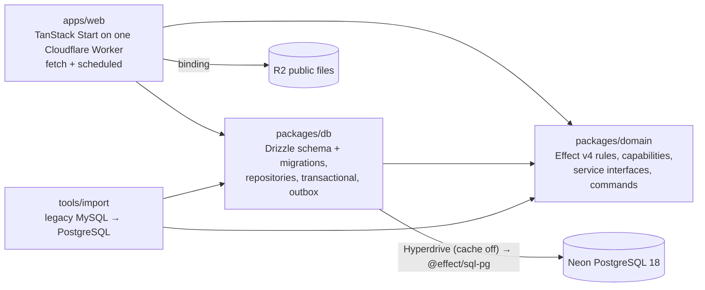

# vektorprogrammet (reimagined)

A rebuild of the legacy Symfony 3.4 site for Vektorprogrammet, a volunteer organisation that places student assistants in schools. This repository is Phase 1 of a five-phase plan: the organisation core (departments, semesters, fields of study, admission periods) and the public site (home, about, parents, news, sponsors, static text, contact, files).

## Where the truth lives

| Fact | Source |
| --- | --- |
| What to build, phase gates, operator decisions | `../../analysis/vektorprogrammet/MODERNIZATION_BRIEF.md` (binding; changes go on `Proposed revision:` lines) |
| Capabilities, domain model, interface contracts, Behavior Contract | `../../analysis/vektorprogrammet/AI_NATIVE_SPEC.md` |
| Architecture, decisions and their sources | `../../analysis/vektorprogrammet/REIMAGINED_ARCHITECTURE.md` |
| Business rules (RULE-nnn) with legacy citations | `../../analysis/vektorprogrammet/BUSINESS_RULES.md` |
| Slice specs | `docs/specs/` (`0000-database-path-spike.md` with its `0000-results.md`, `0001-departments-and-semesters.md`) |
| Mission state | `STATE.md` |
| Package details | each package's `README.md` |

Paths starting with `../../` are relative to this repository inside the modernization workspace (`/srv/share/projects/vektorprogrammet/vektorprogrammet`). The legacy code is a read-only worktree at `../../legacy/vektorprogrammet`.

## Architecture in one picture



- **One Worker.** Server functions are the only write path. A command runs in one transaction that writes domain rows, an audit row and outbox rows. Mail (Cloudflare Email Service) and Slack are delivered after commit by `waitUntil` and a cron sweep.
- **`domain` is pure Effect** and imports nothing from `db` or `web`. Atomic commands require `InTransaction`, which only `db`'s `transactional` provides, so an unwrapped command doesn't type-check.
- **Only production can send real mail or Slack.** Local and preview deployments get a capture sink (structural, tested).
- **Database rules for every phase:** no advisory locks, LISTEN/NOTIFY or session `SET` (Hyperdrive). Invariants live in constraints and `INSERT … ON CONFLICT … RETURNING`.
- **A cancelled request interrupts its program** (and rolls back an open transaction) only because `apps/web/worker.config.ts` sets `enable_request_signal`, which has no default compatibility date. Slice 0000 check 3b measured both sides: without the flag the transaction committed after the client had gone.

## Units

| Unit | Responsibility | Tests |
| --- | --- | --- |
| `packages/domain` | rules, branded types, capabilities (deny by default, department-scoped), service interfaces, commands | rule-named acceptance tests |
| `packages/db` | Drizzle schema (single source) → `drizzle/` migrations, `DatabaseLive`, `transactional`, `OutboxDelivery`, `classifySqlFailure` | PGlite + real PostgreSQL (concurrency, transactions, negative controls) |
| `apps/web` | routes, server functions, per-request Effect runtime, error table, `/filer` header policy, redirects, `alchemy.run.ts` | Node tests + `vp build` |
| `tools/import` | deterministic, rerunnable legacy import with a reconciliation report holding no personal data | real MySQL → PostgreSQL round trip |
| `tools/db-path-spike` | slice 0000: a throwaway Worker and a smoke command that check Worker → Hyperdrive → Neon → `@effect/sql-pg` → Drizzle on the real platform; also the deployed preview smoke test | local PostgreSQL rehearsal with negative controls; the deployed run in `docs/specs/0000-results.md` |

## Run it

Everything runs inside devenv: it pins Bun 1.4.2 and Node 24 and runs PostgreSQL 18 and MySQL 8.4. The system Bun (1.3.x) hangs on `bun install`.

```sh
devenv up -d                                   # PostgreSQL + MySQL; stop with: devenv down
devenv shell -- bun install
devenv shell -- bash -c 'cd packages/db && bun run db:migrate'   # local schema
devenv shell -- bunx vp run -r test            # every unit's tests
devenv shell -- bunx vp check                  # format, lint, type check
devenv shell -- bash -c 'cd apps/web && bunx vp dev --port 3000'  # http://localhost:3000
```

- Environment variables (`DATABASE_URL`, `TEST_DATABASE_ADMIN_URL`, `LEGACY_MYSQL_URL`) come from `devenv.nix`, derived from the ports devenv allocates. Deployed environments get the database through the Hyperdrive binding declared in `apps/web/alchemy.run.ts`.
- Secrets (Turnstile, Slack webhooks) are Worker secrets set with `cf`, never files.
- Neon secrets are declared in `secretspec.toml` and read only through `secretspec run -- <command>` with a `SECRETSPEC_REASON`, so a value never enters devenv evaluation, the Nix store or a shell. `packages/db/README.md` (Neon) has the branch, role and connection details.
- Real-PostgreSQL tests create and drop their own `vp_db_test_*` / `import_test_*` databases.
- The local test actor exists only when `DEPLOYMENT=local` (`vp dev`), via the `vp-test-actor` cookie.

## Quality gates

One source: the root `vite.config.ts` (`lint`, `fmt`, `staged`). Nested lint configs are ignored by Vite+.

| Gate | What enforces it | Run it |
| --- | --- | --- |
| Format, lint, type check | Oxfmt; Oxlint with Ultracite (`core`, `anti-slop`, `shadcn`), `@effect/tsgo` (`strict`, `effectNative`), the Effect plugin (all rules), mono-web's anti-slop plugins (`tools/oxlint/anti-slop/`), cognitive complexity ≤ 15, import boundaries; type-aware via tsgolint | `devenv shell -- bunx vp check` |
| Everything at once | check, tests, web build, knip, jscpd, gitleaks, exception registry | `devenv shell -- bun run ready` |
| Pre-commit | `vp staged` (`vp check --fix` on staged files) + gitleaks on staged changes (secrets, Norwegian national ids, SQL user dumps) | automatic (`.vite-hooks/pre-commit`) |
| Commit message | commitlint, Conventional Commits | automatic (`.vite-hooks/commit-msg`) |
| Pre-push | `vp run -r test` | automatic (`.vite-hooks/pre-push`) |
| Suppressions | every `oxlint-disable` / `@ts-expect-error` needs an entry in `tools/quality/effect-exceptions.json` | `devenv shell -- bun run check:exceptions` |
| CI | the same gates on every pull request | `.github/workflows/checks.yml` |

- Hooks are installed by `vp config` (the `prepare` script, which also runs `effect-tsgo patch`). Never use `--no-verify`.
- Fix the code, not the rule. A rule that is wrong for a file class gets a narrow `overrides` entry with a one-line reason. Two presets that contradict each other get one global switch with a comment naming both rules.
- Editor diagnostics come through the patched TypeScript (`@effect/language-service` in each tsconfig). CLI probe: `devenv shell -- bunx effect-tsgo diagnostics --file <f> --lspconfig '{"diagnostics":true}' --format text`.

## Conventions

- Native Effect v4: read `<package>/node_modules/effect/AGENTS.md` before writing Effect code. Total calculations stay plain functions.
- Tests are named by rule id (`RULE-022: …`). An unimplemented rule is `it.fails` with its id, never skipped.
- Exact dependency pins live in the root `package.json` `catalog`. Drizzle is pinned to `1.0.0-rc.5-5935859`, because rc.4 can't load with Effect 4.0.5.
- UI is shadcn/ui on Base UI (`base-nova`). Add components with `shadcn add`, then `bun add` any dependency it names (its npm install fails silently under the Bun `devEngines` rule).
- Lint, format and staged-file checks are configured once, in the root `vite.config.ts`.

## Legacy → modern traceability (Phase 1)

| Legacy (`src/AppBundle/…`) | Rules | New home |
| --- | --- | --- |
| `Entity/Semester.php`, `Utils/SemesterUtil.php`, `Entity/Repository/SemesterRepository.php` | 022, 033, 050, 051, 084, 190, 237 | `domain/src/organisation/semester.ts`; `db` `SemesterRepository.ensure` |
| `Controller/SemesterController.php`, `Form/Type/CreateSemesterType.php` | 144, 190 | `domain` `createSemester`; `web` `/kontrollpanel/semestre` |
| `Entity/Department.php` (admission helpers) | 015ʳ, 119ʳ | `domain/src/organisation/admission.ts` |
| `Controller/FieldOfStudyController.php` | 139 | `domain/src/organisation/fieldOfStudy.ts` + capabilities; `web` `/kontrollpanel/linjer` |
| `Controller/StaticContentController.php` | 296 | `domain/src/content/staticContent.ts`; `web` `/kontrollpanel/statisk-innhold` |
| `Twig/Extension/SafeHtmlExtension.php` | 133ʳ | `domain/src/content/sanitizer.ts` (`SanitizedHtml`) |
| `Controller/ArticleController.php`, `ArticleAdminController.php`, `Service/SlugMaker.php`, `Repository/ArticleRepository.php` | 096, 182, 266 (bug fixed), 267, 326, 331 | `domain/src/content/{article,slug}.ts`; `web` `/nyheter`, `/nyhet/$slug`, `/kontrollpanel/artikler` |
| `Controller/HomeController.php`, `home/index.html.twig` | 070 (bug fixed); 075 dropped | `domain/src/content/home.ts`; `web` `/` |
| `Entity/Sponsor.php` | 189 (URL check added) | `domain/src/content/sponsor.ts`; `web` `/kontrollpanel/sponsorer` |
| `Entity/SocialEvent.php` | 085, 188 (end after start added) | `domain/src/content/socialEvent.ts`; `web` `/kontrollpanel/arrangementer` |
| `Entity/SupportTicket.php`, `Controller/ContactController.php`, `EventSubscriber/SupportTicketSubscriber.php`, `Form/Type/SupportTicketType.php` | 156, 167 (Turnstile), 249, 327ʳ | `domain/src/contact/*`; `web` `/kontakt`, `/kontakt/avdeling/$id`; outbox |
| `Service/FileUploader.php`, `Controller/FileBrowserController.php` | 130, 290ʳ | `domain/src/files/*`; `web` `/filer/$key` |
| Slack as the audit log | C12 | `audit_log` table, written in each staff write's transaction |
| Legacy URLs `/om`, `/bedrifter`, `/faq`, `/artikkel/{slug}`, file paths | — | 301 redirects in `apps/web/src/server/redirects.ts` + `public_file.legacy_path` |

ʳ = replaced by an operator decision (brief §7). Dropped at Checkpoint 1: the changelog (C7), feedback (C9), RULE-075 count inflation, ipinfo geolocation.

## Not done yet (Phase 1 gates)

- **File migration:** copying the production upload directories is not authorised yet, so the importer reports every file as missing.
- Phase 1 exit criteria in the brief §3: the page-by-page diff against legacy, and CI on every pull request once the repository has a remote.
