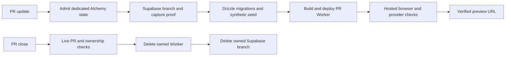

# @vektorprogrammet/web

Vektorprogrammet's public site and control panel run in one TanStack Start Cloudflare Worker. Supabase provides PostgreSQL, Auth and Storage. Content editing is part of the control panel; there is no separate CMS process, Cloudflare Queue, R2 bucket or Hyperdrive binding.

## Run the synthetic local prototype

Follow [`tools/prototype/README.md`](../../tools/prototype/README.md) to start the official local Supabase services and obtain a private CLI status environment file. Use the pinned project toolchain:

```sh
devenv shell -- bun install
export SUPABASE_ENV_FILE=/path/to/private-local-status.env
export RUNTIME_DATABASE_URL_FILE=/path/outside/repository/runtime-url
export SYNTHETIC_SUPABASE_OWNED=1
devenv shell -- bunx vp run prototype:setup
devenv shell -- bunx vp run prototype:dev
```

Open http://localhost:3000/logg-inn. Synthetic accounts are declared in [`localPeople.ts`](test/fixtures/localPeople.ts). Use a fresh synthetic Supabase database for the hybrid migration chain. Upgrading an existing prototype database has not been rehearsed and is not supported; do not reset the interactive prototype. Setup refuses remote database/API targets.

The application does not accept a test-actor cookie. Sign in through real local Supabase Auth. Supabase CLI's development keys are publicly shared defaults; ports may be bound beyond loopback. Never use this stack for real personal data or production credentials. Local Auth email is captured by the CLI's Mailpit service; application invitations and notifications use the non-production capture store.

## Runtime configuration

| Binding | Purpose |
| --- | --- |
| `DATABASE_URL` | Server-only restricted runtime PostgreSQL role with domain operations and required Auth reads; never an owner, superuser or BYPASSRLS role. Migration credentials stay outside the Worker. |
| `SUPABASE_URL` | Auth and Storage API origin |
| `SUPABASE_PUBLISHABLE_KEY` | Public provider client key |
| `SUPABASE_SECRET_KEY` | Server-only privileged SDK key |
| `SITE_URL` | Application origin used in invitation/recovery links |
| `DEPLOYMENT` | Explicit local, preview or production mode |
| `CONTACT_RATE_LIMIT` | Worker-native per-IP limiter |
| `TURNSTILE_SITE_KEY`, `TURNSTILE_SECRET_KEY` | Spam protection; documented test keys locally |
| `PREVIEW_HEAD_SHA` | Preview-only served revision; production returns no version response |

Secret values remain server-side. Standalone production builds contain empty database and secret bindings; Alchemy supplies preview runtime bindings. Production mail, Slack and Workspace remain separate operator-controlled integrations.

## Request and data boundaries

The app-local organisation is described in [spec 0030](../../docs/specs/0030-app-local-feature-organisation.md). Its decision history is recorded there.

| Location | Responsibility |
| --- | --- |
| `src/features/<feature>/` | Feature domain, functions, forms and components |
| `src/core/` | App-shared foundation: portable kernel, assembly registries, outbox and jobs, not a reusable package |
| `src/adapters/db/` | Database implementation; migrations in `drizzle/` and tests in `test/db/` |
| `src/adapters/` | Provider integrations, including Supabase, storage, messaging, Turnstile, rate limiting, Workspace and Web Crypto |
| `src/server/` | Composition, request identity, background execution and diagnostics |
| `src/http/outcome.ts` | Shared client/server HTTP outcome |
| `src/routes/` | TanStack routes |

Business rules and grant declarations remain in the domain. Provider adapters do not import the composition root. Worker bindings are separate from feature-specific request state. Import concrete modules directly; do not add package barrels or shims.

- Start server functions are the application's read/write entry points. Commands reuse the existing Effect domain rules and Drizzle/PostgreSQL transactions. Domain rows, audit and outbox intent commit together.
- The shared Drizzle table factory enables RLS without browser-role policies on domain tables. Anonymous and authenticated Data API clients cannot bypass Worker authorization. Provider Auth and Storage schemas keep their native policies. Before a hosted release, inspect exposed definer functions and owner-privileged views separately.
- Supabase verifies identities. Trusted administrator-owned `app_metadata.personId` links a provider identity to a domain person. Every protected application request checks current account state and domain grants. User-editable metadata never grants authority.
- Native provider invitations/recovery/password updates replace custom credential delivery. Recovery submits a provider one-time token to a fresh client at password-setting time. Session controls use supported sign-out scopes, not a fabricated per-session revocation API.
- JavaScript-owned forms declare POST and disable submission until hydration. Premature or forced native submission cannot place credentials or form fields in the URL. Native activation, export and contact forms retain their existing POST handlers.
- A private Supabase `public-files` bucket holds content-addressed objects. `/filer/$key` checks the domain registry and applies safe serving headers. A private object is not made anonymously readable merely because it has a public-file registry entry.
- Legacy public-file redirects use only the registry database layer. They run before Start installs its cookie context and require no authenticated principal.
- The editor uses the Portable Text SDK 8.2.11 public beta synchronous LOCAL operation snapshots to track edits. This beta API is an upgrade constraint. Dirty state compares the draft with the last saved payload; a response acknowledges only its submitted snapshot. A compiled replay covered immediate save and edits during a delayed POST; uncommitted IME DOM input remains unproven.
- The in-process content adapter stores separate draft and published JSON snapshots. Visitors read only the published snapshot. The control panel uses the maintained Portable Text editor and existing collection schemas. Unsupported rich-content blocks remain read-only rather than undergoing destructive normalization. Only the browser editor loads through React lazy and TanStack ClientOnly. The route retains server rendering and authorization.
- Direct post-commit delivery and the scheduled recovery sweep share conditional due-time/lease-fenced Postgres claims. External delivery remains at least once. Provider identity deletion/relink intents survive prolonged outages and remain pending with backoff instead of expiring silently.
- Erasure/merge/retention commit domain changes before provider cleanup. The UI distinguishes local erasure from pending provider work. Arbitrary editorial content requires explicit manual privacy review.

## Deployment and verification

### Synthetic PR previews

The [preview workflow](../../.github/workflows/preview.yml) runs only for pull requests from this repository. Forks receive no deployment credentials.

Supabase owns preview branches, Auth and Storage. Drizzle owns the application schema. Alchemy owns each PR Worker, its assets, bindings and cron triggers. The [Terraform controller is retired](../../infra/terraform/README.md).

`tools/preview` contains the lifecycle commands. They refuse default branches, copied production data, mismatched project identities and unsafe SMTP configuration.



### One-time operator setup

1. Create a dedicated synthetic Supabase project in an organization that supports branching. Never select a production project.
2. Leave the application data empty. Do not enable a second GitHub migration controller or copy SQL into `supabase/migrations`.
3. Create a dedicated Mailtrap Email Testing sandbox. Do not use Mailtrap Email Sending credentials.
4. Disable all forwarding for that sandbox. The confirmation variable records this operator check; capture receipt alone cannot prove absence of forwarding.
5. Configure the `synthetic-preview` GitHub environment. Require an operator reviewer before adding provider credentials.
6. Configure the secrets and variables referenced by the workflow. Use scoped provider tokens and never paste their values into chat or logs.

| Configuration | Purpose |
| --- | --- |
| `SUPABASE_ACCESS_TOKEN` secret | Branch lifecycle, branch credentials and service configuration for the designated synthetic project |
| `CLOUDFLARE_ACCOUNT_ID`, `CLOUDFLARE_API_TOKEN` secrets | Preview Workers and the dedicated Alchemy backend; existing repository secrets can supply these |
| `MAILTRAP_API_TOKEN` secret | Read the designated sandbox credentials and captured messages |
| `PREVIEW_CREDENTIAL_SEED` secret | Stable per-branch HMAC input; create once and retain across reruns |
| `SUPABASE_PREVIEW_PROJECT_REF` variable | The new dedicated parent project, never production |
| `CLOUDFLARE_WORKERS_SUBDOMAIN` variable | Actual Workers subdomain of the selected Cloudflare account |
| `MAILTRAP_ACCOUNT_ID`, `MAILTRAP_INBOX_ID` variables | The dedicated capture sandbox |
| `MAILTRAP_NO_FORWARDING_CONFIRMED=1` variable | Operator attestation after the forwarding check |

The workflow checks the environment reviewer rule and the exact checked-out PR head before provider operations. Jobs for one PR run sequentially.

### Dedicated Alchemy state

The preview stack uses its own state-store Worker. It does not adopt or upgrade the account-wide default store.

With separate operator authority and scoped Cloudflare credentials, provision or upgrade this backend explicitly:

```sh
devenv shell -- bunx vp run preview:bootstrap-state
```

Keep the command output private. Alchemy can include provider response details in errors. Do not add `--force` or run a default-store bootstrap.

Automated deployment requires `CI=true` and sets `updateStateStore:false`. Admission uses the installed SDK's version check before Supabase provisioning. The SDK can use an ephemeral edge preview for authentication; admission does not create application resources or upgrade the backend.

### Lifecycle and recovery

The workflow runs these uncached commands from the repository root:

```sh
devenv shell -- bunx vp run preview:admit-state
devenv shell -- bunx vp run preview:prepare
devenv shell -- bunx vp run preview:bootstrap
devenv shell -- bunx vp run preview:build
devenv shell -- bunx vp run preview:deploy
devenv shell -- bunx vp run preview:verify
```

These commands require the workflow identity variables and a private `PREVIEW_STATE_FILE` outside Git. Keep local output private too.

The database uses the provider's shared Supavisor host with the documented session port. This supports IPv4 runners without guessing a region or using transaction pooling for migrations.

Only the publishable key enters the build. Receipt decoding rejects swapped API keys and database connection overrides. Migration credentials and control-plane tokens never enter Worker bindings.

Preparation sends one reserved-address Auth invitation and checks the designated Mailtrap inbox. Later checks exercise the deployed revision, browser sign-in, CMS publication, private Storage, database guarantees and native Auth capture.

On closure, the workflow invokes `preview:teardown`. Teardown rechecks the live PR state and head before destructive work. Failed runs retain their PR-scoped resources for retry; they never delete a previously working preview merely because a later build or provider request failed.

Teardown uses PR identity rather than database credentials. It does not require Mailtrap availability. It deletes the Worker before its branch, and refuses orphaned or ambiguous state.

Do not call raw `alchemy destroy`. A stale or reopened PR, missing state, or conflicting ownership requires reconciliation instead of forced deletion. Deployment can resume an interrupted create through Alchemy's ownership-aware recovery. Teardown refuses a create checkpoint without provider attributes: successfully redeploy it before closing, or reconcile it manually. GitHub and provider operations do not form one transaction.

The workflow removes private receipts and logs from the runner. It does not publish them as artifacts. A successful local check does not establish a hosted deployment.

### Local verification

```sh
devenv shell -- bunx vp run @vektorprogrammet/web#build
devenv shell -- bunx vp check
devenv shell -- bunx vp run ready
```

Tests requiring Auth/Storage need the real local Supabase environment. SQL adapter tests use disposable databases and a minimal observed provider-schema fixture where they exercise SQL rather than the provider API. Browser tests must own their Supabase project/database, fixture users and app process; never reset the interactive prototype to run them. Turnstile test-key verification requires outbound access to Cloudflare's documented public test endpoint.

In an active devenv shell, use `bunx vp`; the `vp` shorthand below assumes local binaries are on PATH. Package scripts run uncached by default. Native Vite+ tasks retain their standard cache default; live, probe, generator and security tasks declare `cache: false`. File tracking cannot establish that external service state is unchanged. Do not use `--cache` for live verification scripts. Use `vp run test:all` for the uncached workspace run. The app task `vp run @vektorprogrammet/web#test` gates domain → db → web tasks on success. For a direct scoped run, use `vp test --project <name>` from the app. Bare `vp test` can continue later groups after a failure.

Root `vp run ready` runs static dependencies first, then serial `test:all` and a fresh build. The cached app build keys `SITE_URL`, `SUPABASE_URL` and `SUPABASE_PUBLISHABLE_KEY`. Use the built-in fresh build for a release. A warmed cache hit restored deleted client JS and `.wrangler/deploy/config.json` byte-for-byte. Changing `SITE_URL` caused a miss and changed the binding; restoring it hit the baseline. A fake private environment change caused a conservative miss, not a hit, and manifest private bindings stayed empty. The configuration excludes generated `.wrangler/**` inputs and preserves the deploy pointer as output. Root Bun lifecycle scripts retain `prepare` and `commitlint`; tasks are not duplicated as scripts.

Spec [`0028`](../../docs/specs/0028-supabase-prototype.md) records the earlier prototype contract and evidence. Historical specs describe previous infrastructure, not deployment instructions. Production migration, real delivery integrations and a hosted release remain separate gates.
