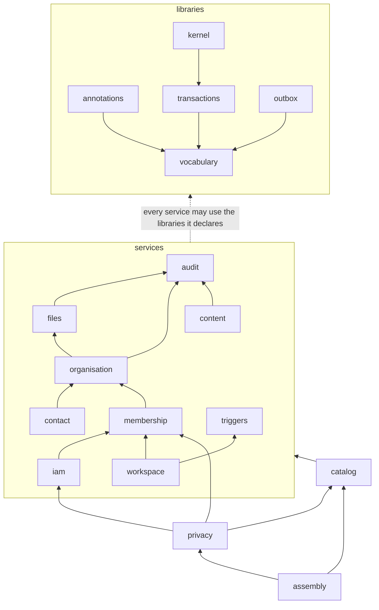

# Modules sit in layers, and a check enforces their dependency graph

Proposed on 2026-10-28. Evidence: repository at main `797e9e4`. The numbers for spec 0018 come from its open branch `spec/0018-store-guarantees` at `4e81d8c` (not merged). Every number below comes from a measurement of the code, not from memory (see "How this was measured" and "Evidence limits").

## Operator direction (2026-10-28)

These points are binding for this ADR.

- **The monorepo stays.** All pieces version together. There are no per-service package versions.
- **A piece moves to its own repository only when it has a different owner, release cadence, consumers or access boundary.** The repository pins it by commit. Today only effx qualifies, and it is already separate.
- **What we want is good module boundaries and an enforced dependency graph.** We do not want more repositories or more packages for their own sake.
- **Taxonomy.** A **library** has no runtime and no authority. A **service** declares commands, ports and rules, and depends on libraries. A **platform** implements them: adapters, Workers, the CMS app. An **integration** is a platform piece with an external dependency.
- **Proposed groupings.**
  - Libraries: kernel (its generic part goes to effx), transactions (`Transactor`, `InTransaction`), the outbox pattern, the personal-data annotation vocabulary, `cms-client`, docgen, the Oxlint rules.
  - Services: IAM (accounts, codes, sessions, grants), Organisation lifecycle (semesters, departments, admission, fields of study), Membership and teams (IAM depends on it, not the reverse), Content, Files, Contact, Audit (the legal record, not observability), Privacy (export, erasure, retention, record of processing).
  - Platform: the database adapters, the web Worker (`fetch`), the background Worker (scheduled and queue; split before production secrets, by credentials), the CMS app, and Triggers (cron and outbox events as one construct; each service declares its own jobs).
  - Integrations: mail, Slack, SMS, Turnstile, Workspace directory sync.

## Context

`packages/domain` holds 108 source files in 13 directories. All 13 directories sit in one dependency cycle. No file sits in a file-level cycle. So the cycles are not code that calls itself. They come from files that sit in the wrong directory, and from catalogs that import every service.

### 1. What the code looks like today (`packages/domain/src`, main `797e9e4`)

| Fact | Measured value |
| --- | --- |
| Source files (tests excluded) | 108 |
| Import edges between files (static `import`, `export … from`, `import type`) | 505, of which 93 are type-only |
| Dynamic `import()` | none |
| Cycles between files | **0** (two tools agree: my script, and Oxlint `import/no-cycle` with the negative control below) |
| Directories that import each other (modules, root files excluded) | 13, with 62 directed edges |
| Strongly connected components of the directory graph | **1, with all 13 directories in it** |
| Pairs of directories that import each other | **14** |
| Elementary cycles in the directory graph | **3,368** (14 of length 2, 31 of length 3, 86 of length 4, longest 11) |
| Packages imported besides `effect` | `sanitize-html`, in `content/sanitizer.ts` only |
| Imports of anything in the repository outside `packages/domain` | none |

3,368 cycles look like a design problem. They are not. They have a few causes, listed next.

### 2. The 14 mutual pairs, with file and line

| Pair | One direction | The other direction | Cause |
| --- | --- | --- | --- |
| `accounts` ↔ `shared` | `shared/outbox.ts:11` → `accounts/code.ts`; `:12` → `accounts/passwordHasher.ts` | 19 imports, for example `accounts/commands.ts:15-20` → `shared/aggregate`, `errors`, `ids`, `outbox`, `transaction` | `shared/outbox.ts` is the message catalog of every service |
| `shared` ↔ `workspace` | `shared/outbox.ts:13` → `workspace/change.ts` | `workspace/commands.ts:31-33` → `shared/aggregate`, `outbox`, `transaction`; `workspace/declaration.ts:20-21`, `services.ts:15-18`, `plan.ts:13` | the same file |
| `accounts` ↔ `kernel` | `kernel/commands.ts:17` (type), `kernel/domain.ts:21`, `kernel/subject.ts:14` → `accounts/code.ts` | `accounts/commands.ts:12-14`, `declaration.ts:5,15`, `principal.ts:4` → `kernel/*` | the kernel needs `CodePurpose` and `codePolicy`, which sit in `accounts` |
| `kernel` ↔ `organisation` | `kernel/guard.ts:15` → `organisation/semester.ts` | `organisation/commands.ts:11-12`, `declaration.ts:9` → `kernel/commands`, `domain` | the semester value type sits in `organisation` |
| `personalData` ↔ `accounts` | `personalData/catalog.ts:6` → `accounts/personalData.ts`; `commands.ts:17-18` → `accounts/principal`, `services`; `rpc.ts:9` → `accounts/code.ts` | `accounts/personalData.ts:5,17,18` → `personalData/declaration`, `periods`, `retentions` | the directory holds two things (below) |
| `personalData` ↔ `audit` | `catalog.ts:7`; `commands.ts:19` → `audit/auditLog.ts` | `audit/personalData.ts:6,16-18` | same |
| `personalData` ↔ `contact` | `catalog.ts:8` | `contact/personalData.ts:8` → `personalData/forms.ts` | same |
| `personalData` ↔ `content` | `catalog.ts:9` | `content/personalData.ts:2` | same |
| `personalData` ↔ `files` | `catalog.ts:10`; `commands.ts:21` → `files/services.ts` | `files/personalData.ts:2,10` | same |
| `personalData` ↔ `jobs` | `catalog.ts:11` | `jobs/personalData.ts:7,14,15` | same |
| `personalData` ↔ `organisation` | `catalog.ts:12`; `alumni.ts:8` → `organisation/semester.ts` | `organisation/personalData.ts:5` | same |
| `personalData` ↔ `outbox` | `catalog.ts:13` | `outbox/personalData.ts:11,22-24` | same |
| `personalData` ↔ `teams` | `catalog.ts:14`; `alumni.ts:10` (type); `commands.ts:29-30` → `teams/personResource`, `services` | `teams/personalData.ts:6,21-23` | same |
| `personalData` ↔ `workspace` | `catalog.ts:15` | `workspace/personalData.ts:5,13,14` | same |

The longer cycle that the operator named is real: `teams/entities.ts:20` → `workspace/companyEmail.ts`; `workspace/commands.ts:26` → `jobs/registry.ts`; `jobs/registry.ts:11` → `teams/endingSoon.ts`.

Two causes explain almost everything:

1. **`personalData/` holds two different things.** Seven files are a vocabulary that every service's own `personalData.ts` uses (`declaration`, `periods`, `retentions`, `duration`, `forms`, `consents`, `texts`). Six files are the Privacy service, and one file (`catalog.ts`) imports the `personalData.ts` of ten directories. Ten of the 14 pairs have this one cause.
2. **Catalogs sit among the things they list.** `shared/outbox.ts` (the closed union of all outbox messages), `personalData/catalog.ts` and `jobs/registry.ts` import other directories. The operator already said they belong at the top. The measurement confirms it: `catalog.ts` imports 10 directories, `outbox.ts` imports 2, and `registry.ts` imports 1.

The remaining cause is four vocabulary files in the wrong directory: `accounts/code.ts`, `organisation/semester.ts`, and the two kernel files (`principal.ts`, `subject.ts`) that name `TeamFunction`, `SystemJob`, `AuditClient` and `CodePurpose`.

IAM depends on Membership and not the reverse, as the operator wants. Measured: `accounts` imports `teams` in 4 files (`commands.ts`, `declaration.ts`, `services.ts`, `sso.ts`), and `teams` imports `accounts` in no file.

### 3. Other packages

| Unit | File cycles | Directory cycles | Note |
| --- | --- | --- | --- |
| `packages/db/src` (36 files) | 0 | the root files (`databaseLive.ts`, `schema.ts`, `transactional.ts`) against `aggregate/` and `repositories/` | a layout effect, not a design cycle; modules by file group remove it |
| `apps/web/src` (140 files) | 0 at runtime; **a 17-file cycle that exists only in type imports**, through `server/env.ts:18` (`import type … from "./contactPost"`), and a 2-file one (`server/errors.ts` ↔ `lib/outcome.ts`) | `lib` ↔ `server` (type-only) | Oxlint's `import/no-cycle` ignores type imports by default; with `ignoreTypes: false` it reports 47 sites in `apps/web/src` |
| `tools/import/src` (18 files) | 0 at runtime; one type-only (`report.ts` ↔ `transform/plan.ts`; Oxlint with `ignoreTypes: false` reports 2 sites) | root ↔ `emdash`, root ↔ `transform` | small |

Package-level edges (imports of one workspace package by another, `src` / test / config files):

| From | To | src | test | config |
| --- | --- | --- | --- | --- |
| `packages/db` | `packages/domain` | 29 | 45 | 0 |
| `apps/web` | `packages/domain` | 36 | 46 | 1 |
| `apps/web` | `packages/db` | **1** (`server/runtime.ts`) | 13 | 0 |
| `apps/web` | `packages/cms-client` | 4 | 5 | 0 |
| `apps/web` | `apps/cms` | 0 | **1** (`test/textSlots.test.ts` reads `../../cms/seed/seed.json`) | 0 |
| `apps/cms` | `packages/db` | 0 | 0 | 1 (`scripts/checkBundle.ts`) |
| `apps/cms` | `apps/web` | 0 | 0 | **1** (`scripts/checkBundle.ts:46` → `../../web/worker.config.ts`) |
| `tools/import` | `packages/domain`, `packages/db`, `packages/cms-client` | 5, 1, 4 | 1, 1, 4 | 0 |
| `tools/docgen`, `tools/effx-conformance` | `packages/domain` | 2, 3 | 1, 1 | 0 |
| `tools/oxlint` | `packages/db` | **1** (`no-owned-table-write.ts:4`, a known allowance) | 0 | 0 |
| `tools/db-path-spike` | `packages/db`, `packages/domain`, `apps/web` | 3, 1, 0 | 1, 0, 0 | 0, 0, **1** (`alchemy.run.ts:22`) |

`packages/domain` and `packages/cms-client` import no workspace package, as they should. Two app-to-app edges exist (`apps/cms` → `apps/web`, a config import; `apps/web` → `apps/cms`, a test reading a JSON file). The lint does not see them, because its pattern looks for `/src` in a path and `worker.config.ts` is not under `src`. The store boundary (ADR 0014, spec 0017) is the only enforced rule on this graph today.

### 4. What spec 0018 changes

On the 0018 branch the domain has 110 files and 545 file edges (115 type-only). It adds two files to `shared/`: `guarantees.ts` and `transactionModes.ts`. They import 9 and 10 directories (the ports of every service), so they are catalogs, and they make `shared` import upward. The directory cycle stays as it is, and the file graph stays acyclic. Because both specs change the same modules, cycle-breaking starts after 0018 merges (staged plan below).

### 5. How this was measured

- A throwaway script (not committed) parsed every `.ts` file of `packages/domain/src` with `oxc-parser` 0.153.0 (already a root dependency). It took every static import, `export … from` and dynamic `import()`. It resolved relative specifiers and skipped `test/`.
- A second run with `import type` and type-only `export` edges removed gave the same component of 13 directories, so type edges do not cause the directory cycle in the domain.
- Oxlint `import/no-cycle` (Oxlint 1.88.0, `node_modules/.bun/oxlint@1.88.0`) reported nothing on `packages`, `apps` or `tools` at its default. Negative control: two files that import each other produce two reports. With `ignoreTypes: false` it reports nothing on `packages` (domain, db and cms-client included), 47 sites on `apps/web/src` and 2 on `tools/import/src`.
- The edge and cycle numbers above come from the same script, on the same 108 files. Both runs together took 1.0 s, including the start of `devenv shell`.

## Decision

### 1. The monorepo stays; the boundaries are modules, enforced by a check

A **module** is a named group of files inside a package. It is the unit of the declared graph. A module is not a package and has no version. Promotion goes in one direction and only on evidence: a module becomes a workspace package when a second consumer needs it without the rest, and a package becomes its own repository (pinned by commit) when it has a different owner, release cadence, consumers or access boundary. Today only effx meets that test.

`packages/domain` stays one package. Splitting it into packages now would add a `package.json`, `tsconfig`, knip entry and test configuration for each part. It would also split the barrel `index.ts` that 36 files of `apps/web` import. The enforced graph gives the benefit of a package boundary at none of that cost.

### 2. Four layers

| Layer | May import | Imported by | Examples |
| --- | --- | --- | --- |
| **library** | other libraries it declares, and `effect` | libraries, services, catalogs, assembly, platform | `vocabulary`, `kernel`, `transactions`, `outbox`, `annotations` |
| **service** | libraries, and services it declares | services that declare it, catalogs, Privacy, assembly, platform | `audit`, `organisation`, `membership`, `iam`, `triggers`, `workspace`, `content`, `files`, `contact` |
| **catalog** | libraries and services | Privacy, assembly, platform | the personal-data catalog, the job registry, the outbox message union |
| **assembly** | everything in `packages/domain` | platform and tools | `declarations.ts`, `index.ts`, `localPeople.ts`, the store-guarantee catalogs of spec 0018 |

Privacy is a service, but it reads the catalog, so it sits between catalog and assembly (`privacy` may import `catalog`; `catalog` may not import `privacy`). The **platform** layer is outside `packages/domain`: `packages/db`, `apps/web`, the future background Worker, `apps/cms`, `tools/import`. It may import the domain and nothing in the domain imports it. An **integration** is a platform piece that talks to an outside system.

This adds one rung (catalog) to the operator's three. The measurement is the reason: no service imports a catalog, the personal-data catalog imports the declarations of nine target services, and Privacy reads the catalog. Without the rung, either Privacy or the catalogs form a cycle.

### 3. Target modules and file groups

Modules are file globs over the current layout. No file must move for the declaration to hold.

| Module | Layer | Files (current paths) | Count |
| --- | --- | --- | --- |
| `vocabulary` | library | `shared/ids`, `errors`, `validation`, `clock`, `siteOrigin`; `organisation/semester`; `kernel/principal`, `subject`; `accounts/code` | 9 |
| `kernel` | library | `kernel/authorize`, `commands`, `domain`, `effx`, `grant`, `guard`, `machine` (2,499 lines) | 7 |
| `transactions` | library | `shared/transaction`, `transactor`, `aggregate` | 3 |
| `outbox` | library | the pattern part of `shared/outbox.ts` (after the split in stage 3) | 1 |
| `annotations` | library | `personalData/declaration`, `duration`, `forms`, `periods`, `retentions`, `consents`, `texts` | 7 |
| `audit` | service | `audit/*` | 4 |
| `files` | service | `files/*` | 6 |
| `content` | service | `content/*` | 9 |
| `organisation` | service | `organisation/*` except `semester.ts` | 8 |
| `membership` | service | `teams/*`, `workspace/companyEmail.ts` | 12 |
| `iam` | service | `accounts/*` except `code.ts` | 11 |
| `contact` | service | `contact/*` | 4 |
| `workspace` | service | `workspace/*` except `companyEmail.ts` | 7 |
| `triggers` | service | `jobs/job`, `runs`, `problems`, `personalData`; `outbox/*` (delivery, status, captured, declaration, personalData) | 9 |
| `catalog` | catalog | `personalData/catalog`, `jobs/registry`; the message union of `shared/outbox.ts` (after stage 3) | 2 |
| `privacy` | service | `personalData/alumni`, `commands`, `derive`, `notice`, `rpc`, `services` | 6 |
| `assembly` | assembly | `declarations.ts`, `index.ts`, `localPeople.ts`; on the 0018 branch also `shared/guarantees.ts` and `shared/transactionModes.ts` | 3 (+2) |

The `*/personalData.ts` file of each service stays with its owner. Each service declares its own stored data (ADR 0004, ADR 0014 stage 5).

Moving every file into a directory with its module's name would change the directory of 38 files and rename two directories (`accounts` → `iam`, `teams` → `membership`; 22 more files). That is optional, and stage 4 of the plan does it.

### 4. The graph is data

`tools/quality/moduleGraph.ts` declares, for each module: its layer, its file globs, the modules it may use, and the external packages it may import. It follows `tools/quality/storeBoundary.ts`: one declaration, and everything else reads it (the check, the lint, the generated document). This is the repository's rule that declarations are data (ADR 0009).

**The declared graph, measured on the 108 files** (each row lists what the module imports today; `assembly` may use all):

| Module | Uses |
| --- | --- |
| `vocabulary` | (none) |
| `annotations`, `transactions`, `outbox` | `vocabulary` |
| `kernel` | `transactions`, `vocabulary` |
| `triggers` | `annotations`, `kernel`, `outbox`, `transactions`, `vocabulary` |
| `audit` | `annotations`, `kernel`, `vocabulary` |
| `files`, `content` | `annotations`, `audit`, `kernel`, `transactions`, `vocabulary` |
| `organisation` | the row above, `outbox`, and `files` (type only: `legacyImport.ts` uses `fileType`) |
| `contact` | `annotations`, `kernel`, `organisation`, `outbox`, `transactions`, `vocabulary` |
| `membership` | `annotations`, `audit`, `kernel`, `organisation`, `outbox`, `transactions`, `vocabulary` |
| `iam` | `annotations`, `audit`, `kernel`, `membership`, `outbox`, `transactions`, `vocabulary` |
| `workspace` | `annotations`, `audit`, `kernel`, `membership`, `outbox`, `transactions`, `triggers`, `vocabulary` |
| `catalog` | `annotations`, `audit`, `contact`, `content`, `files`, `iam`, `membership`, `organisation`, `triggers`, `workspace` |
| `privacy` | `annotations`, `audit`, `catalog` (type only), `files`, `iam`, `kernel`, `membership`, `outbox`, `transactions`, `vocabulary` |

### 5. Rules the check enforces

1. Every source file belongs to exactly one module. A new file that no glob matches fails.
2. An import from one module to another is an edge. The edge must be in the importer's `uses`, and its target must not be in a higher layer.
3. The declared graph has no cycle, and the real graph has no edge that the declaration lacks.
4. A declared edge that no file needs fails. The list can only shrink (the same ratchet as `storeBoundary.ts`).
5. A library imports only `effect`, other declared libraries and nothing else: no `node:` module, no `cloudflare:`, no workspace package. A service imports the same, plus `sanitize-html` where its row says so.
6. Package rows: `packages/domain` imports no workspace package. `packages/db` imports only `packages/domain`. A platform piece imports the domain, `packages/db` and `packages/cms-client`. No piece imports an `apps/*` package. The known leaks in the package table of the Context are the starting baseline, each with a reason, and the list can only shrink.
7. While a baseline exists, the check allows exactly the baselined edges. When the baseline is empty, the check removes the exception, and the graph must be acyclic.

### 6. Platform and integrations

The platform pieces and where today's code sits. The "service port" column says where the port that the piece implements is declared.

| Piece | Today | Port declared in | Note |
| --- | --- | --- | --- |
| Database adapters | `packages/db` | `packages/domain` (ADR 0014 stage 1) | modules inside: `schema`, `aggregate`, `repositories`, `personalData`, `wiring` |
| Web Worker (`fetch`) | `apps/web/src/server/` `accountPost`, `accounts`, `auth`, `contact*`, `panel*`, `principal`, `publicFiles`, `redirects`, `shell`, `teams`, and the routes |  | holds `BETTER_AUTH_SECRET`, `TURNSTILE_SECRET_KEY`, `CMS_TOKEN`, `CONTACT_RATE_LIMIT`, `PUBLIC_FILES` |
| Background Worker (scheduled and queue) | the same Worker: `jobRunners`, `jobs`, `outboxQueue`, `outboxSweep`, `outboxDelivery`, `retentionMode` |  | needs the job database role, `OUTBOX_QUEUE`, `SEND_EMAIL`, `MAIL_FROM`, `SLACK_WEBHOOK_URL`; Workspace credentials are not provisioned yet (spec 0008) |
| Shared composition | `server/runtime.ts`, `scope.ts`, `env.ts`, `deployment.ts` |  | one `WorkerEnv` holds both Workers' credentials; `runtime.ts` builds the request, tick and queue scopes |
| Triggers | `jobs/*`, `outbox/*` in the domain; `jobRunners.ts`, `outboxQueue.ts` in `apps/web` | `triggers` | each service declares its own jobs; the registry is a catalog |
| Mail, Slack | `server/senders.ts` | **`apps/web`** (`MessageSender`) | port in the platform: moves to `triggers` |
| Turnstile | `server/turnstile.ts` | **`apps/web`** (`TurnstileVerifier`) | port in the platform: moves to `contact` |
| Contact rate limit | `server/rateLimit.ts` | **`apps/web`** (`ContactRateLimiter`) | port in the platform: moves to `contact` |
| Workspace directory sync | `server/workspace.ts` | `workspace` | fits |
| Public files (R2) | `server/fileStore.ts` | `files` | fits |
| SMS | none | none | no code yet |
| CMS | `apps/cms`, `packages/cms-client` |  | third-party product behind a typed library |

The split of the background Worker is its own decision. This ADR gives the rule that makes it checkable: the two Workers share the domain and the adapters, and neither imports the other. A secret reaches only the Worker whose row lists it.

### 7. What does not fit, and what we do about it

| Item | Why it does not fit | Plan |
| --- | --- | --- |
| `shared/outbox.ts` | One file is the generic `Outbox` service and the closed union of every service's messages. It imports `accounts` and `workspace` | Split (stage 3): the pattern stays a library; each service declares the messages it enqueues; the union is assembled in `catalog`, where delivery decodes it |
| `jobs/registry.ts` | A catalog that `workspace/commands.ts:26` imports | `workspace` declares its own sync job (stage 2); the registry imports it |
| `kernel/*` is not generic | `principal.ts` and `subject.ts` name `TeamFunction`, `SystemJob`, `AuditClient`, `CodePurpose`. `commands.ts` closes `Resource` over `EntityName`. `guard.ts` knows semesters | The Vektor-specific names go to `vocabulary` now. The generic part that moves to effx is not defined yet (ADR 0009: when a second domain uses the kernel) |
| `shared/ids.ts` | One file holds the id brand of every service and the closed `EntityName` set | Stays in `vocabulary`. It is a leaf (no imports), so it causes no cycle. It grows with every service; per-service ids are a later option |
| `personalData/periods.ts` | One file holds every service's retention period | Stays in `annotations` for the same reason |
| `kernel/effx.ts` (963 lines) | It imports `AggregateRoots` from `shared/aggregate` | A kernel → `transactions` edge. Move `AggregateRoots` to `vocabulary` if this edge is unwanted |
| `shared/guarantees.ts`, `shared/transactionModes.ts` (spec 0018) | Catalogs that import 9 and 10 directories, in `shared/` | Module `assembly`. 0018 must put them in a path the globs map |
| Ports in `apps/web` | `MessageSender`, `TurnstileVerifier`, `ContactRateLimiter` are declared in the platform | Move to the domain services (section 6) |
| `tools/oxlint` → `packages/db` | The rule reads the adapter's ownership declaration | ADR 0014 stage 5 moves the declaration to the domain |
| `apps/cms` ↔ `apps/web` | A config import and a seed-file read between two apps | Move `worker.config.ts` to a place both may import; stage 5 |
| `apps/web/src/server` type cycle | 17 files through `env.ts` | Needed before the Worker split; stage 7 |

## Enforcement options

| Option | In the tree? | Sees module cycles | Sees layers | What I observed |
| --- | --- | --- | --- | --- |
| Oxlint `import/no-cycle` | Yes (Oxlint 1.88.0 in `vp`) | File cycles only | No | 0 reports on `packages`, `apps` and `tools` at the default (`ignoreTypes` true). Two files that import each other: 2 reports. With `ignoreTypes: false`: 0 on `packages`, 47 on `apps/web/src`, 2 on `tools/import/src` |
| Oxlint `import/no-restricted-paths` | — | — | — | The rule does not exist in 1.88.0: `Rule 'no-restricted-paths' not found in plugin 'import'` |
| Oxlint `no-restricted-imports` (the `storeBoundary.ts` pattern) | Yes | No | Yes, by regex on the written specifier | Works for `../module/…` specifiers, so it needs a directory per module (stage 4) |
| dependency-cruiser 18.7.0 | No (new dev dependency) | Yes | Yes | The repository pins TypeScript 7.0.2. dependency-cruiser supports `>=2.0.0 <7.0.0`. In this tree it printed `missing-tsc-transpiler` and cruised **0 of 108** files |
| eslint-plugin-boundaries | No (needs ESLint; the tree has none) | No | Yes | Not run. Rejected: a second linter for one rule |
| Nx `enforce-module-boundaries` | No (needs an Nx project graph) | Yes | Yes, by tags | Not run. Rejected: Nx for one rule. The tag idea is in our layer field |
| Extend `storeBoundary.ts` | Yes (`oxc-parser` is a root dependency; `tools/quality` has the scan, the test and the `ready` hook) | Yes (the script above finds them) | Yes | The throwaway script measured the whole domain in under a second |

**Recommendation: extend the `storeBoundary.ts` pattern.**

- `tools/quality/moduleGraph.ts` is the declaration. `moduleGraphCheck.ts` scans with `oxc-parser`, as `storeBoundaryCheck.ts` does, and reports findings with file and line. `checkModuleGraph.ts` is the entry. `bun run check:module-graph` joins `ready`. Its test runs the check on the real tree, as `storeBoundary.test.ts` does, so it also runs in `test:all`, the pre-push hook and CI.
- Turn on Oxlint `import/no-cycle` for `packages/**` in `vite.config.ts`, with `ignoreTypes: false`. It costs one line, it reports nothing on `packages` today, and it keeps the file graph acyclic from the editor.
- Generate `no-restricted-imports` overrides from the same declaration after stage 4 (directory = module), for editor feedback. One override per module, because a later override replaces an earlier one. Before stage 4 the check is the only enforcement, because a regex over a written specifier cannot name a file group.
- Fold `storeBoundary.ts` into the same declaration later (stage 6): the database packages become platform rows.

Reasons: it reuses what is in the tree (the parser, the pattern, the test shape, the gate). Its one-way declaration also generates the document. The only maintained alternative that sees layers and cycles, dependency-cruiser, does not work with this tree's TypeScript today. We do not write a resolver: the domain uses only relative specifiers and `effect`, and for packages the check looks at the specifier and the package row.

## Falsifiers

Each falsifier has a negative control: the same input without the fault passes. The tests follow `tools/quality/test/storeBoundary.test.ts` (an in-memory file map, so no file on disk changes).

| # | Falsifier | Negative control |
| --- | --- | --- |
| F1 | **A cycle fails.** A file in `membership` imports `iam` (which already imports `membership`): the check fails and prints both import sites with file and line | The same map without the new import passes |
| F2 | **An upward import fails.** `kernel` imports a service; a service imports `catalog`; `catalog` imports `privacy`: each fails | The same imports in the allowed direction pass |
| F3 | **An undeclared sideways edge fails.** `contact` imports `iam` | The declared edge `iam` → `membership` passes |
| F4 | **The ratchet.** A declared edge that no file uses fails | Removing it from the declaration passes |
| F5 | **An unmapped file fails.** A new file in a new directory matches no module | The same file under a mapped glob passes |
| F6 | **A library with runtime fails.** A library imports `node:fs`, `cloudflare:workers` or `@vektorprogrammet/db` | An import of `effect` passes |
| F7 | **Package rows.** `apps/web/src` imports `apps/cms`; `packages/domain` imports a workspace package | The baselined leaks (the Context's package table) pass, and a baselined leak that no file needs fails |
| F8 | **Oracle.** For a fixture with a known cycle, the check and Oxlint `import/no-cycle` give the same verdict; for the real domain both say acyclic at file level | The same fixture without the cycle: both pass |
| F9 | **The real tree.** The check run on `packages/domain/src` reports exactly the baselined edges. The baseline count is pinned in the test, so a stage that removes an edge must also lower the count | Adding one real import (a mutation of the in-memory map) raises the findings by one |
| F10 | **The lint agrees.** After stage 4, a fixture file that Oxlint rejects for a restricted specifier is rejected by the check too, for the same specifier | A specifier that the declaration allows passes in both |

A control must fail every time without its mechanism. Prove each one by removing the rule and running the test five times, as `AGENTS.md` requires for locks.

## Staged plan

Each stage ends green: `vp check`, `bun run test:all`, `bun run check:module-graph`, `bun run ready`. Stages 2 and later wait for spec 0018 to merge, because both change `shared/`, `kernel/`, `accounts/` and `workspace/`. Effort sizes are estimates.

| Stage | Change | Done when (falsifier) | Size |
| --- | --- | --- | --- |
| 0 | Operator accepts or amends this ADR (open questions below). | Status changes. | — |
| 1 | Write `moduleGraph.ts` with modules as globs over the current layout, the check, its tests and the `ready` and CI hooks. Baseline: the 3 upward edges (`shared/outbox.ts:12`, `:13`, `workspace/commands.ts:26`) and the package leaks. Turn on `import/no-cycle` for `packages/**`. | F1 to F9 pass. The check reports exactly the baseline on the real tree. | M |
| 2 | `workspace` declares its own sync job. `jobs/registry.ts` imports it. | Baseline loses `workspace/commands.ts:26`. `registry.test.ts` passes (it checks that declaration, command, runner and document agree). | S |
| 3 | Split `shared/outbox.ts` (own spec): the library keeps `Outbox` and the enqueue contract; each service declares its messages; `catalog` assembles the union that delivery decodes. | Baseline loses `outbox.ts:12` and `:13`. The directory graph is acyclic: the exception in rule 7 is removed. | M |
| 4 | Make directory = module: `git mv` the 38 files, rename `accounts` and `teams`, rewrite imports with a codemod, one module per change. Then generate the `no-restricted-imports` overrides. | F10 passes. The imports of `index.ts` and the docgen change, and nothing else. | M |
| 5 | Package rows: move `worker.config.ts` out of `apps/web`; move the `MessageSender`, `TurnstileVerifier` and `ContactRateLimiter` ports into the domain; the seed read goes through a package export. | The package baseline is empty. | S to M |
| 6 | Fold `storeBoundary.ts` into the declaration. | `check:store-boundary` and `check:module-graph` are one command with the same findings as before. | S |
| 7 | Generate `docs/system/modules.md` (the diagram and the tables above) from the declaration, checked by `check:docs`. Break the `apps/web/src/server` type cycle at `env.ts`, then split the background Worker by credentials (own ADR). | `check:docs` fails when the declaration and the document differ. Each Worker's `WorkerEnv` lists only its own secrets. | M |
| 8 | Move the generic part of `kernel` to effx when a second domain uses it (ADR 0009). | effx pins it by commit. | — |

## Considered options

| Option | Verdict |
| --- | --- |
| **A. Status quo.** Directories are a convention. | Rejected. 3,368 cycles exist today, and one new import can add more with no signal. |
| **B. One workspace package per service.** `package.json` dependencies are the graph. | Rejected for now. It needs 12 or more `package.json`, `tsconfig`, knip and test setups, and it splits the barrel. It adds no check that the declared graph does not give. Promotion stays possible per module. |
| **C. One repository per service, pinned by commit.** | Rejected. The operator's test (different owner, cadence, consumers or access boundary) fails for every piece except effx. Versions would move apart for no reason. |
| **D. dependency-cruiser or Nx.** | Rejected. dependency-cruiser does not read this tree (TypeScript 7). Nx adds a project graph for one rule. See the options table. |
| **E. A declared module graph and a check, in the tree (chosen).** | One declaration, one check, and the same declaration generates the lint and the documents. |

## Consequences and costs

- **A 17-module declaration to keep up.** A new file must match a glob (F5). A new dependency between modules is a declaration change, so a reviewer sees it as a one-line diff.
- **`vocabulary` is a growth point.** It holds `ids.ts` and `EntityName` for all services. If it grows without limit, it becomes a shared kernel in disguise. The check cannot see that; review must.
- **Stage 4 moves 38 files and renames two directories.** Spec 0018 and other open work touch the same files, so stage 4 waits for a quiet period.
- **The lint only covers the domain's internal graph.** `apps/*` import the barrel `@vektorprogrammet/domain`, so the check cannot see which service a platform file uses. That is acceptable: the platform may use every service.
- **[INFERENCE] A new service (ADR 0011 units, ADR 0013 activities, ADR 0012 elections) declares its layer and `uses` in the same change as its first file.** I did not model them. They look like services above `membership`, `triggers` and `outbox`, below `catalog`.
- **Cost of the check:** about 300 lines in `tools/quality`, a test file, and one more command in `ready` [estimate; the throwaway measurement scripts were 60 to 70 lines each].

## Open questions for the operator

1. **Two additions to your taxonomy.** `vocabulary` (a library of closed sets, ids, errors, calendar and principal shapes) and the `catalog` rung. Recommended: yes. The measurement shows no acyclic layout without them.
2. **`triggers` as one service.** It holds `jobs/{job,runs,problems}` and `outbox/*` (delivery, status, captured, declaration). Recommended: yes, as you said (cron and outbox events as one construct). Its measured edges form no cycle.
3. **Per-service outbox messages (stage 3).** Each service declares the messages it enqueues and `catalog` assembles the union. The alternative is to keep one union in a library and move `PasswordHash` and `WorkspaceChange` into `vocabulary`. That is cheaper but grows `vocabulary`. Recommended: per-service.
4. **Globs before directories.** Stage 1 maps modules by file glob over today's layout. Stage 4 renames directories. Recommended: yes, so that enforcement does not wait for 38 file moves.
5. **GLOSSARY.** The terms library, service, catalog and assembly are new. Recommended: add them to `GLOSSARY.md` when this ADR is accepted.

## Evidence limits

- Numbers are from main `797e9e4`, except where marked as the 0018 branch (`4e81d8c`, not merged). The measurement scripts are throwaway and are not committed. Stage 1 turns them into the checked, tested version.
- The target graph with 0 upward edges and 0 cycles was measured by mapping the 108 files onto the modules above and moving **three import edges** in the model (the two edges of `shared/outbox.ts` to `catalog`, and `workspace` → `jobs/registry` to a `workspace` declaration). It simulates stages 2 and 3. The code does not exist yet. Before the three edges are moved, the same mapping shows exactly 3 upward edges and one component of 8 modules.
- On the 0018 branch, the same mapping shows 0 upward edges once `shared/guarantees.ts` and `shared/transactionModes.ts` are in `assembly`. They are an upward edge into Privacy if they are put in `catalog`: they import `personalData/services.ts`.
- The graph covers static imports. A computed `import()` is invisible. The domain and the database package have no dynamic imports; `apps/web` has none in `server/`.
- The package-level counts treat `test/`, `e2e/` and `.spec.` files as tests, and top-level or `scripts/`, `build/` files as config.
- I did not run `vp check` or the test suite for this ADR. It changes no code.
- Not run: eslint-plugin-boundaries and Nx (judged from their requirements, not from an experiment). dependency-cruiser was run once, at 18.7.0, and failed as described.
- Effort sizes are estimates.
