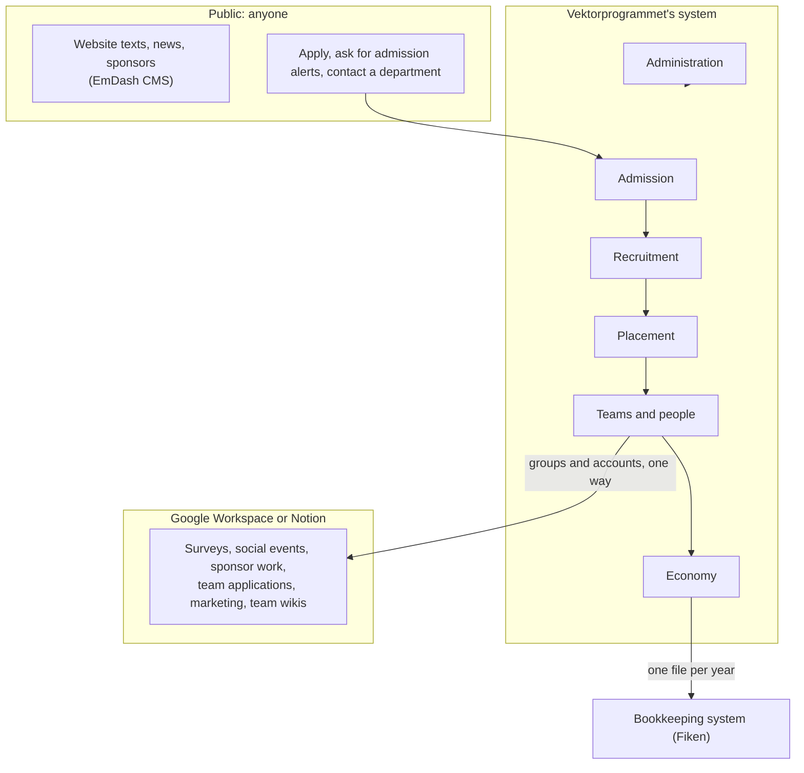
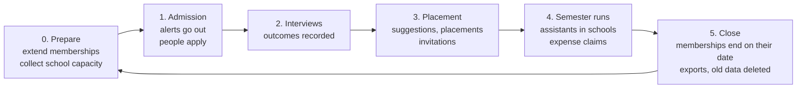

# Vektorprogrammet's information system

> **Status: accepted** (operator, 2026-10-26). This design is the accepted 2026-10-26 revisions in `../../../../analysis/vektorprogrammet/MODERNIZATION_BRIEF.md` §7. The analysis behind it is `../../../../analysis/vektorprogrammet/INFORMATION_MODEL.md`.

## What the system does

Vektorprogrammet sends students to schools as assistants. Each semester, the organisation does the same work:

1. It finds and recruits new assistants.
2. It places them in schools.
3. It runs its teams.
4. It pays back the money that volunteers spend.

The system does this work where rules matter: who can apply, who can see what, which school has room, and who approves money. Other work stays in tools that the teams already use.

In business terms, Vektorprogrammet works like a non-profit staffing agency:

| Staffing agency | Vektorprogrammet |
| --- | --- |
| Clients | Schools |
| Job orders | The number of assistants each school can take, per weekday and semester |
| Candidates | Applicants, who are interviewed |
| Assignments | Placements |

Unlike a staffing agency, nobody pays: schools get assistants for free, the assistants are volunteers, and sponsors and the university fund the work. The students' experience is a goal of its own, not only a means of serving the schools.

The names in these documents have one meaning each. `../../GLOSSARY.md` gives each name and its Norwegian word.

## What is in the system, and what is not

| Work | Where it happens | Why |
| --- | --- | --- |
| Admission, interviews, placement, teams, expense claims, accounts | This system | These need fixed rules: applicants without accounts, access limited to one department, automatic e-mails, money |
| Website texts, news, sponsor logos | EmDash CMS | Editors write content; no business rules |
| Surveys, social events, team applications, certificate requests | Google Forms and Calendar | Low use: for example, the last survey answer in the old system is from December 2022 |
| Sponsor work, marketing, team wikis | Notion or Google Drive | Not automated today, and no rules to protect |
| Bookkeeping | Fiken (or another tool) | The system sends one file of refunded claims per department and year |

Data moves one way only, from this system to the other tools. No other tool writes back. This rule keeps each fact in one place.

## One semester

Every semester runs the same six phases, then the cycle starts again.

Each department sets its own dates through its admission period.

## People come, stay, move and leave

A person stays in the system as one record. Their engagements (placements and memberships) have an end.

- A placement lasts one semester. To come back, an assistant applies again.
- A membership has an end semester, by default two semesters after it starts. To stay, a team leader extends it.
- Nothing continues by itself. When the end semester is over, the person loses the access that the membership gave.
- When a person leaves, the system asks if Vektorprogrammet can keep their details for 5 years. If the person says no, or does not answer, the system anonymises their details after 1 year.

`teams.md` gives the full life cycle.

## Domains

Each domain page starts with a plain description. A **Reference** section for developers follows.

| Domain | What it covers |
| --- | --- |
| [Admission](admission.md) | Admission periods, applications, admission alerts |
| [Recruitment](recruitment.md) | Interview forms, interviews, outcomes |
| [Placement](placement.md) | Schools, school capacity, placement suggestions, placements |
| [Teams and people](teams.md) | Teams, memberships, terms, people who join, move, leave and come back |
| [Accounts and sessions](accounts.md) | Invitations, credentials, account state, sessions and profile |
| [Economy](economy.md) | Expense claims, refunds, bookkeeping export |
| [Administration](administration.md) | Accounts, the admin list, personal data and retention |

Every command of every domain, by the resource it acts on, is in [Commands by resource](commands.md). How the system is built (technology, packages, one command end to end) is in [Architecture](architecture.md). Decisions that are hard to change are in `../decisions/`.

## How the system decides what is allowed

Three questions decide if an action is allowed:

1. **Who are you?** The system finds your groups from your current memberships and placements, for example "the economy team of NTNU". No one keeps a separate list of roles.
2. **What state is the thing in?** For example, you cannot edit an expense claim after someone approves it.
3. **Is the data correct?** For example, a bank account number must be valid.

If any answer is no, the system refuses the action. Nothing is allowed unless a rule allows it.

## How to read the Reference sections

The Reference section of each domain page declares, for developers:

- the entities and their fields
- each command, who can do it and in which state
- the state machine
- the invariants
- the reactions
- the personal data: purpose, legal basis and retention
- the legacy rules (RULE-nnn) that each item replaces

Specs 0006, 0007 and 0007c generate the marked teams, accounts and commands-by-resource blocks from `packages/domain`. Run `bun run docs` after changing declarations. CI runs `bun run check:docs`. Other references remain hand-written until their slices are built.
