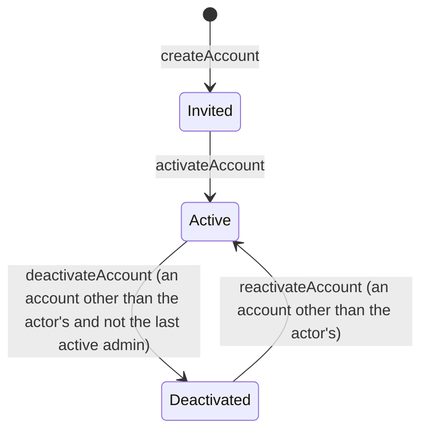

# Accounts and sessions

A team leader invites a person. The invitation links to a one-use activation page. Once active, the person signs in and manages their profile, sessions and password on Min side. A leader can also edit a person's profile in their department. Registration and both edit paths use the same profile fields.

An administrator can deactivate or reactivate another person's account. The last active administrator cannot be deactivated. Ending a membership does not deactivate the account.

A reset request gives the same answer for every address. Only an active account's private address receives a reset link. A code is a request-scoped credential for its one command and person, not a login session. All login sessions require an active account.

## Who does what

<!-- docgen:begin who -->

| You are | You can | Scope |
| --- | --- | --- |
| A team leader in the department | Invite a person to activate an account. Update a person's profile. | department |
| The person the record belongs to | Update a person's profile. | own |
| The holder of the activation code | Activate an invited account with its single-use code. | own |
| The holder of the resetPassword code | Reset an active account's password with its single-use code. | own |
| Anyone, also without signing in | Request a password reset without revealing whether an account exists. | all |
| An admin | Invite a person to activate an account. Request a password reset without revealing whether an account exists. Deactivate an account without changing the person. Reactivate a deactivated account. Update a person's profile. | all |

<!-- docgen:end who -->

## Account machine

<!-- docgen:begin account -->

<!-- docgen:end account -->

## Commands

<!-- docgen:begin commands -->

| Command or read | Resource | Method | What it does | Granted to | Scope | Replaces |
| --- | --- | --- | --- | --- | --- | --- |
| `createAccount` | Account | `create` | Invite a person to activate an account. | Leader(d); Admin | department, all | RULE-207, RULE-323 |
| `activateAccount` | Account | `:activate` | Activate an invited account with its single-use code. | Holder(activation) | own | RULE-131, RULE-201 |
| `requestPasswordReset` | Account | `:requestPasswordReset` | Request a password reset without revealing whether an account exists. | Anyone; Admin | all | RULE-112 |
| `resetPassword` | Account | `:resetPassword` | Reset an active account's password with its single-use code. | Holder(resetPassword) | own | RULE-126, RULE-166 |
| `deactivateAccount` | Account | `:deactivate` | Deactivate an account without changing the person. Never one's own account and never the last active admin. | Admin | all | RULE-202, RULE-299 |
| `reactivateAccount` | Account | `:reactivate` | Reactivate a deactivated account. Never one's own account. | Admin | all | RULE-202, RULE-299 |
| `updatePerson` | Person | `update` | Update a person's profile. | Leader(d); Self; Admin | department, own, all | RULE-143 |

<!-- docgen:end commands -->

## Codes

<!-- docgen:begin code-policy -->

| Purpose       | Command             | Hours | Account | Single use |
| ------------- | ------------------- | ----- | ------- | ---------- |
| activation    | activateAccount     | 336   | Invited | yes        |
| alumniConsent | answerAlumniConsent | 1440  | none    | no         |
| resetPassword | resetPassword       | 24    | Active  | yes        |

<!-- docgen:end code-policy -->

Delivery mints a new random code and stores only its SHA-256 hash. A retry replaces the previous code. The plaintext stays in memory and in the delivered email. The non-production mailbox stores that email for tests. A conditional update gives one winner. The expiry comparison uses the whole stored instant.

A single-use code ends with its first use. A code that is not single use (the alumni consent code) is checked and never consumed, so the person can answer again until it expires. It opens one command, and only for the person it names. A purpose that needs no account (the alumni consent code) works for a person who has none.

## Sessions

Better Auth owns its four authentication tables inside the web Worker. The domain owns account state and grants. Authentication writes are outside domain command transactions. Passwords use bcrypt at cost 12 and accept legacy PHP `$2y$` hashes. Reads do not refresh sessions or retain IP addresses. Last seen is the later of session creation and the latest audited domain command from that session.

A Better Auth operation cannot be cancelled mid-transaction. An aborted sign-in can leave one unseen session. Min side lists that session until it expires.

The marked reference blocks come from `packages/domain`. Run `bun run docs` after changing declarations or code policy. [Spec 0007](../specs/0007-accounts-and-sessions.md) has the complete contract and revisions.
