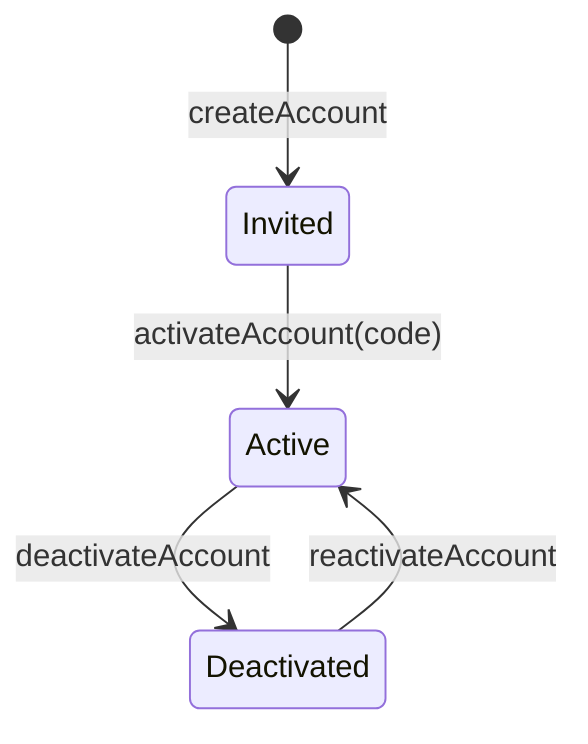

# Administration: accounts, the admin list and personal data

> **Status: accepted** (2026-10-26; see `README.md`). Phase 2 and Phase 5 of the modernization brief.

## What it is for

This domain keeps the system safe and lawful. It gives people accounts, keeps the short list of admins, and makes sure that the system deletes personal data on time.

## Who does what

| You are | You can |
| --- | --- |
| A team leader | Invite a person in the department to make an account. |
| A person | Change their profile. Download all data about themselves. Ask the system to delete their data. Change each consent. |
| An admin | Do every action. Deactivate and reactivate accounts. Add and remove admins. Join two records that belong to the same person. |
| A person who has left | Answer two questions about their data with the link in an e-mail, without signing in. The table of codes in [accounts.md](accounts.md#codes) says how long the link works. |
| The privacy owner (the national board leader; the IT leader as deputy) | Answer requests about personal data within one month. Report a data breach to Datatilsynet within 72 hours. |

## The admin list

- Admins are a short list of named people, usually the IT leader and most team and board leaders.
- Each place on the list ends on a date. By default, it ends with the person's membership.
- Nobody can add or remove themselves.
- The last admin with an Active account and a place that has not ended cannot be removed. A place that a deactivated account holds does not count.
- Four weeks before an admin's place ends, the admins get a reminder.

## Personal data

Vektorprogrammet is responsible for all personal data in the system. The privacy notices in the reference name the organisation.

### What is kept, and for how long

<!-- docgen:begin retention -->

| Data | Kept for | At the end |
| --- | --- | --- |
| A test mailbox that the non-production deployments use instead of sending mail | 30 days after the mail was captured \* | deleted |
| Ask a person who leaves whether their details may be kept for 5 years and whether to send alumni news | 1 year after the person's last engagement or application ends, 5 years while the “keep my details” consent is current | deleted |
| Keep the historical record of who was a member or assistant, where and when (certificates, references) | 10 years after the term ends | deleted |
| Keep the record of who held a place on the admin list | 3 years after the place ends \* | deleted |
| Know who is a member or assistant, where and when, and what each may do | 1 year after the person's last engagement or application ends, 5 years while the “keep my details” consent is current | anonymised |
| Let a person sign in and keep them signed in | 1 year after the person's last engagement or application ends, 5 years while the “keep my details” consent is current | deleted |
| Let a person sign in and keep them signed in | when the session expires | deleted |
| Let a person sign in and keep them signed in | 30 days after the code expires \* | deleted |
| Record what a person agreed to, which text they saw and when (Art. 7(1)) | 1 year after the person's last engagement or application ends, 5 years while the “keep my details” consent is current | deleted |
| Send each team leader one summary of the memberships that are about to end | 1 year after the person's last engagement or application ends, 5 years while the “keep my details” consent is current | deleted |
| Send the e-mail and Slack messages that the system makes | 30 days after the message was queued \* | deleted |
| Show a member's photo, with their consent | 1 year after the person's last engagement or application ends, 5 years while the “keep my details” consent is current | anonymised |
| Show who did what and when, so that the organisation can account for its own use of the data (Art. 5(2) and 24) | 3 years after the row was written \* | deleted |
| Show who published a public file | 1 year after the person's last engagement or application ends, 5 years while the “keep my details” consent is current | anonymised |

<!-- docgen:end retention -->

\* Proposed, awaiting operator approval.

Each night, the system deletes or anonymises the data that has reached the end of its period. The audit row of the run holds one count for each table, and never a value.

These data are in the information model but have no table yet. Each gets its declaration with the slice that builds it: applications that are not accepted and their interviews (6 months after the admission period), interview answers of accepted applicants and special needs (until the placement semester ends), expense claims and receipts (5 years after the end of the year), bank account numbers (until the refund is recorded and exported), and admission alerts (until the person stops them, or 2 years without an opening \*).

### The rights of a person

- **Access and a copy.** A person downloads everything held about them as one JSON file, from Min side. The file holds their rows and nobody else's. Passwords and session keys are not in it. Each download is audited.
- **Consent.** A person answers two questions when they leave, with a link in an e-mail and without signing in: may the organisation keep their details for the longer period, and may it send alumni news. They can change each answer later on Min side, or with the same link while it works.
- **Erasure.** A person, or an admin for them, can erase a person's data. The system anonymises the name, the e-mail addresses and the other core fields. It deletes the account, the sessions, the consents and the subscriptions. It keeps the history rows, such as memberships, which then name nobody. It stops, with the reason, when a legal hold applies or when it would remove the last admin with an Active account. Running it twice changes nothing. No source of legal holds exists yet. Expense claims add the first one (spec 0012).
- **Joining two records.** An admin joins two records of one person. Every row of the second record moves to the first, and the second stays as a tombstone with no name or address. The join stops, and nothing changes, when both records have an account, or when it would give one person two memberships in one team that overlap.

Every service that keeps data for the system runs on an account that the organisation owns, with a data processing agreement. This is a condition before the system goes live.

---

## Reference

> The retention schedule, the record of processing, the privacy notices, the consent texts and the personal data commands are **generated** from the declarations (`bun run docs`). The rest is hand-written from `INFORMATION_MODEL.md` §9.3, §10.3 F, §11.2–§11.4, §11.7, §11.9. Do not add facts that are not in those sources.

### Entities

| Entity | Key fields | Invariants |
| --- | --- | --- |
| Account | `person`, auth data (Better Auth, Phase 2) |  |
| AdminGrant | `person`, `grantedBy`, `until` | `grantedBy ≠ person`; at least one grant valid after the current semester |
| ActivationCode / ResetCode | hashed, expiring, single use | RULE-131 ✗, 220 ✗ |
| Consent | `person`, `kind` (`keepDetails`, `news`, `photo`), `textVersion`, `givenAt`, `withdrawnAt` | One record for each person and kind. A record names the current version of the text. |
| AlumniRequest | `person`, `engagementEnd` | One for each person and each end of an engagement, so the e-mail is sent once. |

### State machine: Account

Every login path refuses a Deactivated account (RULE-125, 104 ✗). Leaving Vektorprogrammet does not deactivate an account; access ends because the engagements end.

### Commands and grants

| Command | Granted to | Scope | Replaces |
| --- | --- | --- | --- |
| `createAccount(person)` | `Leader(d)` | department | 323, 207 |
| `activateAccount(code)`, `resetPassword(code)` | holder of the code | — | 132 ✗, 220 ✗, 131 ✗, 201, 112 ✗ |
| `deactivateAccount`, `reactivateAccount` | `Admin` | all, never oneself | 202 ✗, 299 ✗, 117 |
| `updatePerson` | `Self ∪ Leader(d)` | own / department | 143 |
| `createAdminGrant`, `deleteAdminGrant` | See the [teams command table](teams.md#commands-and-grants) |  |  |
| `ensureSemesters` | the scheduled job | — | 237, 144 |

`Admin` holds every command with scope `all`, as one grant row. No check has an admin bypass inside it.

The commands of the personal data rights (consent, photo, export, erasure, merge, and the two jobs) are in the generated table under "Personal data commands".

### Personal data declaration (single source)

`packages/domain` declares every stored table once: `personalData/catalog.ts` gathers one `personalData.ts` of each domain. For each column, the declaration says what it holds about a person (purpose, legal basis, how long it is kept, and what happens at the end), or why it holds nothing about a person. A table also says how to find a person's rows, whether they are exported, how they are erased and how two records are merged.

These are generated from the declaration, or run from it:

1. the record of processing activities (GDPR Art. 30), below
2. the privacy notice of each form that collects personal data, below and on the form's page
3. the nightly retention job, which writes counts (never values) to the audit log
4. the export of a person's data, the erasure and the merge of two records

Two tests close the declaration. The first fails if a column of the migrated database has no declaration, or a declaration names a column that does not exist. The second fails if a foreign key to the person has no merge rule.

#### Record of processing

<!-- docgen:begin record -->

| Purpose | Legal basis | Data | Kept for | At the end | Approval |
| --- | --- | --- | --- | --- | --- |
| A test mailbox that the non-production deployments use instead of sending mail | Legitimate interest of the organisation (Art. 6(1)(f)) | `captured_mail`: recipient, sent_at, subject, text | 30 days after the mail was captured | deleted | period and legal basis: proposed, awaiting operator approval |
| Ask a person who leaves whether their details may be kept for 5 years and whether to send alumni news | Legitimate interest of the organisation (Art. 6(1)(f)) | `alumni_request`: engagement_end, person_id, requested_at | 1 year after the person's last engagement or application ends, 5 years while the “keep my details” consent is current | deleted | legal basis: proposed, awaiting operator approval |
| Keep the historical record of who was a member or assistant, where and when (certificates, references) | Legitimate interest of the organisation (Art. 6(1)(f)) | `membership`: end_ordinal, end_term, end_year, leader, person_id, position_id, start_ordinal, start_term, start_year, team_id | 10 years after the term ends | deleted | legal basis: proposed, awaiting operator approval |
| Keep the record of who held a place on the admin list | Legitimate interest of the organisation (Art. 6(1)(f)) | `admin_grant`: granted_by, person_id, until | 3 years after the place ends | deleted | period and legal basis: proposed, awaiting operator approval |
| Know who is a member or assistant, where and when, and what each may do | Agreement with the person (taking part as a member or assistant) (Art. 6(1)(b)) | `person`: company_email, email, email_verified, name | 1 year after the person's last engagement or application ends, 5 years while the “keep my details” consent is current | anonymised | legal basis: proposed, awaiting operator approval |
| Let a person sign in and keep them signed in | Agreement with the person (taking part as a member or assistant) (Art. 6(1)(b)) | `account`: person_id, state `auth_account`: access_token, access_token_expires_at, account_id, created_at, credential_version, id_token, password, provider_id, refresh_token, refresh_token_expires_at, scope, updated_at, user_id `auth_user`: created_at, email, email_verified, image, name, person_id, updated_at | 1 year after the person's last engagement or application ends, 5 years while the “keep my details” consent is current | deleted | legal basis: proposed, awaiting operator approval |
| Let a person sign in and keep them signed in | Agreement with the person (taking part as a member or assistant) (Art. 6(1)(b)) | `auth_session`: created_at, expires_at, ip_address, token, updated_at, user_agent, user_id `auth_verification`: created_at, expires_at, identifier, updated_at, value | when the session expires | deleted | legal basis: proposed, awaiting operator approval |
| Let a person sign in and keep them signed in | Agreement with the person (taking part as a member or assistant) (Art. 6(1)(b)) | `code`: expires_at, hash, purpose, subject, used_at | 30 days after the code expires | deleted | period and legal basis: proposed, awaiting operator approval |
| Record what a person agreed to, which text they saw and when (Art. 7(1)) | Legal obligation (Art. 6(1)(c)) | `consent`: decided_at, given_at, kind, person_id, text_version, withdrawn_at | 1 year after the person's last engagement or application ends, 5 years while the “keep my details” consent is current | deleted | legal basis: proposed, awaiting operator approval |
| Send each team leader one summary of the memberships that are about to end | Legitimate interest of the organisation (Art. 6(1)(f)) | `ending_soon_digest`: person_id, recorded_at, term, year | 1 year after the person's last engagement or application ends, 5 years while the “keep my details” consent is current | deleted | legal basis: proposed, awaiting operator approval |
| Send the e-mail and Slack messages that the system makes | Legitimate interest of the organisation (Art. 6(1)(f)) | `outbox`: last_error, payload | 30 days after the message was queued | deleted | period and legal basis: proposed, awaiting operator approval |
| Show a member's photo, with their consent | Consent (Art. 6(1)(a)) | `person`: photo_key | 1 year after the person's last engagement or application ends, 5 years while the “keep my details” consent is current | anonymised | legal basis: proposed, awaiting operator approval |
| Show who did what and when, so that the organisation can account for its own use of the data (Art. 5(2) and 24) | Legitimate interest of the organisation (Art. 6(1)(f)) | `audit_log`: action, at, client, entity, entity_key, person_id, session_id | 3 years after the row was written | deleted | period and legal basis: proposed, awaiting operator approval |
| Show who published a public file | Legitimate interest of the organisation (Art. 6(1)(f)) | `public_file`: uploaded_by | 1 year after the person's last engagement or application ends, 5 years while the “keep my details” consent is current | anonymised | legal basis: proposed, awaiting operator approval |

<!-- docgen:end record -->

#### Privacy notices

<!-- docgen:begin notices -->

#### Contact form

_proposed, awaiting operator approval._

Vektorprogrammet (organisation number 998744814) is the controller of the data on this form.

| Field | Why | Legal basis | Who receives it | Kept for |
| --- | --- | --- | --- | --- |
| Your e-mail address | Answer a question sent through the contact form | Legitimate interest of the organisation (Art. 6(1)(f)) | The department you write to (its mailbox and Slack channel) and the organisation's notification channel. Each keeps its own copy of the message until someone deletes it there; the time under “Kept for” applies to the copy in this system only | 30 days after the message was queued |
| Your message | Answer a question sent through the contact form | Legitimate interest of the organisation (Art. 6(1)(f)) | The department you write to (its mailbox and Slack channel) and the organisation's notification channel. Each keeps its own copy of the message until someone deletes it there; the time under “Kept for” applies to the copy in this system only | 30 days after the message was queued |
| Your name | Answer a question sent through the contact form | Legitimate interest of the organisation (Art. 6(1)(f)) | The department you write to (its mailbox and Slack channel) and the organisation's notification channel. Each keeps its own copy of the message until someone deletes it there; the time under “Kept for” applies to the copy in this system only | 30 days after the message was queued |
| The subject | Answer a question sent through the contact form | Legitimate interest of the organisation (Art. 6(1)(f)) | The department you write to (its mailbox and Slack channel) and the organisation's notification channel. Each keeps its own copy of the message until someone deletes it there; the time under “Kept for” applies to the copy in this system only | 30 days after the message was queued |

You can ask to see, correct or delete your data, to receive it in a file, and to withdraw a consent. You can complain to Datatilsynet. Contact us to use your rights.

<!-- docgen:end notices -->

#### Consents

A consent record names the version of the text that the person saw, when they gave it and when they withdrew it. It can name only the current version. A "no" is a record too: the person was asked, saw this text, at this time.

<!-- docgen:begin consents -->

| Consent | Version | What the person sees | In English | Approval |
| --- | --- | --- | --- | --- |
| keep my details | 1 | Ja, Vektorprogrammet kan beholde kontaktopplysningene mine i 5 år etter at jeg har sluttet, i stedet for 1 år. Jeg kan trekke samtykket når som helst. | Yes, Vektorprogrammet may keep my details for 5 years after I leave, instead of 1 year. I can withdraw this at any time. | proposed, awaiting operator approval |
| alumni news | 1 | Ja, send meg nyheter for tidligere medlemmer og assistenter. Jeg kan trekke samtykket når som helst. | Yes, send me news for former members and assistants. I can withdraw this at any time. | proposed, awaiting operator approval |
| photo | 1 | Ja, Vektorprogrammet kan lagre og vise bildet mitt for å presentere meg i teamet mitt. Jeg kan trekke samtykket når som helst, og bildet fjernes da. | Yes, Vektorprogrammet may store and show my photo to present me in my team. I can withdraw this at any time, and the photo is then removed. | proposed, awaiting operator approval |

<!-- docgen:end consents -->

### Personal data commands

<!-- docgen:begin personal-data-commands -->

| Command or read | Resource | Method | What it does | Granted to | Scope | Replaces |
| --- | --- | --- | --- | --- | --- | --- |
| `setPhoto` | Person | `:set` | Set a person's photo under their consent, or remove it. A photo is stored only under a current photo consent; withdrawing the consent removes it. | Self; Leader(d); Admin | own, department, all | RULE-142, RULE-143, RULE-160 |
| `setAlumniConsent` | Consent | `:set` | Answer the alumni questions on Min side: keep my details for 5 years, and send me alumni news. Only the person themself can answer: an administrator's grant does not reach this command, and the handler refuses it, because a consent is the person's own statement. | Self; Admin | own, all |  |
| `answerAlumniConsent` | Consent | `:answer` | Answer the alumni questions with the code from the e-mail. The code lives 60 days and can be used again, so an answer can be corrected; it never opens another command. | Holder(alumniConsent) | own |  |
| `exportMyData` | Person | `:export` | Download everything held about a person as JSON (GDPR Art. 15, 20). Audited. It changes no data. Only the person themself can download it: an administrator's grant does not reach this command, and the handler refuses it. | Self; Admin | own, all |  |
| `erasePerson` | Person | `:erase` | Anonymise a person's core fields and delete their account, sessions, consents and subscriptions. The history rows stay (GDPR Art. 17). Refused, with the reason, while a legal hold applies and when it would remove the last Active admin. A second call changes nothing. | Self; Admin | own, all | RULE-117 |
| `mergePersons` | Person | `:merge` | Merge two records of one person: every row of the second follows the first, and the second becomes a tombstone without personal data. Refused with a typed conflict, and nothing changes, when both records have an account or when two memberships in one team would overlap. | Admin | all |  |
| `runRetention` | Retention | `:run` | Each night, delete or anonymise what has reached the end of its declared period. The audit row holds integer counts per table, never a value. | System(retention) | all |  |
| `sendAlumniConsent` | Consent | `:send` | When a person's last engagement ends, e-mail them the two alumni questions once. One request per person and engagement end. | System(alumniConsent) | all |  |

<!-- docgen:end personal-data-commands -->

### Scheduled jobs

| Job | Does |
| --- | --- |
| Semesters | Keeps the current and the next semester present |
| Outbox sweep | Delivers e-mails that the request could not send |
| Ending soon | Four weeks before semester end: memberships. Admin-grant reminders are a later slice. |
| Alumni consent | When a person's last engagement ends, e-mails them two questions about their data, once for each end. It runs on the same cron as the sweep, every 10 minutes. |
| Retention | Deletes or anonymises data at the end of its retention period. It runs once a night, on a cron of its own. |

### Processors

| Service | Holds | Location |
| --- | --- | --- |
| Neon PostgreSQL | All system data | `aws-eu-central-1` |
| Cloudflare (Workers, R2, Email) | Requests, files, outgoing e-mail | R2 with EU jurisdiction |
| Google Workspace | Team groups and company accounts (projection) | Organisation's Workspace |

Each service needs an organisation-owned account and an accepted data processing agreement before go-live.
