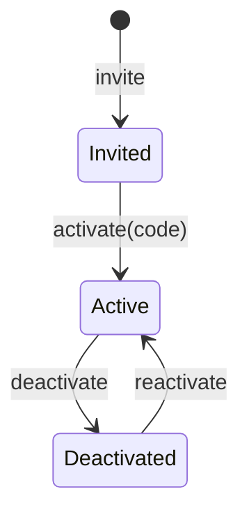

# Administration: accounts, the admin list and personal data

> **Status: proposed** (see `README.md`). Phase 2 and Phase 5 of the modernization brief.

## What it is for

This domain keeps the system safe and lawful. It gives people accounts, keeps the short list of admins, and makes sure that the system deletes personal data on time.

## Who does what

| You are | You can |
| --- | --- |
| A team leader | Invite a person in the department to make an account. |
| A person | Change their profile. Download all data about themselves. Ask the system to delete their data. Change each consent. |
| An admin | Do every action. Deactivate and reactivate accounts. Add and remove admins. Join two records that belong to the same person. |
| The privacy owner (the national board leader; the IT leader as deputy) | Answer requests about personal data within one month. Report a data breach to Datatilsynet within 72 hours. |

## The admin list

- Admins are a short list of named people, usually the IT leader and most team and board leaders.
- Each place on the list ends on a date. By default, it ends with the person's membership.
- Nobody can add or remove themselves.
- The last admin with a place that has not ended cannot be removed.
- Four weeks before an admin's place ends, the admins get a reminder.

## Personal data

Vektorprogrammet (organisation number 998744814) is responsible for all personal data in the system.

| Data | Kept for |
| --- | --- |
| Applications that are not accepted, and their interviews | 6 months after the admission period |
| Interview answers of accepted applicants | Until the placement semester ends |
| Special needs | Until the placement semester ends |
| Contact details of a person without an engagement | 1 year, or 5 years if the person agreed when they left |
| Who was an assistant or a member, where and when | 10 years |
| Expense claims and receipts | 5 years after the end of the year |
| Bank account numbers | Until the refund is recorded and exported |
| Admission alerts | Until the person stops them, or 2 years without an opening \* |
| Audit log | 3 years, without the changed values \* |
| Sent e-mails in the outbox | 30 days \* |

\* Proposed, not yet decided by the operator.

Each night, the system deletes or anonymises the data that has reached the end of its period.

Every service that keeps data for the system runs on an account that the organisation owns, with a data processing agreement. This is a condition before the system goes live.

---

## Reference

> **Hand-written** from `INFORMATION_MODEL.md` §9.3, §10.3 F, §11.2–§11.4, §11.7, §11.9. Generated later. Do not add facts that are not in those sources.

### Entities

| Entity | Key fields | Invariants |
| --- | --- | --- |
| Account | `person`, auth data (Better Auth, Phase 2) |  |
| AdminGrant | `person`, `grantedBy`, `until` | `grantedBy ≠ person`; at least one grant valid after the current semester |
| ActivationCode / ResetCode | hashed, expiring, single use | RULE-131 ✗, 220 ✗ |

### State machine: Account



Every login path refuses a Deactivated account (RULE-125, 104 ✗). Leaving Vektorprogrammet does not deactivate an account; access ends because the engagements end.

### Commands and grants

| Command | Granted to | Scope | Replaces |
| --- | --- | --- | --- |
| `invite(person)` | `Leader(d)` | department | 323, 207 |
| `activate(code)`, `resetPassword(code)` | holder of the code | — | 132 ✗, 220 ✗, 131 ✗, 201, 112 ✗ |
| `deactivate`, `reactivate` | `Admin` | all, never oneself | 202 ✗, 299 ✗, 117 |
| `updateProfile`, `setPhoto` | `Self ∪ Leader(d)` | own / department | 143, 160, 142 |
| `grantAdmin(person, until)`, `revokeAdmin` | `Admin` | all, never oneself, never the last valid grant | 113 ✗, 308 |
| `mergePersons(a, b)` | `Admin` | all | new |
| `exportMyData` | `Self` | own | new (GDPR Art. 15, 20) |
| `eraseMe` / `erasePerson` | `Self` / `Admin` | own / all | new (Art. 17). Refuses, with the reason, while a legal hold applies (an open claim, accounting retention) |
| `ensureSemesters` | the scheduled job | — | 237, 144 |

`Admin` holds every command with scope `all`, as one grant row. No check has an admin bypass inside it.

### Personal data declaration (single source)

Each personal field declares its purpose, legal basis and retention once in `packages/domain`:

```
Entity.field → { purpose, legalBasis, retention: { trigger, duration }, onExpiry: delete | anonymise }
```

These outputs are generated from the declaration:

1. the record of processing activities (GDPR Art. 30)
2. the privacy notice on the application, contact and alert forms
3. the nightly retention job, which writes counts (never values) to the audit log

A test fails if a personal column has no declaration.

### Scheduled jobs

| Job | Does |
| --- | --- |
| Semesters | Keeps the current and the next semester present |
| Outbox sweep | Delivers e-mails that the request could not send |
| Ending soon | Four weeks before semester end: memberships and admin grants that end |
| Retention | Deletes or anonymises data at the end of its retention period |

### Processors

| Service | Holds | Location |
| --- | --- | --- |
| Neon PostgreSQL | All system data | `aws-eu-central-1` |
| Cloudflare (Workers, R2, Email) | Requests, files, outgoing e-mail | R2 with EU jurisdiction |
| Google Workspace | Team groups and company accounts (projection) | Organisation's Workspace |

Each service needs an organisation-owned account and an accepted data processing agreement before go-live.
