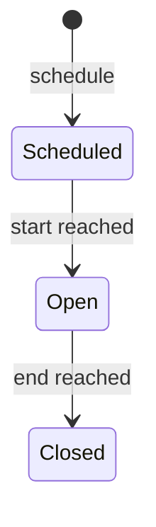
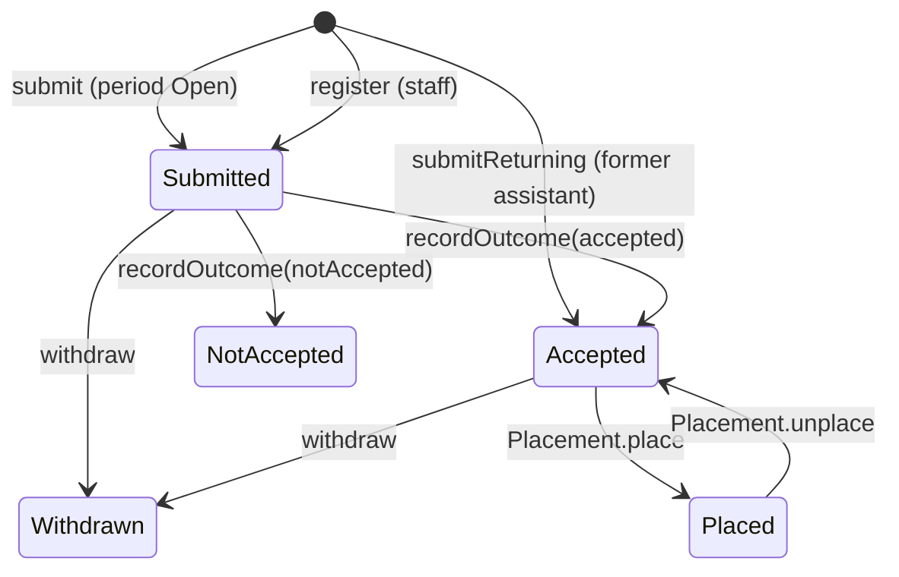

# Admission: admission periods, applications and admission alerts

> **Status: accepted** (2026-10-26; see `README.md`). Phase 3 of the modernization brief.

## What it is for

Each semester, each department looks for new assistants. The department opens an admission period. In that period, students apply on the website. People who are interested before the period opens can ask for an e-mail when it opens.

## Who does what

| You are | You can |
| --- | --- |
| Anyone | Apply while a period is open. Ask for an admission alert. Stop admission alerts with the link in any alert e-mail. |
| A former assistant | Apply again, any number of semesters later. A returning assistant does not need a new interview. |
| The applicant | Withdraw the application. |
| The department's recruitment team, or a team leader | Plan the admission period. Register an applicant at a stand, any time in a semester that has an admission period. Read the department's applications. |
| A team leader | Withdraw an application for the applicant. |

## Over a semester

1. Before the semester, the recruitment team plans the period with a start date and an end date.
2. On the start date, the period opens by itself. The system sends an admission alert to each person who asked for one.
3. Students apply. The form asks if the person also wants admission alerts later. The box is not ticked by default.
4. Each applicant gets a confirmation e-mail.
5. On the end date, the period closes by itself. Interviews follow (`recruitment.md`).

## Personal data

- If a person is not accepted, or withdraws, the system deletes the application 6 months after the period ends.
- The special-needs field is optional. The applicant gives a separate consent for it. The system deletes it when the semester of the placement ends.
- Gender is optional. The system uses it only in totals.
- An admission alert needs consent. A person can stop the alerts with one click.

---

## Reference

> **Hand-written** from `INFORMATION_MODEL.md` §9.3, §10.3 A, §11.3, §11.7, §11.9. Generated later. Do not add facts that are not in those sources.

### Entities

| Entity | Key fields | Invariants |
| --- | --- | --- |
| AdmissionPeriod | `department`, `semester`, `start`, `end` | One per department and semester; `start < end` (RULE-103 ✗) |
| Application | `person`, `period`, `yearOfStudy` (1–5), `fieldOfStudy`, `availableWeekdays`, `teamInterest`, `heardAboutUs`, `specialNeeds?` (with consent), `outcome?`, `score?` (derived, see `recruitment.md`) | One per e-mail per period (RULE-129, 134); `fieldOfStudy` belongs to the department (RULE-165); year of study 1–5 (RULE-162); team interest names active teams (RULE-159) |
| AdmissionSubscription | `email`, `department`, consent record | Unique per e-mail and department (RULE-171) |

### State machine: AdmissionPeriod (calculated from time, not stored)

`isOpen(period, now)` uses the half-open window `[start, end)`. This one function replaces RULE-015 ✗, 042, 059, 068, 095, 118 ✗, 119 ✗ and 123 ✗. In the legacy system, three of these rules did not agree with each other.

### State machine: Application

The status that the applicant sees is the state itself (replaces RULE-216 ✗, 256).

### Commands and grants

| Command | From → to | Granted to | Scope | Replaces |
| --- | --- | --- | --- | --- |
| `AdmissionPeriod.schedule`, `revise` | — → Scheduled | `Leader(d) ∪ Fn(recruitment, d)` | department | 137 |
| `AdmissionPeriod.cancel` | Scheduled → removed, only without applications | same | department | 222 |
| `Application.submit` | — → Submitted, only while Open | `Anyone` (Turnstile, rate limit) | — | 105, 129, 138 |
| `Application.register` | — → Submitted | `Leader(d) ∪ Fn(recruitment, d)` | department | 221, U153 |
| `Application.submitReturning` | — → Accepted, only with an earlier Placement (any gap) | `Self` | own | 128, 193, 215 ✗, 012 ✗, 021 ✗, 155 |
| `Application.withdraw` | Submitted \| Accepted → Withdrawn | `Self ∪ Leader(d)` | own / department | 283, 286 ✗ |
| `Application.markSubstitute` | flag, only in Accepted | `Leader(d) ∪ Fn(recruitment, d)` | department | 145, 227 |
| read applications | — | `Member(d)` | department | 287, 309 |
| `AdmissionSubscription.subscribe` | — → Subscribed | `Anyone` | — | 171 |
| `AdmissionSubscription.unsubscribe(code)` | Subscribed → Unsubscribed | holder of the code | — | 181 |

### Reactions

| Event | Effect | Replaces |
| --- | --- | --- |
| AdmissionPeriod becomes Open | Admission alert to each subscription of the department | 254 |
| Application Submitted | Confirmation e-mail; a subscription only if the consent box is ticked | 240, 271, 272 |
| Application Submitted with a known e-mail | Link to the existing Person only after the e-mail is verified | 306 ✗ |

### Personal data

| Field | Purpose | Legal basis | Retention |
| --- | --- | --- | --- |
| Application (not accepted or withdrawn) | Assess the application | Art. 6(1)(b) | 6 months after the period ends |
| `specialNeeds` | Adjustments | Art. 9(2)(a), separate explicit consent | End of the placement semester |
| `heardAboutUs` | Marketing totals | Art. 6(1)(f) | With the application |
| AdmissionSubscription | Admission alerts | Art. 6(1)(a), withdrawable | Until unsubscribe, or 2 years without an opening (proposed, not yet decided) |
