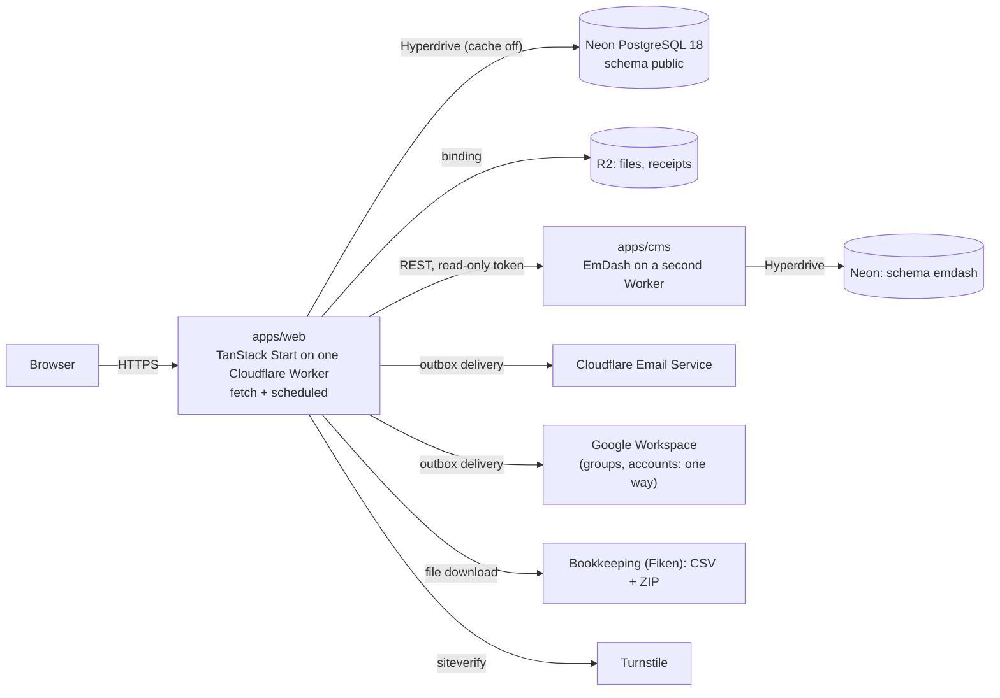
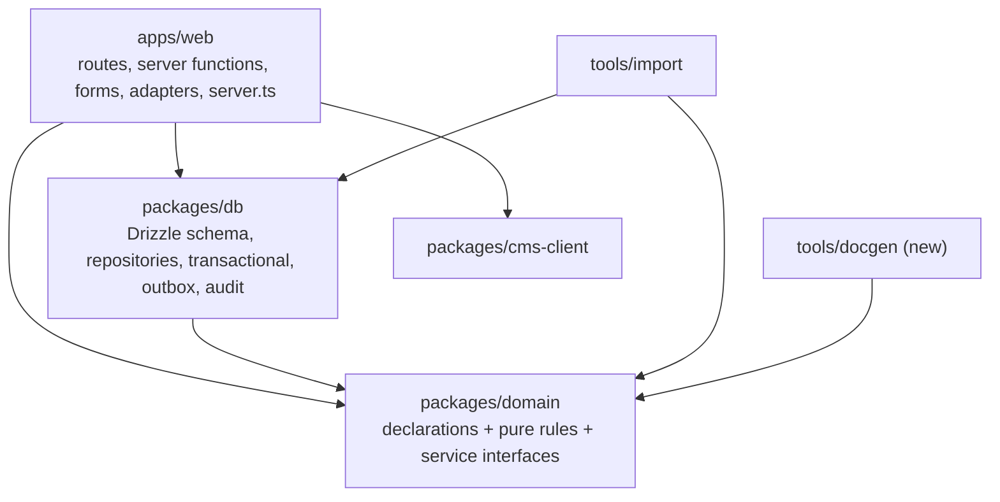

# Architecture and technology

> **Status: proposed** (see `README.md`). The technology that already runs is pinned in the root `package.json` `catalog`; this page names the parts and where each fact lives, and does not repeat version numbers except where a decision depends on them.

## In plain words

The system is one website with one database. Each domain (`admission.md`, `economy.md` and the others) declares its things, its actions, who may do them and in which state. The website, the checks, the documentation and the tests all read those declarations. A change to a rule is made in one place, and every part that depends on it follows.

## Deployment



Infrastructure is declared in `apps/web/alchemy.run.ts` (Alchemy v2), the single infrastructure root. Local development runs PostgreSQL and MySQL (the legacy import source) through devenv.

## Technology

| Layer | Choice | Status |
| --- | --- | --- |
| Runtime and hosting | Cloudflare Workers (`enable_request_signal` required), Neon PostgreSQL through Hyperdrive with query caching off, R2 | Running (spec 0000) |
| Language and tooling | TypeScript 7, Bun, Vite+ (Vitest, Oxlint, Oxfmt), `@effect/tsgo` diagnostics, devenv | Running |
| Application | TanStack Start + React; shadcn/ui on Base UI (`base-nova`) | Running |
| Domain and server | Effect v4: Schema, Effect, `effect/rpc` for command declarations | Effect running; `effect/rpc` new (ADR 0006) |
| Data access | Drizzle `effect-postgres` on `@effect/sql-pg`; Drizzle schema is the table source, `drizzle-kit` the migrations | Running |
| Forms | TanStack Form (`@tanstack/react-form-start`), validated through Standard Schema from Effect Schema | New (ADR 0003) |
| State machines | House transition tables in `packages/domain` | New (ADR 0007) |
| Permissions | House grant table + `authorize` | New table; `authorize` exists (ADR 0001) |
| Authentication | Better Auth (library), its own `pg` client for the auth tables only | Phase 2 (accepted brief revision) |
| Content | EmDash 1.3 headless CMS | Running (spec 0005) |
| Background work | Postgres outbox delivered by `waitUntil` and a cron sweep; cron jobs for semesters, "ending soon", retention | Outbox and semester job running; the rest new |
| E-mail, spam protection | Cloudflare Email Service (production only; capture sink elsewhere), Turnstile | Running |
| Tests | `@effect/vitest`, PGlite and real PostgreSQL, Schema arbitraries for property tests, Playwright | Running; property tests new |
| Documentation | `docs/system/` with Reference sections generated from `packages/domain` (`check:docs`) | New |

**Not used, and why:** XState and the Effect machine libraries (actor model, pre-1.0; ADR 0007), Effect Cluster and Workflow (need a long-running runner), `effect/eventlog` (built for local-first sync), event sourcing (the audit table answers "who changed what"), Cedar or OpenFGA (a service for a table of about 40 rows), SurveyJS (per-developer licence; ADR 0003). effx is a candidate generator for later, when hand-written declarations multiply.

## Packages and their dependencies



`packages/domain` imports nothing from `db` or `web` (lint rule). It runs in the Worker, in the browser (for form validation) and in tools.

## Inside `packages/domain`, per domain

| Declaration | Construct | Read by |
| --- | --- | --- |
| Entities and value types | Effect Schema; branded ids; personal-data annotations on fields | `db` (via Drizzle-generated schemas), forms, retention job, privacy notice, docs |
| States and events | `Schema.TaggedUnion` | machines, handlers, audit |
| Machine | Transition table: `{ command: { from: [...], to, guard? } }` | runtime guard, UI (which buttons show), docs diagram, property tests |
| Commands | `Rpc.make(name, { payload, success, error })` in one `RpcGroup` per domain, annotated with its machine transition | server functions (in-process client), handlers (`RpcGroup.toLayer`), grant completeness test, docs |
| Grants | `(subject set, commands, scope)` rows | `authorize`, UI, the "who does what" tables, property tests |
| Reactions | `event → effect` rows | outbox writers, docs |
| Pure rules | Plain functions: `isOpen`, `answersSchema`, `score`, `proposePlacements`, semester calendar | handlers, browser, tests |
| Ports | Service interfaces: repositories, `Mail`, `Files`, `BookkeepingExport`, `WorkspaceDirectory` | implemented in `db` and `apps/web` |

## One command, end to end

```mermaid
sequenceDiagram
  participant B as Browser (TanStack Form)
  participant F as Server function
  participant C as Command handler (RpcGroup)
  participant P as PostgreSQL
  B->>B: validate with Schema.toStandardSchemaV1(input schema)
  B->>F: POST (FormData or JSON)
  F->>F: decode with the same schema
  F->>C: in-process client: Command(payload) + current actor
  C->>P: BEGIN
  C->>C: authorize(actor, command, record) from the grant table
  C->>P: UPDATE … SET state = to WHERE id = $1 AND state = from
  C->>P: domain rows, audit row, outbox rows
  C->>P: COMMIT
  F-->>B: outcome; route data reloads
  F->>F: waitUntil(deliver outbox rows)
```

A refused grant, an illegal transition (zero rows updated), or invalid data each end in a typed domain error, mapped once to a response. No provider call (e-mail, Google, files) runs inside the transaction.

## Derived artefacts and the checks that keep them true

| Artefact | Derived from | Check |
| --- | --- | --- |
| `authorize` behaviour | Grant table | Property test against the table, with a negative control |
| Grant ↔ command ↔ machine completeness | All three tables | Test: every command has a grant; every transition names a command |
| Reference sections, diagrams, "who does what" | Declarations | `check:docs` fails on a difference |
| Privacy notice, record of processing, retention job | Personal-data annotations | Test: every personal column is declared |
| Form validators | `answersSchema` / input schemas | One schema on client and server (ADR 0003) |
| Read-only queries | Query registry | Existing SELECT-only role test |
