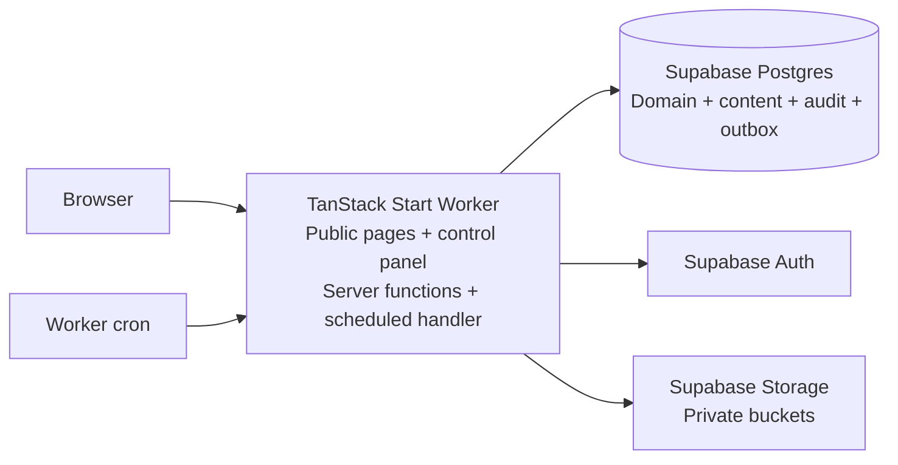

# Architecture and technology

The runnable prototype is specified in [0024](../specs/0024-supabase-prototype.md): one TanStack Start application on Cloudflare Workers and one Supabase project. Historical infrastructure decisions are superseded for this prototype, not evidence of a production cutover.

## Responsibilities

| Component | Responsibility |
| --- | --- |
| `apps/web` | React routes/forms, server functions, request composition, Auth/Storage adapters, scheduled delivery |
| `packages/domain` | Application-specific schemas, permissions, account/membership transitions, invariants, audit/outbox contracts and privacy rules |
| `packages/db` | Drizzle schema/migrations, Postgres transactions and repositories, content persistence, locking and lease-fenced delivery |
| `packages/cms-client` | Shared content models and in-process content service contracts; no CMS HTTP service |
| `tools/prototype` | Guarded local setup and synthetic provider identities/buckets; not deployed |
| `tools/import` | Separate legacy import tooling; MySQL is a migration/test dependency, not an application runtime dependency |
| `infra/terraform` | Selected existing Supabase settings and the single hosted Worker, its assets, bindings and cron triggers |

## Data and authority

The browser does not write domain tables through the Supabase Data API. Start server functions invoke domain commands, which authorize against the one grant model and run multi-table writes in a Postgres transaction. Audits and notification intents commit with those changes. Schema constraints and row locks remain responsible for their existing concurrency guarantees; replacing the database host does not replace these rules.

Supabase Auth owns passwords and provider sessions. Trusted app metadata identifies a domain person, but current domain account state and department/team grants determine application access. Native invitation/recovery flows replace the former custom credential system. Password recovery requires a provider one-time token when the password is set; a navigation query parameter or an ordinary existing browser session is not recovery proof. Individual provider sessions are not presented as independently revocable when the supported SDK only supplies sign-out scopes.

Files live in private provider buckets. The existing registry remains authoritative for `/filer/$key`, including MIME/disposition/security headers. Auth and Storage SDK keys with elevated privileges remain on the server. Local development status files and Terraform state can contain secrets and must not be logged or committed.

Content has independent draft and published snapshots. Public reads never expose uncommitted editorial changes. Editing uses the maintained Portable Text editor and the existing schemas/rendering, not another CMS deployment. Editorial content can mention people outside a simple foreign-key ownership model; privacy results disclose manual review instead of inventing automatic expiry or silently omitting that data.

## Background work and provider consistency

Postgres outbox rows are the durable record. Immediate post-commit delivery and a scheduled recovery sweep use the same due-time-aware conditional claim and lease fencing. A lost claim cannot acknowledge a newer owner's work. Ordinary messages have a bounded attempt policy; provider identity cleanup/relink intents retain recoverable state with capped backoff after prolonged outages. Sending remains at least once where the provider does not enforce idempotency.

Provider operations do not participate in the domain SQL transaction. Erasure and merge commit their local changes plus durable provider intent; the UI does not claim provider cleanup completed at that moment. Invitation metadata is linked before an invitation is sent. A short locked recheck after a provider write detects erasure/merge races and records compensating cleanup without holding a SQL transaction open across provider I/O.

The existing approved job registry supplies cron definitions, system principals, period claims and continuation cursors. Retention approval gates remain intact. No Cloudflare Queue or separate worker service is needed.

## Package choices

Start/React supply the application and routing; the Supabase SDK and SSR package own provider requests and session-cookie mechanics; Effect and the existing Drizzle/Postgres adapter express domain behavior and transactions. Existing shadcn/Base UI components and Portable Text rendering/editor provide the UI. The official TanStack Supabase example and Supabase Library were evaluated for integration patterns; unrelated realtime/chat packages and a second authentication or CMS framework were not installed.

Version pins belong in package manifests and the lockfile, not this page. Runtime binding details and startup commands live in [the web README](../../apps/web/README.md) and [the prototype setup guide](../../tools/prototype/README.md).

## Deployment boundary

Terraform reads the actual Vite-generated Worker configuration and modules; it does not maintain a second hand-written cron/compatibility/module list. It manages settings on an explicitly identified existing synthetic-data Supabase project, not implicit project creation/deletion. Database migrations, synthetic local seeding and private bucket creation use their existing commands.

Terraform validation and a local Worker build are not a deployed-platform test. No hosted deployment, production migration, live mail/SMS/Google write or copying of production upload directories is implied. The prototype uses captured application notifications and local Auth SMTP; hosted Auth SMTP safety is independently operator-gated. Full recruitment/interview/placement capability remains governed by its own unfinished modernization phases.
