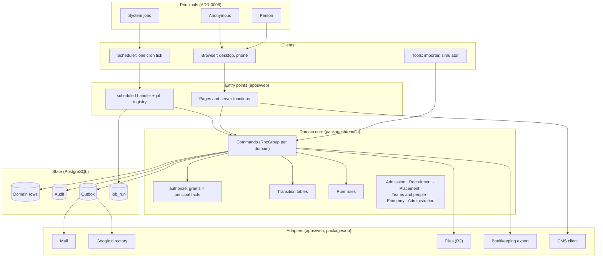
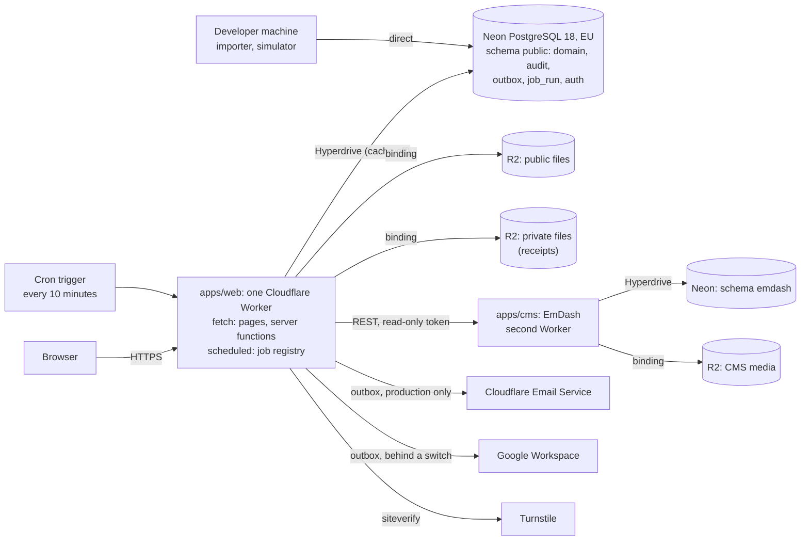
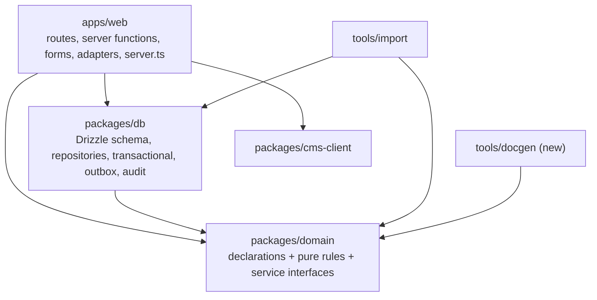

# Architecture and technology

> **Status: accepted** (2026-10-26; see `README.md`). The technology that already runs is pinned in the root `package.json` `catalog`; this page names the parts and where each fact lives, and does not repeat version numbers except where a decision depends on them.

## In plain words

The system is one website with one database. Each domain (`admission.md`, `economy.md` and the others) declares its things, its actions, who may do them and in which state. The website, the checks, the documentation and the tests all read those declarations. A change to a rule is made in one place, and every part that depends on it follows.

## Logical view



- **Every write is a command.** Pages, the scheduler and the tools call the same commands. Each command runs `authorize` for its principal, checks its transition and writes domain rows, an audit row and outbox rows in one transaction.
- **Principals act through clients.** A person through a browser session, a system job through the cron tick, a developer through a tool. A client never has more rights than its principal.
- **Provider calls happen after commit**, from the outbox. The adapters are the only code that talks to e-mail, Google, R2 or the CMS.

## Deployment



| Stage | What runs | Data |
| --- | --- | --- |
| Local (devenv) | `vp dev` for web, `astro dev` for the CMS, PostgreSQL and MySQL in devenv | Fake fixtures; the legacy backup only on the operator's machine |
| Preview (one per pull request) | Worker Previews of web and CMS; no cron | A Neon branch forked from `dev`, fake data |
| Main | Long-lived Workers, cron on | Neon `dev`, fake data |
| Production | Long-lived Workers, cron on, real e-mail | Neon production, EU |

Infrastructure for every stage is declared in `apps/web/alchemy.run.ts` (Alchemy v2), the single infrastructure root. Only production binds the real e-mail sender. Every other stage builds a capture sink.

## Scheduled jobs

Jobs are declared in code (`packages/domain`): name, when the job is due, its System principal and its chunk size. Postgres holds only `job_run`, with one row per job and period, and the work the jobs produce in the outbox. The one cron tick claims each due job with `INSERT … ON CONFLICT DO NOTHING` on `(job, period)`, runs it through `authorize` as its System principal, and stores its outcome and cursor. A job that would exceed one cron run continues from its cursor on the next tick. When a job is due is read from domain rows, for example the start date of an admission period, never from a stored schedule.

| Job | Due when |
| --- | --- |
| Semesters | Each tick; idempotent |
| Outbox sweep | Each tick |
| Admission alerts | An admission period has opened and has no alert run |
| Ending soon | Four weeks before the semester ends; once per semester |
| Alumni consent | A person's last engagement has ended and no consent mail has gone out |
| Retention | Once per night |
| Google directory sync | Once per night, in dry-run until switched on |

## Technology

| Layer | Choice | Status |
| --- | --- | --- |
| Runtime and hosting | Cloudflare Workers (`enable_request_signal` required), Neon PostgreSQL through Hyperdrive with query caching off, R2 | Running (spec 0000) |
| Language and tooling | TypeScript 7, Bun, Vite+ (Vitest, Oxlint, Oxfmt), `@effect/tsgo` diagnostics, devenv | Running |
| Application | TanStack Start + React; shadcn/ui on Base UI (`base-nova`) | Running |
| Domain and server | Effect v4: Schema, Effect, `effect/rpc` for command declarations | Running (spec 0006, ADR 0006) |
| Data access | Drizzle `effect-postgres` on `@effect/sql-pg`; Drizzle schema is the table source, `drizzle-kit` the migrations | Running |
| Forms | TanStack Form (`@tanstack/react-form-start`), validated through Standard Schema from Effect Schema | New (ADR 0003) |
| State machines | Transition tables with serializable Effect Schema guards | Running for Membership (spec 0006, ADR 0007) |
| Permissions | Grant table + `authorize` | Running (spec 0006, ADR 0001) |
| Authentication | Better Auth (library), its own `pg` client for the auth tables only | Phase 2 (accepted brief revision) |
| Content | EmDash 1.3 headless CMS | Running (spec 0005) |
| Background work | Postgres outbox delivered by `waitUntil` and the cron sweep; jobs declared in code, claimed per period in `job_run` (see Scheduled jobs) | Outbox, semester job and leader ending-soon digest running (spec 0006); the registry new (spec 0008); retention and admin reminders later |
| E-mail, spam protection | Cloudflare Email Service (production only; capture sink elsewhere), Turnstile | Running |
| Tests | `@effect/vitest`, PGlite and real PostgreSQL, Schema arbitraries, Playwright | Running |
| Documentation | `docs/system/` with generated reference blocks (`check:docs`) | Running for teams (spec 0006) |

**Not used, and why:**

- **XState and the Effect machine libraries:** actor model, pre-1.0 (ADR 0007).
- **Effect Cluster and Workflow:** they need a long-running runner.
- **`effect/eventlog`:** built for local-first sync.
- **Event sourcing:** the audit table already answers "who changed what".
- **Cedar or OpenFGA:** a separate service for a table of about 40 rows.
- **SurveyJS:** per-developer licence (ADR 0003).
- **Odoo** (evaluated 2026-10-26). Its Recruitment, Surveys, Expenses and Events apps cover the generic parts. Three things rule it out for the core:
  - **Cost:** it bills per user. Since Odoo 20, every active employee record counts as at least a €7.90/month Light User, and a full Standard user is €19.90/month.
  - **Customisation:** Odoo Online does not allow custom Python modules. Placement with school capacity, permissions derived from memberships, and explicit terms would need custom modules on Odoo.sh or a self-hosted server.
  - **Permissions:** Odoo assigns access groups to each user by hand, which conflicts with ADR 0001.

- **Volunteer, staffing and open-source tools** (evaluated 2026-10-26; `../../../../analysis/vektorprogrammet/research/tools-*.md`). None covers capacity per weekday and bolk, access derived from memberships with terms, and scored interviews leading to placement. The operator declined both partial options: Rubic Utlegg for expense claims, and posting admission periods on Frivillig.no.

effx is a candidate generator for later, when hand-written declarations multiply.

## Packages and their dependencies



`packages/domain` imports nothing from `db` or `web` (lint rule). It runs in the Worker, in the browser (for form validation) and in tools.

## Inside `packages/domain`, per domain

| Declaration | Construct | Read by |
| --- | --- | --- |
| Entities and value types | Effect Schema; branded ids; personal-data annotations on fields | `db` (via Drizzle-generated schemas), forms, retention job, privacy notice, docs |
| States and events | `Schema.TaggedUnion` | machines, handlers, audit |
| Machine | Transition table with serializable Schema checks on a typed context | runtime guard, UI, docs diagram, property tests, future model generators |
| Commands | `Rpc.make(name, { payload, success, error })` in one `RpcGroup` per domain, annotated with its machine transition | server functions (in-process client), handlers (`RpcGroup.toLayer`), grant completeness test, docs |
| Grants | `(subject set, commands, scope)` rows | `authorize`, UI, the "who does what" tables, property tests |
| Reactions | `event → effect` rows | outbox writers, docs |
| Jobs | `(name, due when, System principal, chunk size, handler)` | the scheduled handler, docs, the simulator |
| Pure rules | Plain functions: `isOpen`, `answersSchema`, `score`, `proposePlacements`, semester calendar | handlers, browser, tests |
| Ports | Service interfaces: repositories, `Mail`, `Files`, `BookkeepingExport`, `WorkspaceDirectory` | implemented in `db` and `apps/web` |

## One command, end to end

```mermaid
sequenceDiagram
  participant B as Browser (TanStack Form)
  participant F as Server function
  participant C as Command handler (RpcGroup)
  participant P as PostgreSQL
  B->>B: validate with Schema.toStandardSchemaV1(input schema)
  B->>F: POST (FormData or JSON)
  F->>F: decode with the same schema
  F->>C: in-process client: Command(payload) + current principal
  C->>P: BEGIN
  C->>C: authorize(principal, command, record) from the grant table
  C->>P: Conditional update of the observed membership term
  C->>P: domain rows, audit row, outbox rows
  C->>P: COMMIT
  F-->>B: outcome; route data reloads
  F->>F: waitUntil(deliver outbox rows)
```

A refused grant, an illegal transition (zero rows updated), or invalid data each end in a typed domain error, mapped once to a response. No provider call (e-mail, Google, files) runs inside the transaction.

## Derived artefacts and the checks that keep them true

| Artefact | Derived from | Check |
| --- | --- | --- |
| `authorize` behaviour | Grant table | Property test against the table, with a negative control |
| Grant ↔ command ↔ machine completeness | All three tables | Test: every command has a grant; every transition names a command |
| Reference sections, diagrams, "who does what" | Declarations | `check:docs` fails on a difference |
| Privacy notice, record of processing, retention job | Personal-data annotations | Test: every personal column is declared |
| Form validators | `answersSchema` / input schemas | One schema on client and server (ADR 0003) |
| Read-only queries | Query registry | Existing SELECT-only role test |
