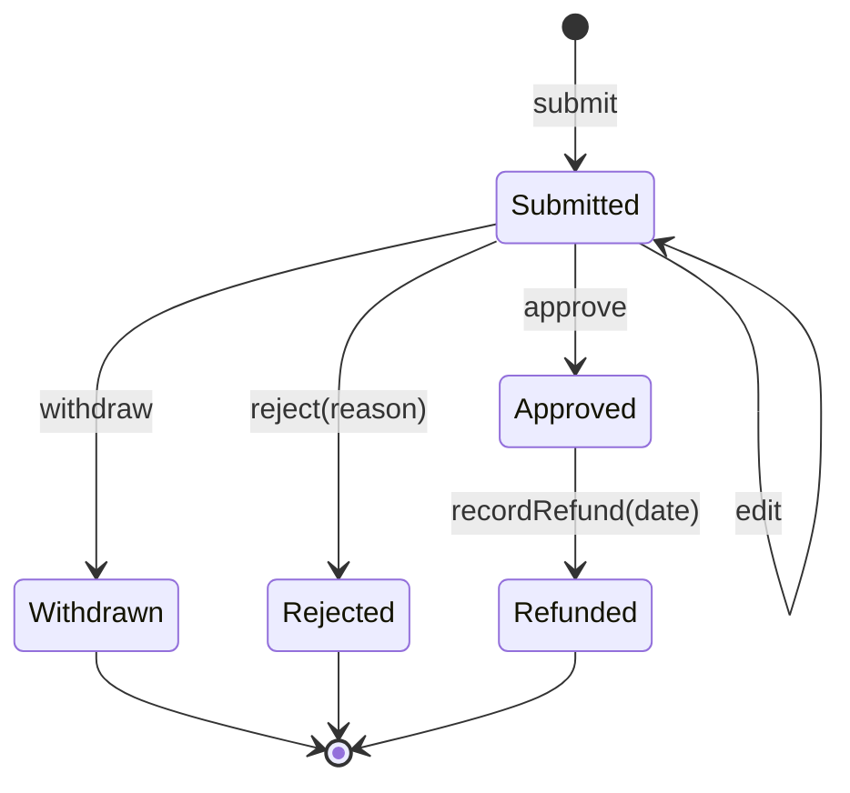

# Economy: expense claims and refunds

> **Status: accepted** (2026-10-26; see `README.md`). Phase 5 of the modernization brief.

## What it is for

Volunteers sometimes pay for things that Vektorprogrammet needs, for example food for an event. An expense claim gets that money back. Each department's economy team approves the claims of its department and pays them. At the end of the year, bookkeeping gets one file with all refunded claims.

## Who does what

| You are | You can |
| --- | --- |
| A member or assistant, or a person who was one on the date of the receipt | Send an expense claim. Change it or withdraw it until someone decides on it. |
| A member of the department's economy team | Approve or reject a claim, and record the date of the refund. |
| A member of the department's board, if the department has no economy team | The same as the economy team. |
| Anyone | **Not** approve or refund their own claim. |

## Over a semester

1. A person sends a claim with the amount, the date, a description, a photo or PDF of the receipt, and a bank account number.
2. The economy team approves or rejects the claim. A rejection needs a reason.
3. The economy team pays the money from the bank. Then it records the date of the refund.
4. The person gets an e-mail at each decision. The refund e-mail shows the last four digits of the account number, so the person sees a wrong number at once.
5. Once a year, the economy team downloads the bookkeeping export: a CSV file and a ZIP file with the receipts.

## What stays outside the system

- The payment itself. The bank moves the money, and the system only records the date.
- The bookkeeping. Fiken, or the tool that the department uses, receives the export file.

## Personal data

- The system deletes the bank account number when the refund is recorded and exported.
- The system keeps the claim and its receipt for 5 years after the end of the year.
- A person can ask the browser to remember their bank account number on their own device. The system does not keep this copy.

---

## Reference

> **Hand-written** from `INFORMATION_MODEL.md` §9.3, §10.3 E, §11.3, §11.7–§11.9. When `packages/domain` exports the declarations, this section is generated. Do not add facts that are not in those sources.

### Entity: ExpenseClaim

| Field | Type | Notes |
| --- | --- | --- |
| `id` | sequence | Shown to people as the claim number (replaces RULE-080) |
| `claimant` | Person |  |
| `department` | Department | Chosen at submit from the claimant's engagements that cover `receiptDate` |
| `amount` | integer øre, > 0 | Never a float (RULE-032 ✗) |
| `receiptDate` | date | Current or previous year (RULE-127) |
| `description` | text, required | RULE-122 |
| `attachment` | file key, required | Image or PDF, private storage (RULE-115 ✗, RULE-130) |
| `bankAccount` | Norwegian account number, MOD11 checked on the server | Deleted after refund and export (RULE-101 ✗) |
| `state` | see below |  |
| `decidedBy`, `decidedAt`, `rejectionReason` |  |  |
| `refundedAt` | date | Set only by `recordRefund` (RULE-204 ✗) |

### State machine

There is no other transition. The legacy free change between statuses (RULE-203 ✗) is gone.

### Commands and grants

| Command | From → to | Granted to | Scope | Replaces |
| --- | --- | --- | --- | --- |
| `submit(department, receiptDate, …)` | — → Submitted | A person whose Membership or Placement in `department` covers `receiptDate` | own | 226, 280, 209 ✗ |
| `edit` | Submitted → Submitted | `Self` | own | 114, 292 |
| `withdraw` | Submitted → Withdrawn | `Self` | own | 294 ✗, 295 ✗ |
| `approve`, `reject(reason)` | Submitted → Approved \| Rejected | `Fn(economy, d)`, or `Fn(board, d)` if the department has no economy team | department of the claim | 203 ✗, 293 ✗ |
| `recordRefund(date)` | Approved → Refunded | same as `approve` | department of the claim | 204 ✗ |
| `exportBookkeeping(year)` | — | same as `approve` | department | 065, 032 ✗ |

**Guard on `approve`, `reject` and `recordRefund`:** the actor is not the claimant.

### Invariants

- `amount > 0`, in integer øre.
- `receiptDate` is in the current or the previous calendar year.
- `attachment` is present and is an image or a PDF.
- `bankAccount` passes MOD11 on the server.

### Reactions

| Event | Effect |
| --- | --- |
| Approved, Rejected, Refunded | E-mail to the claimant through the outbox (replaces RULE-212 ✗; Slack is not used) |
| Refunded and exported | `bankAccount` is set to empty |

### Port: BookkeepingExport

`BookkeepingExport.export(department, year)` reads the refunded claims of one department and year.

| Adapter | Status |
| --- | --- |
| CSV + ZIP of attachments | First. Columns: date, amount, claim number, description, department, attachment file name. |
| Fiken API v2 | Built when a department asks. The API costs 99 NOK per month per organisation. |
| Tripletex | Not planned. |

Each department selects its adapter in its configuration.

### Personal data

| Field | Purpose | Legal basis | Retention |
| --- | --- | --- | --- |
| Claim and attachment | Refund; bookkeeping | Art. 6(1)(b); 6(1)(c) if bookkeeping law applies | 5 years after the end of the fiscal year |
| `bankAccount` | Pay the refund | Art. 6(1)(b) | Deleted after refund and export |

### Queries

Totals, refund time and the queue order (RULE-026, 061, 066, 067) are queries. Statistics go to the export, not to separate views.
