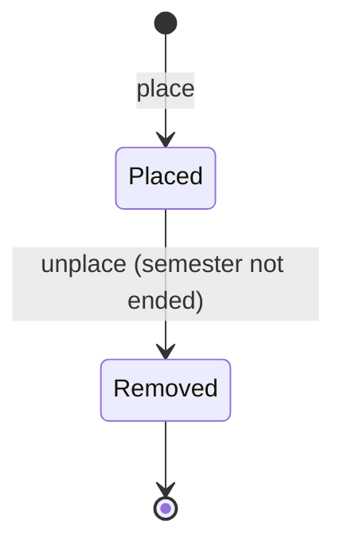

# Placement: schools, school capacity and placements

> **Status: accepted** (2026-10-26; see `README.md`). Phase 4 of the modernization brief.

## What it is for

Each semester, accepted applicants go to schools. Each school says how many assistants it can take on each weekday. The system suggests where each assistant can go. The placement team (Skolekoordinering) checks the suggestion and places the assistants.

## Who does what

| You are | You can |
| --- | --- |
| The department's placement team | Enter school capacity. Get a placement suggestion. Place and unplace assistants. |
| A team leader in the department | Enter school capacity. |
| A member of the department | See the placements of the department. |
| An assistant | See their own placement. |

## Over a semester

1. Before the semester, the placement team asks each school how many assistants it can take, and enters the numbers.
2. After the outcomes are recorded, the placement team asks for a suggestion. The suggestion uses the accepted applicants, their scores, their available weekdays and the school capacity.
3. The team keeps, changes or removes each suggested placement, then places the assistants. The suggestion itself is never saved.
4. The system never puts more assistants in a school than its capacity allows.
5. Each placed assistant gets an e-mail. A new assistant also gets an invitation to make an account.
6. At the end of the semester, the placement ends by itself. To come back, the assistant applies again.

## Police certificates

The board decides if assistants must show a police certificate (politiattest). The system can record "shown on [date], checked by [person]". It never stores the certificate itself. Each department can decide that a placement needs this record first.

## Personal data

- The system keeps the record of who was an assistant at which school, and when, for 10 years. This record supports certificates and references.

---

## Reference

> **Hand-written** from `INFORMATION_MODEL.md` §9.3, §10.3 C, §11.5, §11.9. Generated later. Do not add facts that are not in those sources.

### Entities

| Entity | Key fields | Invariants |
| --- | --- | --- |
| School | `name`, `department`, `active` |  |
| SchoolCapacity | `school`, `semester`, assistants per weekday and block | One per school and semester; active schools only (RULE-186) |
| Placement | `person`, `application`, `school`, `semester`, `weekday`, `block`, `policeCertificateSeen?: {date, checkedBy}` | Semester, school, weekday and block are required (RULE-154); one placement per person per semester; placements per school, weekday and block ≤ capacity, and a double position counts twice (RULE-136, 002, 011, 057) |

### State machine: Placement

"Is an assistant" is a query: the person has a Placement in the current semester (RULE-025, 047, 082).

### Commands and grants

| Command | From → to | Granted to | Scope | Replaces |
| --- | --- | --- | --- | --- |
| `setCapacity(school, semester, …)` | — | `Fn(placement, d) ∪ Leader(d)` | department | 186 |
| `proposePlacements(semester)` | — (pure draft, never written) | `Fn(placement, d)` | department | 001, 003, 006–010, 014 ✗, 036, 037, 079 |
| `place(application, school, weekday, block)` | — → Placed; Application Accepted → Placed | `Fn(placement, d)` | department | 205 |
| `unplace` | Placed → Removed; Application Placed → Accepted | `Fn(placement, d)` | department | 288 ✗, 289 ✗, 310, 318 |
| `recordPoliceCertificate(date)` | — | `Fn(placement, d) ∪ Leader(d)` | department | new |
| read placements | — | `Member(d)`; `Self` | department / own | 316, 317 |

**Optional guard on `place`:** if the department setting `requirePoliceCertificate` is on, `policeCertificateSeen` must be present.

`proposePlacements` leaves out the displacement rules that the review called wrong (RULE-004 ✗, 005 ✗).

### Reactions

| Event | Effect | Replaces |
| --- | --- | --- |
| Placed | E-mail to the assistant. If the person has no account, an invitation. | 241 |

### Personal data

| Data | Purpose | Legal basis | Retention |
| --- | --- | --- | --- |
| Placement history (name, school, semester) | Certificates, references, history | Art. 6(1)(f) | 10 years |
| Police certificate record | Child safety (if the board requires it) | Art. 6(1)(f); politiregisterforskriften §34-1 | With the placement; the document is never stored |
