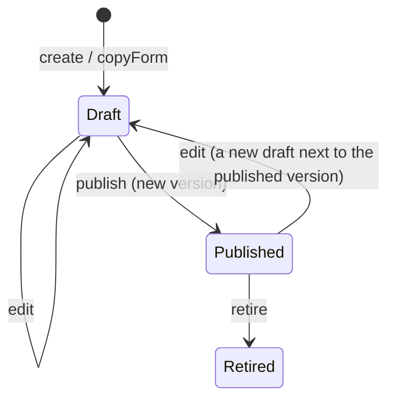
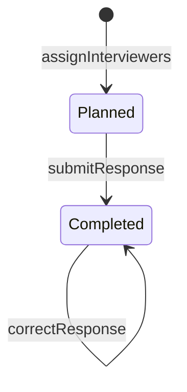

# Recruitment: interview forms, interviews and outcomes

> **Status: accepted** (2026-10-26; see `README.md`). Phase 3 of the modernization brief.

## What it is for

The recruitment team meets each applicant for an interview. The interviewers answer the questions of an interview form. Some questions give points, and the system adds them up to a score. Then the team decides to accept the applicant or not.

## Who does what

| You are | You can |
| --- | --- |
| The national board | Write and publish the national standard interview form. |
| The department's recruitment team | Copy the standard form and change the copy. Publish it. Plan interviews and write the answers. Record the outcome. Read the interviews of the department. |
| A team leader in the department | Read the interviews and record outcomes. |
| The placement team | See the score and the outcome only, not the answers. |
| An applicant | Not see interviews in the system. An applicant can ask for a copy of everything written about them (a right under the GDPR). |
| Anyone | **Not** interview themselves. |

Interviewers write knowing that the applicant can ask to read the answers. The form editor shows this reminder.

## Interview forms

- The IT team decides which kinds of questions exist: short text, long text, single choice, multiple choice, score from 1 to 6, yes/no, and a section heading. A new kind of question needs IT development.
- The recruitment team makes forms from these kinds of questions. It needs no help from IT for this.
- A form starts as a draft. When the team publishes it, the published version cannot change. To change a published form, the team edits a new draft and publishes it as the next version. The answers already given keep the version they answered.

## Over a semester

1. Before the admission period, the recruitment team makes sure that a published form is ready.
2. After applications arrive, the team plans the interviews in its calendar. The system does not schedule interviews.
3. After each interview, an interviewer writes the answers in the system.
4. The system calculates the score from the score questions.
5. The team records the outcome: accepted or not accepted. Accepted applicants go to placement (`placement.md`).

## Personal data

- If the applicant is not accepted, the system deletes the interview answers together with the application, 6 months after the period ends.
- If the applicant is accepted, the system deletes the answers when the placement semester ends. The outcome stays.

---

## Reference

> **Hand-written** from `INFORMATION_MODEL.md` §10.4, §11.9–§11.11 and `MODERNIZATION_BRIEF.md` §7 (2026-10-26). Generated later. Do not add facts that are not in those sources.

### Entities

| Entity | Key fields | Notes |
| --- | --- | --- |
| Form | `owner` (national board or a department), `copiedFrom?`, `currentVersion?` |  |
| FormVersion | `form`, `number`, `questions: Array<Question>`, `publishedAt` | Immutable after publication |
| Question | tagged union: `ShortText`, `LongText`, `SingleChoice{options}`, `MultipleChoice{options}`, `Score{min: 1, max: 6}`, `YesNo`, `Section{heading, help}` | A new variant needs code (renderer, answer schema, scoring) |
| Interview | `application`, `formVersion`, `interviewers: Array<Person>` |  |
| Response | `interview`, `answers` (decoded with `answersSchema(formVersion)`) |  |

### State machine: Form



A published version is never changed. It cannot be deleted while a response refers to it.

### State machine: Interview



The outcome is a transition of the Application (`admission.md`), not of the Interview.

### Commands and grants

| Command | Granted to | Scope | Guard |
| --- | --- | --- | --- |
| `Form.create`, `edit`, `publish`, `retire` (standard form) | `Board` (national) | national | — |
| `Form.copyForm`, `edit`, `publish`, `retire` | `Fn(recruitment, d)` | department | — |
| `Interview.assignInterviewers` | `Fn(recruitment, d) ∪ Leader(d)` | department | An interviewer is not the applicant (RULE-313) |
| `Interview.submitResponse`, `correctResponse` | an interviewer of that interview | own | The answers decode with `answersSchema(version)` |
| `Application.recordOutcome` | `Fn(recruitment, d) ∪ Leader(d)` | department | Application is Submitted |
| read responses | `Fn(recruitment, d) ∪ Leader(d)` | department | — |
| read score and outcome | `+ Fn(placement, d)` | department | — |

### The form schema: one function on both sides

```
answersSchema(version: FormVersion): Schema      // pure, packages/domain
score(version, answers): number                   // pure: the sum of the Score answers
```

- The server decodes every response with `answersSchema(version)`.
- The browser receives the `FormVersion` as data and runs the same function. Then `Schema.toStandardSchemaV1` gives the validator for TanStack Form (`@tanstack/react-form-start`).
- One function on both sides keeps the two validators the same. A schema value cannot go over the network, so the version data does.
- The score is never stored. `recordOutcome` stores only the decision.

### Replaced legacy rules

The 26 legacy interview rules for scheduling, reminders, SMS and the interviewer workload table (RULE-018–020, 028, 046, 093, 094, 106, 107, 110, 111, 140, 195, 197, 199, 217, 223, 224, 247, 255, 265, 273, 313, 314, 324, 330) are not rebuilt. Scheduling stays in the calendar. RULE-313 (an applicant cannot see or do their own interview) stays as the guard above. RULE-034 and 285 ✗ are covered by `recordOutcome`.

### Personal data

| Data | Purpose | Legal basis | Retention |
| --- | --- | --- | --- |
| Response (not accepted) | Assess the application | Art. 6(1)(b) | With the application: 6 months after the period |
| Response (accepted) | Same | Art. 6(1)(b) | End of the placement semester; the outcome stays |
