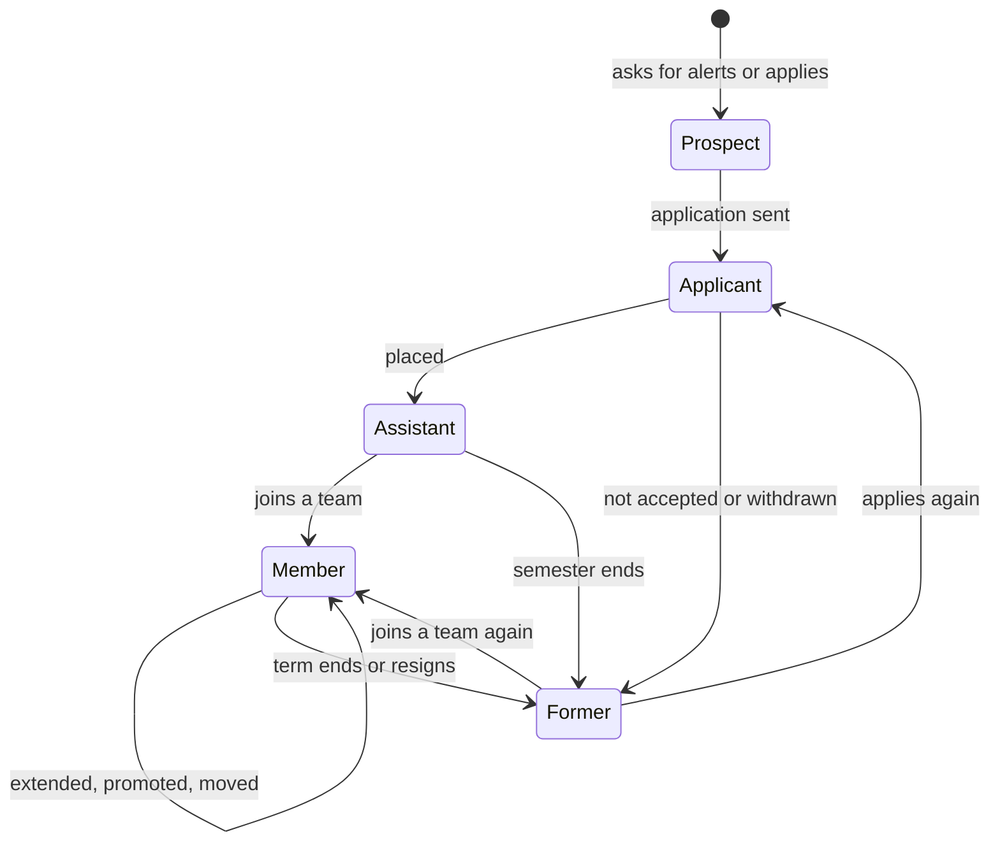
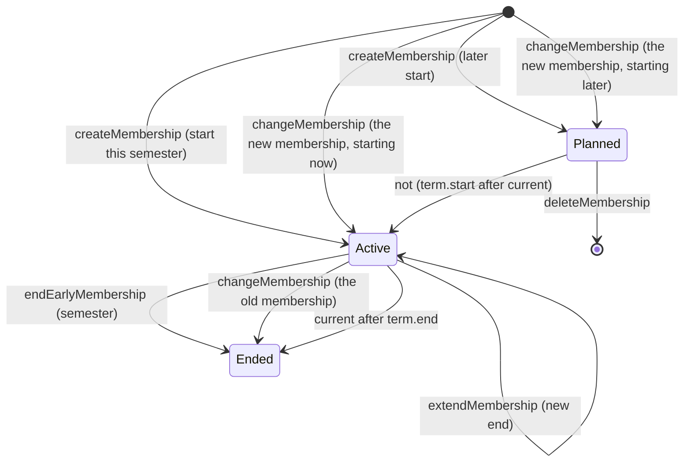

# Teams and people: teams, memberships and the life of a person

> **Status: accepted** (2026-10-26; see `README.md`). Phase 4 of the modernization brief.

## What it is for

Volunteers do Vektorprogrammet's work in teams. A membership puts a person in a team for a term of semesters. What a person can do in the system comes from their current memberships and placements. Nobody keeps a separate list of roles.

## Who does what

<!-- docgen:begin who -->

| You are | You can | Scope |
| --- | --- | --- |
| A team leader in the department or A member of the board | Create a team in a department. Change a team's name, function and default term. Deactivate a team. A team is never deleted. Register a person, with the field of study that gives them a department. Add a person to a team for a term. The end defaults to the team's default term. Extend a membership to a later end semester. Change the position, team or leader flag from a semester: the old membership ends and a new one starts. End a membership from a semester. A member can end their own. Cancel a membership that has not started. See the people of the department. | department |
| The person the record belongs to | End a membership from a semester. A member can end their own. | own |
| A member of a team in the department | See the teams of the department and their memberships. | department |
| The endingSoon job | Four weeks before the semester ends, e-mail each team leader the memberships of the department that end. | all |
| An admin | Create a team in a department. Change a team's name, function and default term. Deactivate a team. A team is never deleted. Register a person, with the field of study that gives them a department. Add a person to a team for a term. The end defaults to the team's default term. Extend a membership to a later end semester. Change the position, team or leader flag from a semester: the old membership ends and a new one starts. End a membership from a semester. A member can end their own. Cancel a membership that has not started. Put a person on the admin list until a date. Take a place off the admin list. See the people of the department. See the teams of the department and their memberships. | all |

<!-- docgen:end who -->

## Teams and what they can do

Each team has a function. The function decides what its members can do in the system.

| Team (examples) | Function | Members can |
| --- | --- | --- |
| Styret | board | Lead the department; approve expense claims if there is no economy team |
| Økonomi | economy | Approve expense claims and record refunds |
| IT | it | Administration (`administration.md`) |
| Rekruttering | recruitment | Admission and interviews |
| Skolekoordinering | placement | School capacity and placements |
| Sponsor, Profilering, Evaluering, Sosialt | other | Be members; their work happens in Google Workspace or Notion |

## A membership has a term

- A membership starts and ends in a semester. The end is always set. The default is two semesters, and a team can set one semester instead.
- A membership is active from its start semester to its end semester. The system calculates this. Nobody switches it on or off.
- Nothing continues by itself. Four weeks before the semester ends, each team leader gets a list of memberships that end. Each item has a link to extend it.

## The life of a person

The system calculates this status from the person's engagements. It does not store it.

| Event | What the team leader does | What happens |
| --- | --- | --- |
| Joins a team | Add the member | A membership with the default term. The person gets a welcome e-mail and Google group access. |
| Stays another term | Extend | The same membership gets a later end. Its history stays. |
| Promotion, demotion, change of position or team | Change | The old membership ends, and a new one starts in the chosen semester. History shows both. |
| Leaves on time | Nothing | The term ends. The person loses access and Google group membership. |
| Leaves early | End early | The same, from the chosen semester. |
| Comes back | Add again | A new membership for the same person. |

## When a person leaves

When the last engagement of a person ends, the system sends an e-mail with two separate questions:

1. "Can Vektorprogrammet keep your details for 5 years?" This lets the person come back, and lets Vektorprogrammet write certificates.
2. "Do you want alumni news?"

If the person says no to the first question, or does not answer, the system anonymises their details 1 year after their last engagement. The person can change each answer at any time.

---

## Reference

The generated blocks describe the declarations in `packages/domain`. The remaining tables describe the accepted design, including later slices.

### Entities

| Entity | Key fields | Invariants |
| --- | --- | --- |
| Team | `department`, `name`, `function ∈ {board, economy, it, recruitment, placement, other}`, `defaultTerm ∈ {1, 2}` (default 2), `active` | Name unique in the department (RULE-157). A team is deactivated, never deleted (RULE-233). |
| Membership | `person`, `team`, `position`, `leader: boolean`, `start: Semester`, `end: Semester` | `start ≤ end`; the person's memberships in one team do not overlap; the person belongs to the team's department (RULE-164) |
| Person | `name`, `email` (verified), `phone`, `fieldOfStudy`, `gender?`, `companyEmail?` | Company e-mail unique and ends with `@vektorprogrammet.no` (RULE-178, 179) |
| AlumniConsent | `person`, `keepDetails: boolean`, `news: boolean`, text version, given at, withdrawn at |  |

### State machine: Membership

<!-- docgen:begin membership -->

<!-- docgen:end membership -->

Active, Planned and Ended are calculated from the semester. They replace the legacy suspension flag and job (RULE-219 ✗, 263) and the separate "active" definitions (RULE-016, 023 ✗, 031, 048, 124 ✗).

### Commands and grants

<!-- docgen:begin commands -->

| Command or read | Resource | Method | What it does | Granted to | Scope | Replaces |
| --- | --- | --- | --- | --- | --- | --- |
| `createTeam` | Team | `create` | Create a team in a department. | Leader(d) ∪ Board; Admin | department, all | RULE-157, RULE-321 |
| `updateTeam` | Team | `update` | Change a team's name, function and default term. | Leader(d) ∪ Board; Admin | department, all | RULE-157, RULE-321 |
| `deactivateTeam` | Team | `:deactivate` | Deactivate a team. A team is never deleted. | Leader(d) ∪ Board; Admin | department, all | RULE-233, RULE-329 |
| `createPerson` | Person | `create` | Register a person, with the field of study that gives them a department. Granted for the department of the chosen field of study. | Leader(d) ∪ Board; Admin | department, all | RULE-164 |
| `createMembership` | Membership | `create` | Add a person to a team for a term. The end defaults to the team's default term. | Leader(d) ∪ Board; Admin | department, all | RULE-164, RULE-206, RULE-284 |
| `extendMembership` | Membership | `:extend` | Extend a membership to a later end semester. | Leader(d) ∪ Board; Admin | department, all | RULE-234, RULE-251, RULE-252 |
| `changeMembership` | Membership | `:change` | Change the position, team or leader flag from a semester: the old membership ends and a new one starts. A move to a team in another department also needs the grant in the receiving department, in the same transaction. | Leader(d) ∪ Board; Admin | department, all |  |
| `endEarlyMembership` | Membership | `:endEarly` | End a membership from a semester. A member can end their own. | Leader(d) ∪ Board; Self; Admin | department, own, all | RULE-298 |
| `deleteMembership` | Membership | `delete` | Cancel a membership that has not started. | Leader(d) ∪ Board; Admin | department, all |  |
| `createAdminGrant` | AdminGrant | `create` | Put a person on the admin list until a date. Never for oneself. | Admin | all | RULE-113, RULE-308 |
| `deleteAdminGrant` | AdminGrant | `delete` | Take a place off the admin list. Never one's own, and never the last place that ends after the current semester and that an Active account holds. | Admin | all | RULE-113, RULE-308 |
| `sendEndingSoon` | Membership | `:sendEndingSoon` | Four weeks before the semester ends, e-mail each team leader the memberships of the department that end. | System(endingSoon) | all |  |
| `viewPeople` | — | — | See the people of the department. | Leader(d) ∪ Board; Admin | department, all |  |
| `viewTeams` | — | — | See the teams of the department and their memberships. | Member(d); Admin | department, all |  |

<!-- docgen:end commands -->

### Subject sets (the permission algebra)

<!-- docgen:begin subjects -->

| Subject set | Definition |
| --- | --- |
| `Anyone` | Every caller, also without sign-in |
| `Self` | The person that the resource `r` belongs to |
| `Holder(p)` | The holder of a code for purpose `p`, restricted to its command and person |
| `Member(d)` | Has an active membership in a team of department `d` |
| `Leader(d)` | Has an active membership with `leader = true` in a team of `d` |
| `Fn(f, d)` | Has an active membership in a team of `d` whose function is `f` |
| `Board` | `Fn(board, *)`: has an active membership in a board team |
| `Admin` | Is on the admin list, and the place has not ended (`docs/system/administration.md`) |
| `System(job)` | A scheduled job (`semesters`, `outboxSweep`, `endingSoon`), which runs as its own principal |

<!-- docgen:end subjects -->

A grant is `(subject set, commands, scope)` with scope `own`, `department` or `all`. Grants only add up. There are no deny grants. A command that no grant covers is refused. This model replaces the legacy role ladder, role recalculation and access-rule tables (RULE-029 ✗, 030, 161, 163, 192, 194, 211, 213 ✗, 214, 218 ✗, 275–279, 282, 300–305, 307 ✗).

### Reactions

| Event | Effect | Replaces |
| --- | --- | --- |
| Membership becomes Active | Add to the team's Google group; create a company account on the first membership; welcome e-mail | 243–246, 248, 225 |
| Membership becomes Ended | Remove from the Google group | 242 |
| Four weeks before semester end | "Ending soon" list to each `Leader(d)`. Admin-grant reminders are a later slice. | new |
| A person's last engagement ends | Alumni consent e-mail | new |

### Personal data

| Data | Purpose | Legal basis | Retention |
| --- | --- | --- | --- |
| Person (name, e-mail, phone, field of study) | Run engagements | Art. 6(1)(b)/(f) | 1 year after the last engagement, or 5 years with `keepDetails` |
| Gender (optional) | Totals only | Art. 6(1)(f) | With the person |
| Membership history | Certificates, history | Art. 6(1)(f) | 10 years |
| Alumni news | News e-mail | Art. 6(1)(a) | Until withdrawn |
| Photo | Not collected; with consent only for a public team page | Art. 6(1)(a) | Until withdrawn, or the engagement ends |
