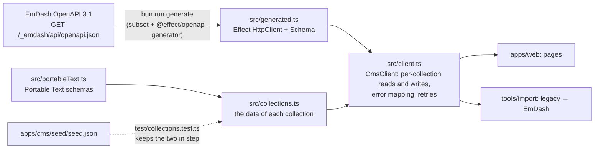

# @vektorprogrammet/cms-client

The typed client for the content in EmDash (`apps/cms`). `apps/web` reads the public site's content through it, and `tools/import` writes the legacy content through it. Both talk to EmDash's REST API (`/_emdash/api/`) with a bearer token. Neither imports EmDash.



## What is generated and what is written

| File | Source |
| --- | --- |
| `openapi/emdash.json` | the six operations this repository calls, cut from EmDash's OpenAPI document by `scripts/subset.ts` (with the schemas they reach) |
| `src/generated.ts` | `@effect/openapi-generator` output for that subset: `EmDash.make(httpClient)`, with a `Schema` for every request and response. Never edit it |
| `src/collections.ts` | the `data` of each collection (`texts`, `news`, `sponsors`, `faq`, `teams`). EmDash's contract types an item's `data` as free JSON, because it depends on the collection, so this half is written by hand and checked against the seed |
| `src/portableText.ts` | the Portable Text blocks EmDash stores (`block`, `code`, `break`, `htmlBlock`, `table`, `image`), as Schemas |
| `src/client.ts` | `CmsClient`: the service that `apps/web` and `tools/import` use |

The six operations: `listContent`, `getContent`, `createContent`, `publishContent` (content), `getField` and `updateField` (the options of a select field). The list is `OPERATIONS` in `scripts/generate.ts`.

## Use

```ts
import { CmsClient, layer } from "@vektorprogrammet/cms-client";

const program = Effect.gen(function* () {
  const { news } = yield* CmsClient;
  return yield* news.published; // every published article, decoded
});

program.pipe(
  Effect.provide(
    layer({ token: Redacted.make(token), url: "https://cms.example" })
  ),
  Effect.provide(FetchHttpClient.layer)
);
```

- Reads (`published`, `publishedBySlug`) always ask for `status=published` and drop every entry that is not published. A token with `content:read` can read drafts, so the client does not trust the filter alone.
- Reads retry transient failures twice and time out after 8 seconds. Writes (`create`, `publish`) are never retried.
- `create` makes a draft with the original `createdAt` and `publishedAt`. A slug that is taken answers `CreateOutcome.SlugTaken`, not a failure, which is what makes the importer safe to rerun.
- Failures are `CmsUnavailable` (transport, 5xx, retries exhausted), `CmsRejected` (the CMS refused: 4xx with its code, for example `INSUFFICIENT_SCOPE`) and `CmsInvalidContent` (an entry's data does not match its collection's schema; carries the slug).
- The token goes only to the CMS base URL. Media paths that EmDash returns are relative; `absoluteUrl(path)` makes them absolute.
- `ensureOptions(collection, field, values)` adds the values that a select or multi-select field lacks to its options (and keeps the ones it has). The importer registers every department city it tags articles with, so each tag is a choice for editors and the CMS accepts it. It needs the `schema:write` scope and replaces the field's validation by its options, which is all those fields have.

## Regenerating the client

Do this when EmDash is upgraded, or when the code needs another operation (add its id to `OPERATIONS`).

```sh
# 1. Save the full document from a running CMS (any token that can read it).
curl -H "Authorization: Bearer $CMS_TOKEN" "$CMS_URL/_emdash/api/openapi.json" -o /tmp/emdash-openapi.json

# 2. Cut the subset and generate. Fails if the document lacks an operation.
devenv shell -- bun run --cwd packages/cms-client generate --spec /tmp/emdash-openapi.json

# 3. Review the diff of openapi/emdash.json and src/generated.ts, then run the tests.
devenv shell -- bunx vp test run
```

`bun run generate` without `--spec` regenerates from the committed subset. The result is byte-identical, which shows that `src/generated.ts` is a function of `openapi/emdash.json`.

EmDash does not declare every status it answers with (for example `409 SLUG_CONFLICT` on create). The generated client reports an undeclared status as an `HttpClientError`, and `client.ts` reads the CMS's `{ error: { code, message } }` envelope out of it in one place (`failureOf`).

## Tests

`devenv shell -- bunx vp test run` (from this directory) needs no network or database.

- `test/client.test.ts`: `CmsClient` against a fake `HttpClient`: cursor paging, drafts dropped, the bearer token, retries (with `TestClock`), 404, `SLUG_CONFLICT`, scope refusal.
- `test/collections.test.ts`: the schemas against EmDash's quirks (booleans read back as 0 and 1, unset fields absent) and against `apps/cms/seed/seed.json`: same collections, same fields, same required fields.
- `test/subset.test.ts`: the OpenAPI subset keeps the named operations and what they reach, and nothing else.
